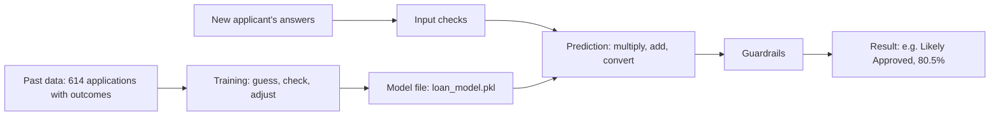

# 00 · AI from zero

> **In short.** LoanWise AI is a computer program that estimates how likely a home-loan application is to be approved. It does this with **machine learning**: it was given 614 real past loan applications together with what happened to each one (approved or rejected), and it calculated a small set of numbers that link the answers on the form to the outcome. Those numbers are saved in a file. When someone new fills in the form, the program multiplies their answers by the saved numbers, adds the results up, and turns the total into a percentage, for example "80 % likely to be approved". The program does not understand loans, people or money. It does arithmetic. When we tested it on 123 past applications it had never seen, it was right on 105 of them (85 %). Saying "approved" to everyone would have been right on 85 of them (69 %). This chapter explains every one of those ideas from the beginning, using the project's real data and the real saved model.

---

## How to read this chapter

You do not need any background beyond school maths: percentages, averages, multiplying and adding, and reading a table.

Every new technical word is printed in **bold** the first time it appears, and it is defined right there.

Some sections end with a box called **For the technically curious**. Those boxes show the exact formulas. You can skip every one of them and still follow the chapter.

All numbers in this chapter were calculated from the project's real files:

- `data/raw/loan.csv`, the past applications;
- `artifacts/models/loan_model.pkl`, the saved model;
- `artifacts/models/model_info.json`, the training report.

They agree with [`docs/MODEL_CARD.md`](../docs/MODEL_CARD.md).

---

## 1. What a computer program is

A computer does nothing on its own. It only carries out instructions.

A **program** is a list of exact instructions that a computer follows, one after another. Each instruction is something very small and precise: "add these two numbers", "compare this number with 50", "if it is bigger, show the word *Approved* on the screen".

The computer follows the instructions exactly as written. It does not know why it is doing them. If an instruction is wrong, the computer carries out the wrong instruction.

A traditional program contains every rule written out by a person. For a loan, a person might write: "If the monthly instalment is more than 65 % of monthly income, say *Likely Rejected*." This project contains rules like that too (Section 11).

---

## 2. What "AI" means in practice today

**AI** stands for **artificial intelligence**. The phrase is used for many different things, which makes it confusing. In practice today, it usually means this:

> A program where some of the rules were not written by a person, but were **calculated by the computer from examples**.

The kind of AI used in this project is called **machine learning**. **Machine learning** is a method in which a program is given many past examples together with their known outcomes, and it calculates numbers that connect the examples to the outcomes as closely as possible. Those calculated numbers are then used to make estimates about new cases.

Here is what this project's AI **can** do:

- take the 11 answers on a loan form;
- combine them with numbers it calculated from past applications;
- produce a percentage that says how often applications with similar answers were approved in the past.

Here is what it **cannot** do:

- It does not understand what a loan, a salary or a family is. To the program, "Married = Yes" is a 1 and "Married = No" is a 0.
- It does not think, reason, plan or have opinions.
- It has no intentions. It does not want anyone to be approved or rejected.
- It cannot know anything that was not in the 614 past applications, such as your debts, your job security or today's interest rates.
- It cannot guarantee an outcome. It produces an estimate based on the past.

Everything it does is calculation: multiplying, adding, comparing. The rest of this chapter shows those calculations.

---

## 3. What data is

**Data** is recorded facts, written down in a form a computer can read. A salary written as "5849", a yes/no answer, a place name such as "Urban": these are all data.

A **dataset** is a collection of data about many similar things, organised the same way for each one. This project's dataset is a file called `loan.csv`. It holds **614 past home-loan applications**.

A dataset is stored as a table.

- A **row** is one line of the table. In this dataset, one row is one past application.
- A **column** is one vertical list in the table. Each column holds the same kind of fact for every application, for example everyone's monthly income.
- A **value** (or cell) is the single entry where one row meets one column.

`.csv` means "comma-separated values": a plain text file where each line is a row and commas separate the columns.

### Five real rows

These are the first five rows of `data/raw/loan.csv`, exactly as they are in the file. Money is shown with Indian digit grouping. The original file stores the loan amount in thousands of rupees (for example `128`), so `128` is shown as ₹1,28,000.

| Loan_ID | Gender | Married | Dependents | Education | Self_Employed | ApplicantIncome | CoapplicantIncome | LoanAmount | Loan_Amount_Term | Credit_History | Property_Area | Loan_Status |
|---|---|---|---|---|---|---|---|---|---|---|---|---|
| LP001002 | Male | No | 0 | Graduate | No | ₹5,849 | ₹0 | *(blank)* | 360 | 1 | Urban | Y |
| LP001003 | Male | Yes | 1 | Graduate | No | ₹4,583 | ₹1,508 | ₹1,28,000 | 360 | 1 | Rural | N |
| LP001005 | Male | Yes | 0 | Graduate | Yes | ₹3,000 | ₹0 | ₹66,000 | 360 | 1 | Urban | Y |
| LP001006 | Male | Yes | 0 | Not Graduate | No | ₹2,583 | ₹2,358 | ₹1,20,000 | 360 | 1 | Urban | Y |
| LP001008 | Male | No | 0 | Graduate | No | ₹6,000 | ₹0 | ₹1,41,000 | 360 | 1 | Urban | Y |

Notice that the first row has no loan amount. The dataset has gaps like this. A blank value is called a **missing value**. The project fills such gaps with a typical value before using the row (Chapter 04 explains how).

### What each column means

| Column | What it records | Possible values |
|---|---|---|
| `Loan_ID` | A reference code for the application. Used only to tell rows apart; never used for the estimate. | e.g. LP001002 |
| `Gender` | The applicant's recorded gender. | Male, Female |
| `Married` | Whether the applicant is married. | Yes, No |
| `Dependents` | How many people (such as children) depend on the applicant financially. | 0, 1, 2, 3+ |
| `Education` | Whether the applicant has a university degree. | Graduate, Not Graduate |
| `Self_Employed` | Whether the applicant runs their own business instead of working for an employer. | Yes, No |
| `ApplicantIncome` | The applicant's income per month, in rupees. | e.g. ₹5,849 |
| `CoapplicantIncome` | The monthly income of a second person on the loan (often a spouse), in rupees. 0 if there is none. | e.g. ₹1,508 |
| `LoanAmount` | How much money was asked for. Stored in thousands of rupees. | e.g. 128 = ₹1,28,000 |
| `Loan_Amount_Term` | How many months the loan would be repaid over. 360 months = 30 years. | e.g. 360 |
| `Credit_History` | Whether the applicant's past borrowing record meets the lender's guidelines. A **credit history** is the record of how a person has repaid money they borrowed before. | 1 = meets guidelines, 0 = does not |
| `Property_Area` | Where the property being bought is. | Urban, Semiurban, Rural |
| `Loan_Status` | What actually happened to the application. | Y = approved, N = rejected |

Of the 614 applications, **422 were approved** and **192 were rejected**. That is 422 ÷ 614 = **68.7 % approved**.

---

## 4. Features and the label

The columns play two different roles.

The **features** are the columns the program uses as its inputs: the facts known at the moment someone applies. In this project there are 11: Gender, Married, Dependents, Education, Self_Employed, ApplicantIncome, CoapplicantIncome, LoanAmount, Loan_Amount_Term, Credit_History and Property_Area.

The **label** (also called the **target**) is the column the program is trying to estimate. Here it is `Loan_Status`. For the 614 past applications, the label is known because the lender already made its decision. It records **what happened in the past**, not what should have happened.

For a new applicant, the features are known (they fill in the form) and the label is unknown. Estimating that unknown label is the whole job of the program.

`Loan_ID` is neither. It is just a name tag.

---

## 5. What "learning from data" means

In machine learning, **learning** means one specific thing: **calculating which features go together with which label, by doing arithmetic on all the past rows.**

The simplest version of this is counting. Take one feature, split the 614 rows into groups by that feature's value, and work out what percentage of each group was approved.

Here are the real counts from `loan.csv`:

| Feature | Group | Applications | Approved | Approval rate |
|---|---|---|---|---|
| *(everyone)* | all rows | 614 | 422 | 68.7 % |
| Credit_History | 1 (meets guidelines) | 475 | 378 | **79.6 %** |
| Credit_History | 0 (does not) | 89 | 7 | **7.9 %** |
| Credit_History | blank | 50 | 37 | 74.0 % |
| Property_Area | Semiurban | 233 | 179 | 76.8 % |
| Property_Area | Urban | 202 | 133 | 65.8 % |
| Property_Area | Rural | 179 | 110 | 61.5 % |
| Education | Graduate | 480 | 340 | 70.8 % |
| Education | Not Graduate | 134 | 82 | 61.2 % |
| Married | Yes | 398 | 285 | 71.6 % |
| Married | No | 213 | 134 | 62.9 % |

(Three rows have a blank in `Married`; all three were approved. They are not shown.)

A **pattern**, in this project, means exactly this: **a difference in approval percentages between groups.** Look at credit history. Among people whose credit history met the guidelines, about 80 out of every 100 were approved. Among people whose credit history did not, about 8 out of every 100 were approved. That gap, 79.6 % against 7.9 %, is the strongest pattern in the whole dataset.

Other patterns are much weaker. Semiurban applications were approved 76.8 % of the time and rural ones 61.5 %. Graduates 70.8 %, non-graduates 61.2 %.

The computer finds these patterns by arithmetic, not by insight. For the table above it only had to count rows and divide. A person with a pencil could do the same, given enough time.

Real machine learning goes one step further. It looks at **all features at the same time** and works out how much each one should count, taking the others into account. For example, it can work out how much "Graduate" still matters once credit history has already been taken into account. That is done with the process described in Section 7.

A pattern is not a cause. The table does not show that living in a semiurban area *makes* a loan more likely to be approved. It only shows that, in these 614 past decisions, it went together with more approvals. The reason could be something not recorded at all.

---

## 6. What a model is

A **model** is the result of learning: **a fixed set of numbers, plus a fixed recipe for using them**, that turns a person's answers into an estimate.

In LoanWise AI the model is stored in a single file, `artifacts/models/loan_model.pkl`. A `.pkl` file ("pickle") is a way of saving a Python object to disk so it can be loaded again later, exactly as it was.

The type of model the project uses is called **logistic regression**. A **logistic regression** model gives each feature a number called a **weight**. A **weight** says how strongly, and in which direction, that feature pushes the estimate. A positive weight pushes towards "approved". A negative weight pushes towards "rejected". The bigger the number (ignoring its sign), the stronger the push. There is also one extra number, the **starting value** (in technical terms the *intercept*), which is where the calculation begins before any feature is added.

Here are the real numbers inside the saved file. We loaded it and printed them:

| Feature (after preparation) | Weight |
|---|---|
| *Starting value* | **+0.672** |
| Credit history (1 = meets guidelines) | **+1.157** |
| Loan term (months) | −0.193 |
| Instalment-to-income ratio | −0.218 |
| Gender: Female | +0.028 |
| Gender: Male | −0.028 |
| Married: No | −0.201 |
| Married: Yes | +0.201 |
| Dependents: 0 | +0.038 |
| Dependents: 1 | −0.211 |
| Dependents: 2 | +0.191 |
| Dependents: 3+ | −0.018 |
| Education: Graduate | +0.123 |
| Education: Not Graduate | −0.123 |
| Self-employed: No | +0.023 |
| Self-employed: Yes | −0.023 |
| Property area: Rural | −0.277 |
| Property area: Semiurban | +0.392 |
| Property area: Urban | −0.116 |

That is the model's core: **19 numbers**. Nothing else is "intelligent" about it.

Notice that the numbers agree with the counting table in Section 5. Credit history has by far the largest weight. Semiurban is positive, rural is negative. Graduate is positive.

A few details about this list:

- Gender, Married, Education and the other choice questions are turned into yes/no switches. "Married: Yes" is 1 for a married person and 0 otherwise. This is called **one-hot encoding**.
- Income and loan amount do not appear by themselves. They are combined into one number, the **instalment-to-income ratio**: the monthly repayment divided by total monthly income. Its weight is negative, so a larger share of income going to repayments always lowers the estimate. The project did this deliberately; Chapter 04 explains why.
- The file also stores the preparation steps and their numbers, for example the average credit-history value in the data (0.855) and the average loan term (342.4 months). These are used to put every feature on a comparable scale before the weights are applied.

So the model file is: the preparation steps, the 19 numbers above, and the recipe "multiply, add up, convert to a percentage".

> **For the technically curious.** The file is a scikit-learn `Pipeline` with steps `clean → impute → features → encode → model`, ending in `LogisticRegression(C=0.1)`. The weights above are `model.coef_` and `model.intercept_`. The three numeric inputs are standardised (`(value − mean) ÷ standard deviation`) by a `StandardScaler`; the stored means are 0.855, 342.4 and 0.0727, and the standard deviations 0.352, 64.4 and 0.0555, for credit history, term and log instalment-to-income ratio respectively. To load it yourself: add `src/` to `sys.path`, `import loanwise.ml.features` (the pipeline refers to functions there), then `joblib.load("artifacts/models/loan_model.pkl")`.

---

## 7. What training is

**Training** is the process of **choosing the model's numbers** so that the model's estimates for the past applications match what actually happened as closely as possible.

Nobody types the 19 weights in by hand. The computer finds them with a repeated procedure:

1. **Start** with some numbers. Usually every weight is set to 0.
2. **Guess.** Use the current numbers to calculate an estimate for every one of the past applications.
3. **Check.** Compare each estimate with the real outcome in the `Loan_Status` column, and add up how wrong the estimates are into a single **error score**. The error score is small when the model gave a high percentage to applications that were really approved and a low percentage to ones that were really rejected. It is large when it did the opposite.
4. **Adjust.** For each weight, work out whether making it a little larger or a little smaller would lower the error score, and move it a small step in that direction.
5. **Repeat** steps 2 to 4, many times, until the numbers stop changing in any useful way.

At the end, the numbers that remain are the model.

### A tiny real example

To make this concrete, we ran the procedure on the real 614 rows using **only one feature, credit history**. This small model has two numbers: a starting value and one weight for credit history. (The 50 blanks in credit history were filled with 1, the most common value, as the project does.)

From those two numbers the model gives two estimates: one percentage for people with a bad credit history, one for people with a good one. The "Right" column counts how many of the 614 applications are on the correct side of 50 % (Section 9 explains that cut-off).

| Round | Starting value | Credit weight | Estimate if credit = 0 | Estimate if credit = 1 | Error score | Right (of 614) |
|---|---|---|---|---|---|---|
| 0 (start) | 0.000 | 0.000 | 50.0 % | 50.0 % | 0.693 | – |
| 1 | 0.375 | 0.497 | 59.3 % | 70.5 % | 0.581 | 422 |
| 5 | 0.192 | 0.897 | 54.8 % | 74.8 % | 0.556 | 422 |
| 10 | −0.107 | 1.234 | 47.3 % | 75.5 % | 0.536 | 497 |
| 50 | −1.363 | 2.626 | 20.4 % | 77.9 % | 0.488 | 497 |
| 300 | −2.404 | 3.730 | 8.3 % | 79.0 % | 0.479 | 497 |

Read it from top to bottom:

- At the start, the model says 50 % for everyone. It knows nothing.
- After one round it has noticed that most applications were approved, so both estimates go up.
- After about ten rounds, the bad-credit estimate drops below 50 %. From then on it correctly rejects most bad-credit applicants, and the number right jumps from 422 to 497.
- By round 300 the estimates have settled at 8.3 % and 79.0 %. Compare those with the real approval rates in the data: 7 out of 89 bad-credit applications were approved (7.9 %), and 415 out of 525 good-or-blank-credit applications were approved (79.0 %).

So the procedure, starting from zero and only following "make the error score smaller", arrived by itself at the same percentages that plain counting gives. That is what training does. The real model does the same thing with all 19 numbers at once, which counting alone cannot do.

> **For the technically curious.** The estimate is `p = 1 ÷ (1 + e^(−z))` where `z = starting value + Σ weight × feature`. The error score is the average **log-loss**: for each row, `−ln(p)` if it was approved and `−ln(1 − p)` if it was rejected. The "adjust" step in the table is plain gradient descent with step size 2: each number moves by `−2 × average of (p − actual) × feature`. The real model is fitted by scikit-learn's `lbfgs` solver, which uses the same idea with smarter step sizes, and adds a penalty that keeps weights small (`C = 0.1`) so the model does not chase noise in a small dataset.

---

## 8. What a prediction is

A **prediction** is what you get when you **put a new person's answers into the saved model**: the recipe is applied with the stored numbers, and out comes a percentage.

Nothing is learned during a prediction. The 19 numbers stay exactly as they were saved.

### One real prediction, step by step

The project has a second file, `data/raw/test.csv`, with applications whose outcomes are **not** recorded. The model has never seen an outcome for any of them, so they behave like new applicants. Here is the first one, `LP001015`:

| Male | Married | 0 dependents | Graduate | Not self-employed | Income ₹5,720 a month | No co-applicant | Loan ₹1,10,000 | 360 months | Credit history meets guidelines | Urban |
|---|---|---|---|---|---|---|---|---|---|---|

The model prepares these answers (switches, ratio, scaling), multiplies each one by its weight, and adds everything up. These are the real pushes for this person:

| Step | Push |
|---|---|
| Starting value | +0.672 |
| Credit history meets guidelines | **+0.476** |
| Married: Yes | +0.201 |
| Education: Graduate | +0.123 |
| Repayment is a small share of income (loan ÷ months ÷ income, about 5 %) | +0.081 |
| Dependents: 0 | +0.038 |
| Self-employed: No | +0.023 |
| Gender: Male | −0.028 |
| Loan term of 360 months (longer than average) | −0.053 |
| Property area: Urban | **−0.116** |
| **Total** | **1.417** |

Pushed up most by: good credit history, being married, being a graduate. Pushed down most by: urban property area and the long term.

The total, 1.417, is not yet a percentage. One last fixed formula converts any total into a number between 0 % and 100 %. You do not need the formula, only how it behaves:

| Total | Becomes |
|---|---|
| −2 | 12 % |
| −1 | 27 % |
| 0 | 50 % |
| 1 | 73 % |
| **1.417** | **80.5 %** |
| 2 | 88 % |
| 3 | 95 % |

A total of 0 means 50 %. Positive totals go above 50 %, negative ones below. The bigger the total, the closer to 100 %, but it never reaches it.

So the model's estimate for this applicant is **80.5 % likely to be approved**. The project's own `predict_proba` function gives exactly the same figure, 0.8049.

> **For the technically curious.** Each push is `weight × prepared value`. For credit history the prepared value is `(1 − 0.855) ÷ 0.352 = 0.412`, and `0.412 × 1.157 = 0.476`. For a switch such as "Married: Yes" the prepared value is 1, so the push equals the weight. The conversion is `p = 1 ÷ (1 + e^(−1.417)) = 0.805`. Switches that are 0 for this person (for example "Married: No") contribute nothing and are left out of the table.

---

## 9. Probability, confidence and the 50 % cut-off

### What the percentage means

A **probability** is a number between 0 % and 100 % that says how often something is expected to happen.

When the app shows "84 % likely to be approved", the intended meaning is:

> Among past applicants whose answers looked like these (in the 11 things the model sees), about 84 out of every 100 were approved, and about 16 out of every 100 were rejected.

This needs three honest qualifications.

1. **It describes a group, not you.** Your own application will be either approved or rejected. 84 % says how the past group turned out, not which of the two will happen to you.
2. **"Similar" only means similar in the 11 recorded answers.** Two people with identical answers can be very different in ways the form does not ask about, such as existing debts.
3. **It is the model's calculated estimate, not a literal count.** We checked how well it holds. On the 614 past applications, the model put 127 of them in the 80 %–85 % range; 105 of those 127 (82.7 %) were actually approved. In the 85 %–90 % range there were 101 applications and 94 (93.1 %) were approved. That is reasonably close. But those are the same rows the model learned from, which flatters it, and the project has not done a formal adjustment step to make the percentages match reality more exactly (the Model Card says so: "No calibration step").

### Why it is not a guarantee

An 84 % estimate still means roughly 16 out of 100 similar applicants were rejected. A high percentage makes approval more likely; it does not make it certain. And the model only knows about a small, old dataset (Section 11). A real lender looks at much more.

### The 50 % cut-off

The app has to give a plain answer, so it uses a **cut-off** (or **threshold**): a fixed line that turns the percentage into a yes or no.

- 50 % or more → "Likely Approved".
- Below 50 % → "Likely Rejected".

### Confidence

**Confidence**, in this app, is the percentage for whichever answer was given. If the estimate is 80.5 % approved, confidence in "approved" is 80.5 %. If the estimate is 30 % approved, the answer is "rejected" with 70 % confidence. The app labels this:

| Confidence | Label |
|---|---|
| 75 % or more | High |
| 60 % to under 75 % | Medium |
| below 60 % | Low |

So applicant `LP001015` above would get "Likely Approved", confidence 80.5 %, labelled High. A result of 52 % would also be "Likely Approved", but labelled Low, because it is close to a coin toss.

---

## 10. How we know if it is any good

### Hiding some answers

A model can look excellent on the applications it learned from, simply because it was adjusted to fit them. That says little about new applicants.

So before training, the project set aside **20 % of the past applications** and did not let the model see them. This hidden part is called the **test set**. The other 80 % is the **training set**.

- Training set: **491** applications.
- Test set: **123** applications (85 approved, 38 rejected). The split keeps the same approved/rejected mix in both parts.

The model was trained on the 491. Then it made a prediction for each of the 123, and those predictions were compared with what really happened.

### Accuracy

**Accuracy** is: how many it got right, divided by how many it tried.

On the test set it got **105 out of 123** right. 105 ÷ 123 = **85.4 %**. (`model_info.json` records this as `accuracy: 0.8537`.)

Breaking those 123 down:

| | Model said approved | Model said rejected |
|---|---|---|
| **Really approved (85)** | 84 | 1 |
| **Really rejected (38)** | 17 | 21 |

It is very good at recognising approvals (84 of 85). It is much weaker at recognising rejections: it caught 21 of the 38 and wrongly said "approved" to 17.

### Why a baseline comparison matters

85 % sounds impressive, but on its own the number means little. Remember that most past applications were approved.

A **baseline** is the score of the simplest possible approach, used as a yardstick. The simplest approach here is: **always say "approved", no matter what**. That needs no AI at all. On the same 123 test applications it would be right on the 85 that were approved: 85 ÷ 123 = **69.1 %**.

So the honest statement is: the model is right on **105** test applications where saying "yes" to everyone would be right on **85**. That gain of 20 applications (about 16 percentage points) is what the machine learning actually adds. Without the baseline, a reader could be impressed by a number that is mostly produced by the data being 69 % approvals.

### A surprising detail

On this test set, the 22 applications the model called "rejected" were **exactly** the 22 with a bad credit history. In practice, on these 123 rows, the model's decisions were the same as the single rule "reject if credit history does not meet guidelines". The other features move the percentage up and down, but on this data they rarely move it across 50 %. The Model Card notes this too: all three candidate models scored identically on the test set, which "suggests they all rely mainly on credit history".

> **For the technically curious.** The split is `train_test_split(test_size=0.2, stratify=y, random_state=42)`. The model type and its settings were chosen by **5-fold cross-validation** on the 491 training rows only (mean accuracy 0.798, standard deviation 0.046), so the test set played no part in any choice. After testing, the chosen model was retrained on all 614 rows and that version is what `loan_model.pkl` contains; the 85.4 % was measured on the version trained on 491. Other test-set measures: precision 0.832 (of those it called approved, 83 % were), recall 0.988 (of those really approved, it found 99 %).

---

## 11. Why it can be wrong, and what the project adds on top

### Reasons it can be wrong

- **It only knows the past it was shown.** 614 applications is a small number. Their origin, time period and lender are unknown. They do not describe any lender's current rules.
- **It sees only 11 answers.** Real lenders look at debts, job history, the property's value, interest rates and much more. None of that is in the data.
- **Patterns are not causes.** If urban applicants were approved less often in this data for a reason that is not recorded, the model copies the difference without knowing why.
- **Gaps are filled with guesses.** 50 applications had no credit history recorded. The project fills them with "meets guidelines", the most common value, which makes missing credit data look good.
- **It can be confidently wrong.** In the test, it said "approved" to 17 applicants who were really rejected.
- **It has no common sense.** It will calculate a number for any input. It does not notice if an answer is absurd.

### Input checks

Before the model sees anything, the app checks every answer. These **input checks** (also called **validation**) are ordinary rules written by people, not learned. They reject things like a missing answer, a word where a number should be, a negative income, or a loan above ₹1,00,00,000 (₹1 crore). They also accept harmless variations, such as "2 lakh" or "₹25,000". Chapter 07 lists them all.

### Safety rules (guardrails)

After the model gives its percentage, the app applies **guardrails**: fixed lending rules, written by people, that can overrule or limit the model. They use the applicant's real numbers and an assumed interest rate of 9 % a year.

- If the estimated monthly instalment is more than **65 %** of total monthly income, the answer is forced to "Likely Rejected".
- If the loan is more than **60 times** total monthly income (more than five years of all income), the answer is forced to "Likely Rejected".
- If the credit history does not meet guidelines and the model still says "approved", confidence is capped at **65 %** (at most "Medium").
- Guardrails never turn a rejection into an approval. Being cautious is the safer mistake for a tool like this.

Why have these at all, if the model already learned from data? Because the model's numbers come from 614 rows and cover ordinary cases. A rule written by a person states a fact about affordability that holds for any input, including cases the data never contained. For example, for applicant `LP001015` the estimated instalment is about ₹885 a month, around 15 % of their ₹5,720 income, so no guardrail is triggered and the model's 80.5 % stands. For a request of ₹1 crore on a ₹5,000 income, the instalment would be about ₹80,462 a month; the model alone already gives this 0.5 %, and the first guardrail would force a rejection anyway. Two independent checks are safer than one.

### Gender and marital status

The model uses Gender and Married as inputs, because they are in the dataset. This is ethically questionable, and in many countries it is illegal for real credit decisions.

The reason is simple. The model copies whatever differences existed in past decisions. In the data, married applicants were approved 71.6 % of the time and unmarried ones 62.9 %. The model learned that difference. Take applicant `LP001015` and change only one answer, from married to not married: the estimate drops from **80.5 %** to **73.4 %**. Same income, same loan, same credit history. Changing only Gender from Male to Female moves it from 80.5 % to 81.3 %.

Nothing about the person's ability to repay changed. Only a personal characteristic did. Using such characteristics can treat people unfairly and can carry past discrimination forward into new decisions. The Model Card recommends removing Gender and Married (and checking related inputs such as Dependents) before any real use. This project keeps them because it is an educational tool built on a fixed public dataset, and it says so openly.

This is also why LoanWise AI is not a lending decision. It is an estimate for learning and self-assessment.

---

## 12. The whole picture

---

## 13. The whole project in 10 sentences

1. A **program** is a list of exact instructions a computer follows; LoanWise AI is a program that estimates how likely a home-loan application is to be approved.
2. Its "AI" is **machine learning**: some of its rules are numbers calculated from past examples instead of being written by a person.
3. The examples are a **dataset** of 614 past applications, one per row, with 11 answers each (the **features**) and the real decision (the **label**): 422 approved, 192 rejected.
4. **Learning** means finding patterns, which here are differences in approval rates, such as 79.6 % approved with a good credit history against 7.9 % without.
5. **Training** finds the model's numbers by guessing, checking the guesses against the real past decisions, adjusting the numbers to reduce the error, and repeating.
6. The **model** is the result: 19 numbers (a starting value and one weight per answer) plus the recipe for using them, saved in `artifacts/models/loan_model.pkl`.
7. A **prediction** multiplies a new person's prepared answers by those weights, adds them up, and converts the total into a **probability**, such as 80.5 %, with 50 % as the cut-off between "Likely Approved" and "Likely Rejected".
8. Tested on 123 past applications it had never seen, it was right on 105 (85.4 %), against 85 (69.1 %) for simply saying "approved" to everyone.
9. It is weakest at spotting rejections, relies mostly on credit history, learned from a small and old dataset, and uses Gender and marital status, which is ethically and legally questionable.
10. For these reasons the app checks every input, applies human-written **guardrails** on top of the model, and presents the result as an educational estimate, never as a lending decision.

---

**Next →** [01 · What and why](01-what-and-why.md)

**←** [Back to index](README.md)
