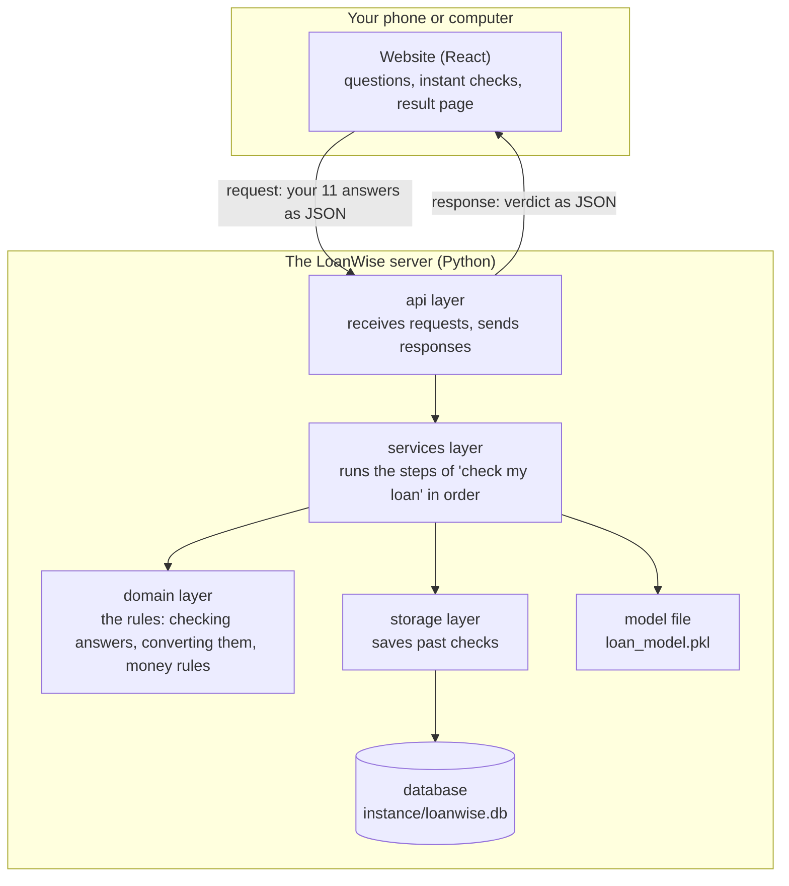
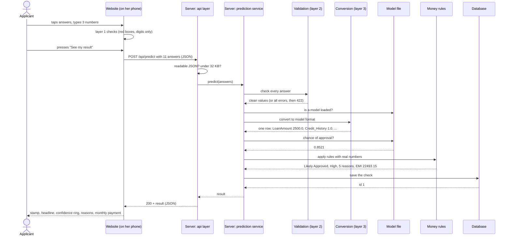
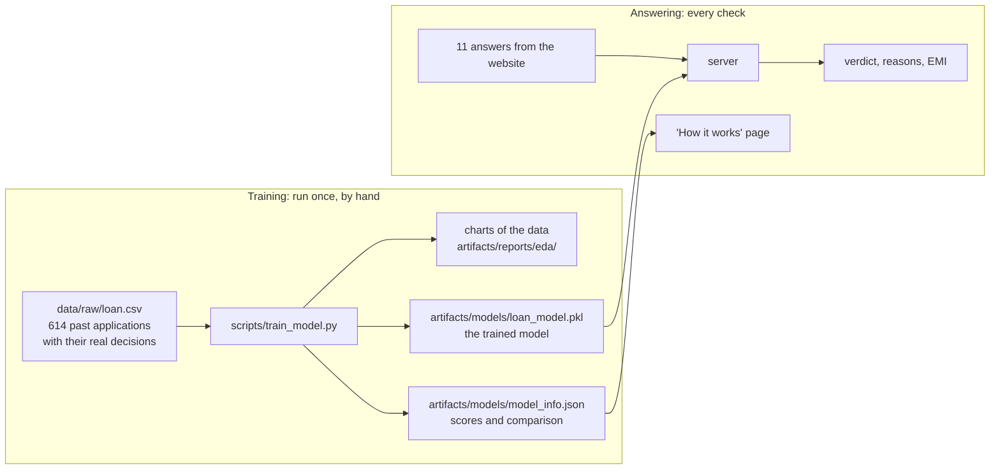

# 02 · How It Works, End to End

> **In short.** LoanWise AI has two halves. The **website** is what you see on your phone or computer. The **server** is a program on another computer that does the real work. When you press "See my result", the website sends your 11 answers to the server as a short piece of text. The server checks every answer, converts the answers into the exact form the prediction program was taught with, asks that program for the chance of approval, applies a few fixed money rules, saves the result, and sends a short piece of text back. The website turns that text into the stamp, reasons and monthly payment you see. This chapter follows one real check through every step, showing the actual text at each stage, captured from the running project. It also explains the separate, earlier step in which the prediction program was created ("training"), and where every file lives.

---

## Contents

1. [The words you need](#1-the-words-you-need)
2. [The two halves and the layers](#2-the-two-halves-and-the-layers)
3. [One real check, step by step](#3-one-real-check-step-by-step)
4. [The whole journey in one diagram](#4-the-whole-journey-in-one-diagram)
5. [Two different times: training and answering](#5-two-different-times-training-and-answering)
6. [Where the files live](#6-where-the-files-live)
7. [For the technically curious: how the model file is loaded and reloaded](#7-for-the-technically-curious-how-the-model-file-is-loaded-and-reloaded)
8. [For the technically curious: what happens when something fails](#8-for-the-technically-curious-what-happens-when-something-fails)

---

## 1. The words you need

Each word below is used in this exact meaning in the rest of the document.

| Word | What it means in this project |
|---|---|
| **Browser** | The app you use to open websites: Chrome, Safari, Edge, Firefox. |
| **Website** (also **frontend**) | The pages you see and tap: the questions, the buttons, the result. They are files the browser downloads and runs on your own phone or computer. |
| **Server** (also **backend**) | A program running on a computer somewhere else (or on the same laptop during a demo). It waits for messages from browsers and answers them. LoanWise AI's server is written in the Python programming language. |
| **Request** | A message the browser sends to the server, asking for something. |
| **Response** | The server's reply to one request. |
| **Address** (also **URL**) | Where a request goes, for example `/api/predict`. Each address does one job. |
| **API** | The list of addresses the server offers and the exact format of what goes in and comes out of each. "API" stands for Application Programming Interface: the agreed way for one program to ask another program for something. LoanWise AI's API is written down in [../docs/API.md](../docs/API.md). |
| **JSON** | The text format used for requests and responses. It is a list of named values in curly brackets, for example `{"loan_term": 240, "credit_history": "good"}`. Text values are in quotes; numbers are not. |
| **Status code** | A number on every response saying how it went. 200 means "done, here is your answer". 422 means "some answers need fixing". 500 means "the server had a problem". |
| **Validation** | Checking that each answer is present and makes sense before using it. |
| **Model** | The prediction program created by learning from 614 past loan applications. It takes one application and returns a chance of approval between 0 and 1. [00](00-ai-from-zero.md) explains models from the beginning. |
| **Model file** | The model saved on disk, `artifacts/models/loan_model.pkl`, so the server can load it without re-learning. |
| **Database** | A file where the server stores data in an organised way so it can find it later. Here it stores the list of past checks. |
| **Training** | The one-time process that creates the model from the past data. |
| **Prediction** | Using the trained model to answer for a new application. |

---

## 2. The two halves and the layers

The website runs on **your** device. The server runs on **the LoanWise computer**. They only talk by sending JSON text over the internet (or over the laptop itself during a demo).

The server is organised in layers. A **layer** is a group of code with one job. Each layer only uses the layers below it.



| Layer | Its single job | Main file |
|---|---|---|
| Website | Ask the questions, catch obvious mistakes immediately, show the result | [../frontend/src/pages/Check.jsx](../frontend/src/pages/Check.jsx), [Result.jsx](../frontend/src/pages/Result.jsx) |
| api | Receive the request, read the JSON, choose the status code, send the response | [../src/loanwise/api/routes/predict.py](../src/loanwise/api/routes/predict.py) |
| services | Run the steps in the right order | [../src/loanwise/services/prediction_service.py](../src/loanwise/services/prediction_service.py) |
| domain | The rules themselves: answer checking, conversion, money rules, wording | [../src/loanwise/domain/](../src/loanwise/domain/) |
| storage | Save and read past checks | [../src/loanwise/storage/history_repository.py](../src/loanwise/storage/history_repository.py) |

Why layers: the most important rules (in "domain") do not depend on the internet part at all. They can be tested on their own, quickly, and changed without touching anything else. More in [08](08-backend.md#b3-dependency-direction-and-why-it-matters).

---

## 3. One real check, step by step

Everything in this section was captured by running the finished project on 21 October 2026 and sending this exact application. The person is the one from [01](01-what-and-why.md#3-what-loanwise-ai-does-one-real-example): married woman, one child, graduate, salaried, earns ₹48,000 a month, husband earns ₹22,000, good repayment record, wants ₹25,00,000 over 20 years for a house near a city.

### Step 1. She answers the questions on the website

She is on the page `/check`. It has three screens: "About you", "Your money", "Your loan". She taps answers and types three numbers.

While she does this, the website checks each answer **on her own device**, with no server involved. If she skips a question and presses "Next", red messages appear under each unanswered question, such as "Please tap 'Yes' or 'No'." The money boxes do not accept letters, and add commas as she types: `2500000` appears as `25,00,000`, with "That's ₹25 lakh." underneath.

This is the **first layer of checking**. It is fast but cannot be trusted alone, because someone could send answers to the server without using the website. [07](07-validation-and-guardrails.md) lists every rule.

### Step 2. She presses "See my result" and the website sends a request

The button only becomes active once every question is answered correctly.

The website converts her answers into the agreed format. Two conversions happen here:

* "Yes, always on time" becomes `"credit_history": "good"`.
* "20 years" becomes `"loan_term": 240` (months).

It then sends this request to the server address `/api/predict` (`POST` is the kind of request used for sending data):

```json
{
  "gender": "Female",
  "married": "Yes",
  "dependents": "1",
  "education": "Graduate",
  "self_employed": "No",
  "applicant_income": 48000,
  "coapplicant_income": 22000,
  "loan_amount": 2500000,
  "loan_term": 240,
  "credit_history": "good",
  "property_area": "Semiurban"
}
```

Meaning of each line: gender; married or not; number of dependents (people who rely on her income); education; whether she runs her own business (`No` means salaried); her monthly income in rupees; her co-applicant's monthly income; the loan she wants in rupees; how many months to repay; her repayment record; where the house is (`Semiurban` means near a city).

While waiting, the screen shows "Checking your answers…" with a spinning coin.

### Step 3. The server reads the request

The server code at [../src/loanwise/api/routes/predict.py](../src/loanwise/api/routes/predict.py) receives it. First it checks the text is readable JSON and is a set of named values. If the text were broken (for example cut off half-way), the server would reply with status 400 and "We couldn't read your answers. Please fill in the form again and press the button. If it keeps happening, refresh the page."

It also refuses anything larger than 32,768 bytes (32 KB). A loan form is a few hundred bytes, so anything bigger is not a real form.

### Step 4. The server checks every answer (second layer)

The code in [../src/loanwise/domain/validation.py](../src/loanwise/domain/validation.py) goes through all 11 answers. For each one it asks two questions:

1. **Can I read it?** It is forgiving here. `" FEMALE "`, `"female"` and `"f"` all become `Female`. `"₹ 48,000"` becomes 48000. `"25 lakh"` becomes 2500000. `"20 years"` becomes 240.
2. **Does it make sense?** It is strict here. A negative income, a loan below ₹1,000 or above ₹1 crore, a term that is not one of the ten allowed lengths, "robot" as a gender, or both incomes being zero are all refused.

Her answers are all fine, so the result of this step is a clean set of values:

```
gender: Female, married: Yes, education: Graduate, self_employed: No,
credit_history: good, property_area: Semiurban, dependents: "1",
applicant_income: 48000.0, coapplicant_income: 22000.0,
loan_amount: 2500000.0, loan_term: 240
```

If anything had been wrong, the server would stop here and reply with status 422 and **every** problem at once, for example:

```json
{"ok": false,
 "errors": {"applicant_income": "This can't be a negative number. Please type your monthly income using numbers only, like 25000."},
 "message": "Some answers need fixing. Look for the red boxes."}
```

The website would then jump back to the right screen and show each message under the right question.

### Step 5. The server converts the answers into the model's format (third layer)

The model was taught using a table of past applications. That table has its own column names and its own units. The model only understands exactly that format. The code in [../src/loanwise/domain/sanitizer.py](../src/loanwise/domain/sanitizer.py) produces one row in that format:

| Column the model expects | Value | What changed |
|---|---|---|
| Gender | Female | name only |
| Married | Yes | name only |
| Dependents | 1 | name only |
| Education | Graduate | name only |
| Self_Employed | No | name only |
| ApplicantIncome | 48000.0 | name only |
| CoapplicantIncome | 22000.0 | name only |
| LoanAmount | **2500.0** | divided by 1000, because the training table stores loans **in thousands of rupees** |
| Loan_Amount_Term | 240.0 | name only |
| Credit_History | **1.0** | `good` became 1.0 (`bad` would be 0.0), because that is how the training table records it |
| Property_Area | Semiurban | name only |

This step also adds a warning if the total monthly income is above ₹5,00,000 ("Please double-check you typed MONTHLY income, not yearly."). Hers is ₹70,000, so there is no warning.

### Step 6. The model calculates the chance of approval

The server gives that one row to the model. Inside, the model file first prepares the row the same way the training data was prepared (explained in [04](04-data-preparation-and-features.md)). Three numbers and the answers to six questions reach the actual calculation:

* **Credit history**: 1.0 (good).
* **Loan term**: 240 months.
* **How heavy the monthly payment is compared with income.** The model's own rough version: ₹25,00,000 ÷ 240 months = ₹10,416.67 a month, which is 0.149 (about 15%) of ₹70,000. (This rough figure ignores interest on purpose; it only needs to grow when the loan grows and shrink when income grows.)
* The six multiple-choice answers (gender, married, dependents, education, self-employed, property area).

The model is a **Logistic Regression** (explained in [05](05-algorithms.md)). It combines these inputs with the weights it learned and returns two numbers that add up to 1:

```
chance of rejection: 0.1479
chance of approval:  0.8521
```

So the model says: **85.21% chance of approval**.

### Step 7. The money rules check the answer (guardrails)

The model learned from only 614 past cases. For unusual cases it can be confidently wrong. So the server applies fixed money rules, called **guardrails**, using her **real** numbers. The code is [../src/loanwise/domain/guardrails.py](../src/loanwise/domain/guardrails.py).

First it calculates a realistic monthly payment (called **EMI**, Equated Monthly Instalment) including 9% yearly interest:

```
EMI = ₹22,493.15 a month
total income = ₹48,000 + ₹22,000 = ₹70,000
EMI as a share of income = 22,493.15 ÷ 70,000 = 32%
loan as months of income = 25,00,000 ÷ 70,000 = 35.7 months (about 3.0 years)
```

Then it checks the rules:

| Rule | Her numbers | Result |
|---|---|---|
| R1. Is the monthly payment more than 65% of income? | 32% | No |
| R2. Is the loan more than 60 months (5 years) of income? | 35.7 months | No |
| R3. Is the repayment record bad? | Good | No |
| R4. Is the payment between 45% and 65% of income ("a big stretch")? | 32% | No |

No rule fires, so the model's answer stands. The full formula with every step of the arithmetic is in [07](07-validation-and-guardrails.md#b5-the-emi-formula-with-a-worked-example).

The approval threshold is 0.5: anything at or above 50% is "Likely Approved". 0.8521 is above, so: **Likely Approved**. The confidence shown is 0.8521. Because it is 0.75 or more, it is labelled **High**.

The same step writes the reasons, in order of importance: credit history first, then how comfortable the payment is (32% is between 30% and 45%, so "manageable, but not small"), then the loan size (3 years or less is "a sensible size"), then the co-applicant, then education.

### Step 8. The server saves the check

The clean answers, the verdict, the confidence and the full result are saved as one row in the database file `instance/loanwise.db`. This row got number **1**. If saving failed for any reason, the check would still succeed; the number would just be empty. Saving is useful but not essential.

### Step 9. The server sends the response

Status 200, with this JSON (exactly as captured):

```json
{
  "ok": true,
  "approved": true,
  "verdict": "Likely Approved",
  "headline": "Great news! Your loan is likely to be approved.",
  "confidence": 0.8521,
  "confidence_label": "High",
  "reasons": [
    {"type": "positive", "text": "Your credit history is good — this helps a lot."},
    {"type": "neutral", "text": "The monthly payment (about ₹22,493) is 32% of your income — manageable, but not small."},
    {"type": "positive", "text": "The loan is about 3.0 years of your income — a sensible size."},
    {"type": "positive", "text": "Having a co-applicant with income makes the loan safer for the bank."},
    {"type": "neutral", "text": "Being a graduate helps a little."}
  ],
  "warnings": [],
  "guardrail_applied": false,
  "emi_estimate": 22493.15,
  "id": 1
}
```

`guardrail_applied: false` means no money rule changed the model's answer. `warnings` is empty because nothing needed to be reinterpreted.

### Step 10. The website shows the result

The website goes to the page `/result` and turns each part of the response into something visible:

| Part of the response | What appears on screen |
|---|---|
| `approved: true` | Green stamp "LIKELY APPROVED" lands on a paper slip; marigold petals fall |
| `headline` | "Great news! Your loan is likely to be approved." |
| `id: 1` | "Your result, check number 1" |
| `confidence: 0.8521`, `confidence_label: "High"` | A ring filled to 85%, "High confidence", "We are quite sure about this answer." |
| `reasons` | "Why we said this": each line with a thumbs-up (positive), thumbs-down (negative) or "i" (neutral) icon |
| `warnings` | Would appear under "Things we fixed for you" (none here) |
| `emi_estimate: 22493.15` | "Your monthly payment would be about ₹22,493 a month", with "For a loan of ₹25,00,000 paid back over 20 years. This is a rough guess." |

The result and her answers are also kept in the browser tab (in "sessionStorage", a small storage area that lasts until the tab is closed), so refreshing the page does not lose them. She can press **Try again with changes** to adjust an answer and check again.

### What if the numbers were unaffordable?

Same form, but earning ₹5,000 a month and asking for ₹1,00,00,000 over 30 years. The model is not given the chance to approve it: the monthly payment would be ₹80,462, more than her whole income, so rule R1 fires, and the loan is far more than 5 years of income, so rule R2 fires too. The captured response says "Likely Rejected", headline "Sorry — this loan looks too big for your income right now.", `guardrail_applied: true`, and explains both reasons with the actual numbers. Section B9 of [07](07-validation-and-guardrails.md#b9-garbage-in-what-comes-out-captured-from-the-real-api) has 36 such cases.

---

## 4. The whole journey in one diagram

A sequence diagram reads from top to bottom. Each vertical line is one part of the system; each arrow is one message or action.



---

## 5. Two different times: training and answering

The model is created **once**, before anyone uses the website. Answering happens **every time** someone presses the button. These are completely separate.



| | Training (offline) | Answering (online) |
|---|---|---|
| When | Once, or whenever someone decides to retrain | Every time someone presses "See my result" |
| Started by | A person running `python3 scripts/train_model.py` (or `./run.sh --retrain`) | A browser request |
| Reads | `data/raw/loan.csv` (614 rows with known outcomes) | The model file and one new application |
| Produces | The model file, a report, charts | One verdict |
| Takes | About a minute | A fraction of a second |
| Learns anything? | Yes | **No.** New applications never change the model |

"Offline" here means "not while serving users", not "without internet".

The training steps, briefly (details in [06](06-training-and-evaluation.md)): load the data and draw charts; set aside 20% of the rows for a final test; teach three different methods on the other 80% and score each one fairly by repeated testing; pick the winner by that score; teach the winner again on all 614 rows; check that more income never lowers the chance and a bigger loan never raises it; save the model and the report; finally load the saved file in a fresh program to prove it works.

The second data file, `data/raw/test.csv`, has no decisions in it. It is used only for the "Fill an example for me" button and the final load check. See [03](03-dataset.md).

---

## 6. Where the files live

```
LoanWiseAI/
├── data/raw/loan.csv               past applications with decisions (training input)
├── data/raw/test.csv               past applications without decisions (examples only)
├── scripts/train_model.py          starts training
├── scripts/run_server.py           starts the server for development
├── wsgi.py                         starts the server in production (gunicorn wsgi:app)
├── artifacts/models/loan_model.pkl the trained model (output of training)
├── artifacts/models/model_info.json scores and comparison (output of training)
├── artifacts/reports/eda/          data charts (output of training)
├── instance/loanwise.db            history of past checks (created on first start)
├── src/loanwise/                   all server and training code
├── frontend/src/                   website source code
├── frontend/dist/                  website, packed and ready to serve (served by the server at "/")
└── docs/                           API contract, architecture, model card, screenshots
```

The same server program sends both the website files (when the browser opens `/`, `/check`, …) and the JSON answers (for addresses starting with `/api/`). So during a demo, one command (`./run.sh`) starts everything at `http://127.0.0.1:5000` (or 8000 on a Mac where 5000 is taken).

Every location above can be changed with a setting called an **environment variable** (a named value given to a program when it starts, such as `LOANWISE_MODEL_PATH`). The full list is in [08](08-backend.md#b9-configuration).

---

## 7. For the technically curious: how the model file is loaded and reloaded

Source: [../src/loanwise/services/model_registry.py](../src/loanwise/services/model_registry.py). Non-technical readers can skip this.

* **Lazy loading.** The server does not read the model file when it starts. It reads it on the first request that needs it. Start-up is fast and a missing model does not stop the server from starting.
* **Hot reload.** Before every use, the registry looks at the file's last-modified time. If the file has changed (because someone retrained), it loads the new one. No restart is needed. Verified while writing this: after `touch artifacts/models/loan_model.pkl`, the next request logged a second "Model loaded from …" line.
* **Safe failure.** If the new file is broken, the error is logged and the previous model keeps answering. If the file is deleted, the last loaded model keeps answering.
* **Thread safety.** The fast path (file unchanged) needs no lock. A reload takes a lock and re-checks, so two simultaneous requests never load the file twice.
* **No model at all.** `GET /api/health` returns `{"ok": true, "model_loaded": false}`, and `POST /api/predict` with valid answers returns 503: "Our loan checker isn't ready yet. Please try again in a few minutes. (The person running this site needs to train the model first.)" Invalid answers still get their 422 field errors, because validation runs before the model is fetched.
* **The pickle depends on code.** The saved file contains references to the functions `loanwise.ml.features.coerce_raw_input` and `add_engineered_features`. That module must stay importable under that name, and scikit-learn must stay at exactly version 1.9.1, or the file will not load.
* With gunicorn, each worker process has its own registry and reloads independently.

---

## 8. For the technically curious: what happens when something fails

| What goes wrong | Where it is caught | Status | What the user sees |
|---|---|---|---|
| Server not running or unreachable | Website [api.js](../frontend/src/api.js) | (none) | Toast "Your answers are safe" / "We couldn't reach the server. Is it running?"; answers stay on the form |
| Server too slow (over 20 s for a check) | Website | (none) | "The server is taking too long to answer. Please try again in a moment." |
| Broken or non-object JSON | api layer | 400 | "We couldn't read your answers. …" |
| Body over 32 KB | Flask | 413 | "That was too much information to send at once. …" |
| Invalid answers | validation | 422 | Each message under its question, the wizard jumps to the right step |
| No model file | service | 503 | "Our loan checker isn't ready yet. …" |
| Model crashes or returns "not a number" | service | 500 | "Something went wrong on our side. Please try again in a minute." (details only in the server log) |
| Database write fails | service | 200 | Normal result; `id` is `null` |
| Any other bug | error handlers | 500 | Same generic message; full traceback in the server log only |

Full details: [08 · Backend, error handling](08-backend.md#b10-error-handling).

---

[Next → 03 · Dataset](03-dataset.md)  
[← Back to index](README.md)
