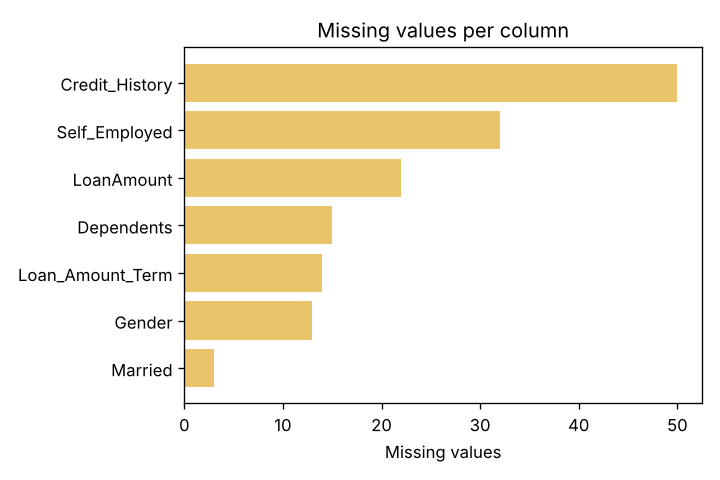
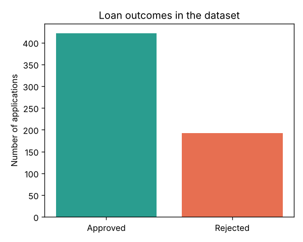
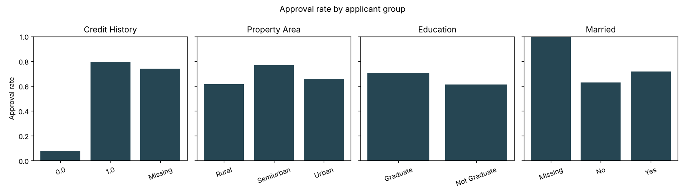
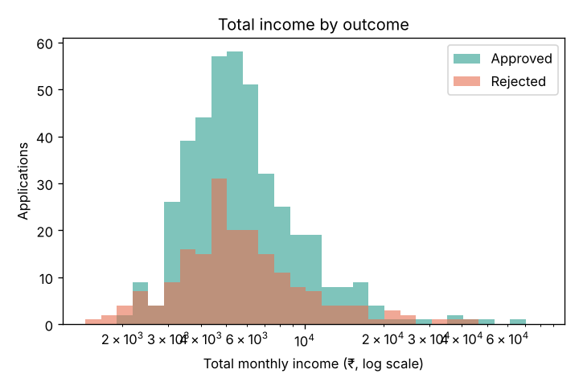

# 03 · The Dataset

> **In short.** The program learns from a table of 614 past home-loan applications. Each row is one person who applied for a loan. Each row lists 11 facts about the person and the loan, plus the answer the lender gave: approved or rejected. 422 people (68.7 %) were approved and 192 (31.3 %) were rejected. Some cells in the table are blank. The single most telling fact is "credit history": 79.6 % of people with a good credit record were approved, but only 7.9 % of people without one. A person's income, on its own, says surprisingly little. A second table of 367 applications has no answers, so it is never used for learning. The data is small, old, and of unclear origin, and it includes gender and marital status. This chapter explains each of these points with real numbers.

If the words "data", "model" or "training" are new to you, read [00-ai-from-zero.md](00-ai-from-zero.md) first. This chapter also explains each term as it comes up.

---

## 1. What a dataset is, using this one

A **dataset** is a table of recorded examples. Each **row** is one example. Each **column** is one kind of fact recorded about every example.

Here are the first five rows of this project's dataset, exactly as stored in the file [`data/raw/loan.csv`](../data/raw/loan.csv). (A **CSV file** is a plain text file that stores a table: one line per row, with commas between the cells.)

| Loan_ID | Gender | Married | Dependents | Education | Self_Employed | ApplicantIncome | CoapplicantIncome | LoanAmount | Loan_Amount_Term | Credit_History | Property_Area | Loan_Status |
|---|---|---|---|---|---|---|---|---|---|---|---|---|
| LP001002 | Male | No | 0 | Graduate | No | 5849 | 0 | *(blank)* | 360 | 1 | Urban | **Y** |
| LP001003 | Male | Yes | 1 | Graduate | No | 4583 | 1508 | 128 | 360 | 1 | Rural | **N** |
| LP001005 | Male | Yes | 0 | Graduate | Yes | 3000 | 0 | 66 | 360 | 1 | Urban | **Y** |
| LP001006 | Male | Yes | 0 | Not Graduate | No | 2583 | 2358 | 120 | 360 | 1 | Urban | **Y** |
| LP001008 | Male | No | 0 | Graduate | No | 6000 | 0 | 141 | 360 | 1 | Urban | **Y** |

Read the second row in words. Applicant `LP001003` is a married male graduate with one dependent and a salaried job. He earns ₹4,583 a month, and a second person on the application earns ₹1,508 a month. He asked for ₹1,28,000 over 360 months (30 years). His credit record meets the lender's rules. The property is in a rural area. The lender said **N**: rejected.

The last column, `Loan_Status`, is the **answer** we want the computer to learn to predict. In machine-learning language this column is called the **target** or **label**. The other columns are the **inputs** (also called **features**): the facts the computer is allowed to look at when it makes a guess.

The full file has **614 rows** and 13 columns: 1 ID column, 11 input columns and 1 answer column. Every `Loan_ID` is different, and no row is an exact copy of another.

---

## 2. Where the data comes from

This is a well-known free practice dataset called **"Loan Prediction"**. It was published for a practice competition on the website *Analytics Vidhya*, and copies are on *Kaggle*, a website where people share datasets. The story that comes with it describes a housing-finance company (usually called *Dream Housing Finance*) that wants to decide automatically, from an online application form, whether an applicant is eligible for a loan.

What is **well known**:

- It comes in two files: one with answers (614 rows; our `loan.csv`) and one without answers (367 rows; our `test.csv`). The competition kept the answers for the second file secret, to grade entries, and never published them.
- Thousands of students and online courses use it for beginner practice.

What is **not known**, and should never be claimed:

- Which real lender, if any, it came from. Which years it covers. Which country's rules it reflects.
- The story suggests India, and people usually read the money columns as rupees, but no official description confirms the currency, the period or the region.
- How the applications were chosen, or whether anyone edited them before publishing.

This project assumes that incomes are **rupees per month** and that `LoanAmount` is in **thousands of rupees**. That is the usual reading. It is written into the code as `LOAN_AMOUNT_UNIT = 1000.0` in [`src/loanwise/domain/schemas.py`](../src/loanwise/domain/schemas.py).

---

## 3. Every column, in plain words

Some columns hold a **category**: one choice from a short fixed list, like "Male" or "Female". Others hold a **number** you can do arithmetic on, like an income. The table says which is which.

| Column | What it records | Kind | Units or allowed values | What the 614 rows contain |
|---|---|---|---|---|
| `Loan_ID` | A reference code for the row | text | `LP` followed by 6 digits | 614 different codes. **The program ignores this column**, because a reference code says nothing about the person. |
| `Gender` | The applicant's gender | category | `Male`, `Female` | Male 489, Female 112, blank 13 |
| `Married` | Whether the applicant is married | category | `Yes`, `No` | Yes 398, No 213, blank 3 |
| `Dependents` | How many people rely on the applicant's income | category | `0`, `1`, `2`, `3+` | 0: 345, 1: 102, 2: 101, 3+: 51, blank 15 |
| `Education` | Highest education | category | `Graduate`, `Not Graduate` | Graduate 480, Not Graduate 134 |
| `Self_Employed` | Whether the applicant runs their own business instead of earning a salary | category | `Yes`, `No` | No 500, Yes 82, blank 32 |
| `ApplicantIncome` | The main applicant's income | number | rupees **per month** | smallest ₹150, middle value ₹3,812.5, largest ₹81,000 |
| `CoapplicantIncome` | Income of a second person on the application (often a spouse) | number | rupees **per month** | ₹0 for 273 rows (44 %); largest ₹41,667 |
| `LoanAmount` | How much the applicant wants to borrow | number | **thousands** of rupees, so `128` means ₹1,28,000 | smallest 9, middle value 128, largest 700; blank 22 |
| `Loan_Amount_Term` | How long the applicant has to repay | number | **months** | 360 months (30 years) for 512 rows (83 %); other values 12, 36, 60, 84, 120, 180, 240, 300, 480; blank 14 |
| `Credit_History` | Whether the applicant's past borrowing record meets the lender's rules | yes/no stored as a number | `1` = meets the rules, `0` = does not | 1: 475, 0: 89, blank 50 |
| `Property_Area` | Where the property is | category | `Urban` (city), `Semiurban` (town edge), `Rural` (countryside) | Semiurban 233, Urban 202, Rural 179 |
| `Loan_Status` | **The answer.** Did the lender approve the loan? | category | `Y` = approved, `N` = rejected | Y 422, N 192 |

Four points that are easy to miss:

- **`Credit_History` is only a yes/no flag.** It does not hold a credit score, an amount owed or a count of missed payments. It records one thing: whether the record "meets the guidelines".
- **`Dependents` is treated as a category, not a number,** because one of its values is `3+`, which is not a number you can calculate with.
- **`LoanAmount` uses a different unit from the incomes.** An applicant earning ₹5,849 a month who asks for `128` is asking for ₹1,28,000, not ₹128. The app takes full rupees from the user and divides by 1,000 before handing the value on ([08-backend.md](08-backend.md)).
- **Almost everyone chose a 30-year term.** The data has very few examples of other terms, so anything learned about them rests on little evidence.

### How the money columns are spread out

Two ways of describing a "typical" value appear below:

- The **mean** (the ordinary average): add all values and divide by how many there are.
- The **median** (the middle value): sort the values from smallest to largest and take the one in the middle. Half the people are below it and half above.

A **percentile** is a cut-off point. The 90th percentile is the value that 90 % of people are below.

| | ApplicantIncome (₹/month) | CoapplicantIncome (₹/month) | Total income: both added (₹/month) | LoanAmount (₹ thousands) |
|---|---|---|---|---|
| Rows with a value | 614 | 614 | 614 | 592 |
| Smallest | 150 | 0 | 1,442 | 9 |
| 25th percentile | 2,877.5 | 0 | 4,166 | 100 |
| **Median** | **3,812.5** | 1,188.5 | **5,416.5** | **128** |
| **Mean** | **5,403.5** | 1,621.2 | **7,024.7** | 146.4 |
| 75th percentile | 5,795 | 2,297.2 | 7,521.8 | 168 |
| 90th percentile | 9,459.9 | 3,782.2 | — | 235.8 |
| 99th percentile | 32,540.4 | 8,895.9 | — | 496.4 |
| Largest | 81,000 | 41,667 | 81,000 | 700 |

**What the table shows.** For applicant income, the mean (₹5,403.5) is much higher than the median (₹3,812.5). A few people earn a great deal: the top 1 % earn more than ₹32,540, and one earns ₹81,000. Those few pull the average up, while the middle value stays put. A spread like this, with a long tail of large values on one side, is called **skewed**. It matters for how gaps are filled ([04-data-preparation-and-features.md](04-data-preparation-and-features.md)).

**Income and loan size rise together.** People who earn more tend to ask for bigger loans. One standard way to measure "rise together" is the **correlation**, a number from −1 to +1. +1 means two columns always rise together perfectly, 0 means no connection, and −1 means one always falls as the other rises. Applicant income and loan amount have a correlation of **0.571**. Total income and loan amount have **0.625**. This connection causes a real problem later ([04-data-preparation-and-features.md](04-data-preparation-and-features.md) §6).

---

## 4. Blank cells ("missing values")

A **missing value** is a cell left blank: the applicant did not answer, or the answer was not recorded. Look at row 1 in §1: `LoanAmount` is blank.

**134 of the 614 rows (21.8 %) have at least one blank cell.** The program does not throw these rows away. It fills each blank with a sensible stand-in value. That process, called **imputation**, is explained in [04-data-preparation-and-features.md](04-data-preparation-and-features.md).

| Column | Blank in `loan.csv` | Share of 614 | Blank in `test.csv` (of 367) |
|---|---|---|---|
| Credit_History | 50 | 8.1 % | 29 |
| Self_Employed | 32 | 5.2 % | 23 |
| LoanAmount | 22 | 3.6 % | 5 |
| Dependents | 15 | 2.4 % | 10 |
| Loan_Amount_Term | 14 | 2.3 % | 6 |
| Gender | 13 | 2.1 % | 11 |
| Married | 3 | 0.5 % | 0 |
| Education, Property_Area, both incomes, Loan_Status | 0 | 0 % | 0 |

The most useful column, `Credit_History`, is also the one most often blank. Of the 50 people with a blank credit history, **74.0 % were approved**. That is close to the approval rate for people whose credit meets the rules (79.6 %) and far from the rate for people whose credit does not (7.9 %). This fact matters when deciding how to fill the blank ([04-data-preparation-and-features.md](04-data-preparation-and-features.md) §4).

---

## 5. How many were approved, and why the split matters

| Answer | Rows | Share |
|---|---|---|
| Approved (`Y`; the program stores this as the number 1) | 422 | 68.7 % |
| Rejected (`N`; stored as 0) | 192 | 31.3 % |

The two answers are not equally common. There are about two approvals for every rejection. When one answer is much more common than the other, the data is called **imbalanced**. Here the imbalance is mild.

It matters for three reasons.

**1. A guess that ignores the applicant already looks good.** Suppose you answered "approved" for every single person without looking at anything. You would be right for all 422 approved people and wrong for all 192 rejected ones: 422 ÷ 614 = 68.7 % correct. So "68.7 % correct" is the score of doing nothing. That do-nothing score is called a **baseline**. Any real method has to beat it. On the 123-row test set the project uses later, the same do-nothing guess scores 85 ÷ 123 = 69.1 %. Training prints this number for comparison ([06-training-and-evaluation.md](06-training-and-evaluation.md)).

**2. "Percent correct" alone can mislead.** A method could approve nearly everyone, score around 70 %, and still be useless at the job a lender cares about most, which is spotting the people who should be rejected. That is why other scores are reported as well ([06-training-and-evaluation.md](06-training-and-evaluation.md) §6).

**3. When the data is divided, each piece must keep the same mix.** The project sets some rows aside for testing ([06-training-and-evaluation.md](06-training-and-evaluation.md)). With only 192 rejections, a careless random division could leave the test piece with too few of them. So every division keeps the 69 / 31 mix. This is called **stratified** splitting.

For the technically curious: the project does not re-weight the two answers (scikit-learn's `class_weight` is left at `None`) and does not resample. At this mild level of imbalance, both would mainly move the cut-off between "approve" and "reject". The project keeps things simple instead. This is a choice, and [06-training-and-evaluation.md](06-training-and-evaluation.md) §11 lists threshold tuning as an improvement.

---

## 6. What the data shows: exploring it before learning from it

Before learning from the data, the project counts and charts it to see which facts go with approval. This step is called **exploratory data analysis**, or **EDA**. Every training run redoes this step ([`src/loanwise/ml/eda.py`](../src/loanwise/ml/eda.py)) and saves the charts in `artifacts/reports/eda/`.

The key measure below is the **approval rate** of a group: the number approved in the group divided by the group's size.

### 6.1 Credit history matters far more than anything else

| Credit_History | People | Approved | Approval rate |
|---|---|---|---|
| 1 (meets the rules) | 475 | 378 | **79.6 %** |
| 0 (does not meet the rules) | 89 | 7 | **7.9 %** |
| blank | 50 | 37 | 74.0 % |

Only 7 of the 89 people with poor credit were approved. A single yes/no fact moves the approval rate by more than 70 percentage points. Every method the project tries ends up relying mostly on this column. [06-training-and-evaluation.md](06-training-and-evaluation.md) §7 shows that, on the test rows, every method ends up answering "approve if and only if credit history is not 0".

### 6.2 The other categories

| Column | Group | People | Approval rate |
|---|---|---|---|
| Property_Area | Semiurban | 233 | 76.8 % |
| | Urban | 202 | 65.8 % |
| | Rural | 179 | 61.5 % |
| Married | Yes | 398 | 71.6 % |
| | No | 213 | 62.9 % |
| | blank | 3 | 100 % (only 3 people) |
| Education | Graduate | 480 | 70.8 % |
| | Not Graduate | 134 | 61.2 % |
| Gender | Male | 489 | 69.3 % |
| | Female | 112 | 67.0 % |
| | blank | 13 | 61.5 % |
| Dependents | 0 | 345 | 69.0 % |
| | 1 | 102 | 64.7 % |
| | 2 | 101 | 75.2 % |
| | 3+ | 51 | 64.7 % |
| | blank | 15 | 60.0 % |
| Self_Employed | No | 500 | 68.6 % |
| | Yes | 82 | 68.3 % |
| | blank | 32 | 71.9 % |

What this says:

- **Semiurban properties do best.** They are about 11 points above Urban and 15 above Rural. The data does not say why.
- **Married people and graduates do better,** by about 9 to 10 points each.
- **Men and women differ only a little** (2.3 points). Being self-employed makes almost no difference.
- **Dependents has no steady pattern.** Two dependents is highest, and one and three-plus are lowest.
- **Small groups give shaky rates.** In a group of 51 people, one extra approval moves the rate by 2 points. So differences of a few points between small groups may be chance.

### 6.3 Income on its own says very little

The chart is a **histogram**: it groups people into income bands and draws a bar for how many people fall in each band. It draws one set of bars for approved people and one for rejected people, on top of each other. The horizontal axis uses a **log scale**: each step to the right multiplies income by the same amount (for example ₹1,000 → ₹10,000 → ₹1,00,000), so small and very large incomes fit on one chart. The two shapes nearly coincide. Approved and rejected people earn about the same.

| | Approved | Rejected |
|---|---|---|
| Median total income | ₹5,439 | ₹5,289.5 |
| Mean total income | ₹6,889 | **₹7,324** |
| Median loan amount | ₹1,26,000 | ₹1,29,000 |

Next, sort everyone by total income and cut them into four equal groups (called **quartiles**):

| Total income band (₹/month) | People | Approval rate |
|---|---|---|
| 1,442 to 4,166 | 155 | 67.7 % |
| 4,166 to 5,416.5 | 152 | 68.4 % |
| 5,416.5 to 7,521.75 | 153 | 71.2 % |
| 7,521.75 to 81,000 | 154 | 67.5 % |

Two surprising facts stand out. Rejected people have a *higher* average income than approved people, because a few very high earners were rejected. And the top income band is approved slightly *less* often than the band below it. Read naively, the data hints that "earning more lowers your chance". No lender works that way. [04-data-preparation-and-features.md](04-data-preparation-and-features.md) §6 explains how this misleading hint caused a real fault in an earlier version of the model, and how it was fixed.

Two smaller findings:

- People **with** a second earner on the application (341 people) were approved 71.8 % of the time, against 64.8 % for the 273 without one.
- The 15 people who chose a **480-month** (40-year) term were approved only 40.0 % of the time. That small group explains why the model slightly penalises long terms ([05-algorithms.md](05-algorithms.md) §2).

---

## 7. The second file, `test.csv`: what it is and is not

[`data/raw/test.csv`](../data/raw/test.csv) has 367 rows with the same 11 input columns, but **no `Loan_Status` column**: nobody knows whether these people were approved.

| `test.csv` **is used for** | `test.csv` **is not used for** |
|---|---|
| Picking a random example application when a user clicks **"Fill example"** in the app ([`src/loanwise/services/sample_service.py`](../src/loanwise/services/sample_service.py)). Blank cells are filled with typical values so every example is complete. | Learning. The program never learns from it. |
| A final check after training ([`src/loanwise/ml/sanity.py`](../src/loanwise/ml/sanity.py)): the saved model is loaded again from scratch and asked to score the first 5 rows, to prove the saved file works. | Measuring how good the model is. That is impossible without the answers. |

Despite its name, this file is **not** the "test set" quoted in the results. That test set is **123 rows taken out of `loan.csv`** and kept aside during learning ([06-training-and-evaluation.md](06-training-and-evaluation.md) §2).

One oddity: `test.csv` contains an applicant income of ₹0. The lowest income in `loan.csv` is ₹150.

---

## 8. Limitations and biases

These are real weaknesses. Anyone presenting or taking over this project should be able to name them.

1. **The dataset is tiny.** 614 rows is very few for learning from examples, and only 192 of them are rejections. Many combinations of facts appear only a handful of times. For example, only 89 people have poor credit and only 15 chose a 40-year term. Scores can shift by about ±4.6 percentage points depending only on which rows are used for checking ([06-training-and-evaluation.md](06-training-and-evaluation.md) §3).
2. **Nobody knows exactly where it came from.** No official description gives the date, the lender, the lender's rules or the currency. "Rupees per month" is a common assumption, not a documented fact.
3. **It is old and never changes.** Incomes, loan sizes, interest rates and lending rules have all moved on. A median home loan of ₹1,28,000 is not realistic today. The program has no idea what year it is and cannot adjust.
4. **Gender and marital status are inputs.** In many countries, using a person's sex or marital status to decide on credit is banned or tightly restricted by law. Examples are the US Equal Credit Opportunity Act and equality law in the UK and EU. Other columns, such as `Dependents` and `Property_Area`, can stand in indirectly for protected traits. Such indirect stand-ins are called **proxies**. The program learns the gaps in the data (married 71.6 % vs unmarried 62.9 %) and repeats them. In the finished model, changing one real applicant from "not married" to "married", with every other fact unchanged, raises their estimated chance from 72.9 % to 80.0 % ([05-algorithms.md](05-algorithms.md) §2). [docs/MODEL_CARD.md](../docs/MODEL_CARD.md) recommends removing these columns before any real use, and this documentation agrees.
5. **The answers record past decisions, not repayment.** `Loan_Status` says whether the lender *approved* a loan, not whether the borrower *paid it back*. So the program learns to copy the old lender's decisions, unfairness included, rather than to predict who will repay.
6. **Credit history is a single yes/no.** Real lenders use credit scores, existing debts, years in a job, the value of the property and the interest rate. None of these are in the data.
7. **Blanks may carry meaning.** For example, people with a blank credit history were approved 74 % of the time. Filling a blank with a stand-in value hides the fact that it was blank ([04-data-preparation-and-features.md](04-data-preparation-and-features.md) §4).
8. **Few examples at the extremes.** Only 1 % of applicants earn more than ₹32,540 a month, and the largest loan is ₹7,00,000. For anyone far outside those ranges the program is guessing beyond its experience. The app adds fixed safety rules to handle such cases ([07-validation-and-guardrails.md](07-validation-and-guardrails.md)).

---

**Next →** [04 · Data Preparation and Features](04-data-preparation-and-features.md)

[← Back to index](README.md)
