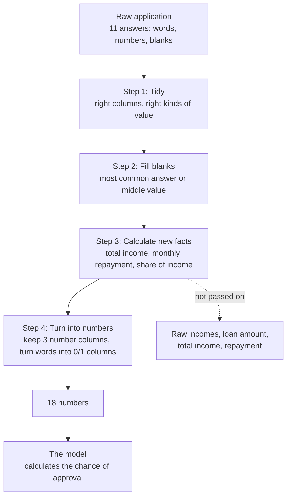

# 04 · Data Preparation and Features

> **In short.** The computer can only learn from a table that is completely filled with numbers. The raw applications contain words ("Male", "Urban"), blank cells, and numbers in different units. So, before any learning happens, every application goes through four fixed steps. **(1) Tidy:** make sure every column is present and holds the right kind of value. **(2) Fill blanks:** put the most common answer, or the middle value, into each empty cell. **(3) Calculate new facts:** total household income, a rough monthly repayment, and what share of income that repayment would take. **(4) Turn everything into numbers:** keep only three number columns and turn each word answer into 0/1 columns, giving 18 numbers per applicant. Raw income and loan amount are deliberately **not** given to the model. When they were, it learned that "more income means less chance of approval", which is false, and which came from a quirk of this small dataset. Income now reaches the model only through the "share of income" figure, which can only move in the sensible direction. All four steps are saved together with the model, so applications are prepared the same way during learning and in the live app.

Source files: [`src/loanwise/ml/features.py`](../src/loanwise/ml/features.py) and [`src/loanwise/ml/pipelines.py`](../src/loanwise/ml/pipelines.py).

---

## 1. Why preparation is needed

A **model** is the set of rules and numbers the computer works out from past examples and then uses to make a guess about a new applicant ([00-ai-from-zero.md](00-ai-from-zero.md)). The calculation methods used in this project accept only a table in which **every cell is a number and no cell is blank**.

The raw applications break that rule in four ways:

- some cells hold **words** (`"Male"`, `"Semiurban"`, `"3+"`);
- some cells are **blank** (134 of the 614 rows have at least one blank);
- the numbers use **different units** (monthly rupees, thousands of rupees, months);
- a few **very large incomes** stand far apart from everybody else.

Preparation fixes all four problems. It is the same fixed sequence of steps for every application, both in learning and in the live app. In software, a fixed sequence of steps that data flows through is called a **pipeline**.

---

## 2. The steps at a glance



---

## 3. Step 1: Tidy

This step checks that the application looks exactly like the rows the model learned from:

1. **Exactly the 11 expected columns, in a fixed order.** A missing column is added and left blank. Extra columns, such as `Loan_ID`, are removed.
2. **Word columns hold clean text.** Spaces at the start and end are trimmed, so `" Male "` becomes `"Male"`. The number `0` in the `Dependents` column becomes the text `"0"`. The texts `""`, `"nan"` and `"None"` count as blank.
3. **Number columns hold numbers.** Anything that is not a number, such as `"abc"` typed into an income box, becomes blank. Step 2 then fills it instead of the program crashing.

**Why this step exists.** Different sources hand over values in slightly different forms. A spreadsheet might store `Dependents` as the number 0, while a web form sends the text `"0"`. Without tidying, the program would treat these as two different answers. The app checks the user's form thoroughly before it ever reaches this point ([07-validation-and-guardrails.md](07-validation-and-guardrails.md)), so this step is a last safety net.

### For the technically curious

The function is `coerce_raw_input`, wrapped in scikit-learn's `FunctionTransformer`. It uses `DataFrame.reindex(columns=RAW_COLS)` and `pd.to_numeric(errors="coerce")`. The saved model file stores a *reference* to `loanwise.ml.features.coerce_raw_input`, not a copy of the code. That is why the module docstring says this file must keep its import path and contain only plain module-level functions (no lambdas). Otherwise the saved model cannot be loaded.

---

## 4. Step 2: Fill the blanks ("imputation")

Filling a blank cell with a stand-in value is called **imputation**. Throwing away every row with a blank would lose 134 of 614 rows, or 22 % of the data. So the project fills them instead.

There are two filling rules.

### Rule A: for word answers, use the most common answer

For `Gender`, `Married`, `Dependents`, `Education`, `Self_Employed` and `Property_Area`, a blank is filled with whichever answer appears most often in that column. The most common value is called the **mode**.

Worked example with `Gender`. Among the 601 non-blank answers, "Male" appears 489 times and "Female" 112 times. "Male" is the most common, so each of the 13 blank `Gender` cells becomes "Male".

The full set of most-common answers:

| Column | Most common answer, used to fill blanks |
|---|---|
| Gender | Male |
| Married | Yes |
| Dependents | 0 |
| Education | Graduate |
| Self_Employed | No |
| Property_Area | Semiurban |
| Credit_History | 1 (meets the rules) |

`Credit_History` is stored as a number, but it is really a yes/no answer (1 or 0). So it also gets the most-common rule. An average of 1s and 0s would be something like 0.86, which is neither "yes" nor "no". The most common answer is 1. The data also supports this choice: people with a blank credit history were approved 74 % of the time, close to the 79.6 % of people with good credit.

### Rule B: for numbers, use the middle value (median)

For `ApplicantIncome`, `CoapplicantIncome`, `LoanAmount` and `Loan_Amount_Term`, a blank is filled with the **median**: sort all the known values from smallest to largest and take the one in the middle.

**Why the median and not the average?** Take a small worked example with 8 real loan amounts, from rows 2 to 9 of the dataset (in ₹ thousands):

```
128, 66, 120, 141, 267, 95, 158, 168
```

Sorted from smallest to largest:

```
66, 95, 120, 128, 141, 158, 168, 267
```

- **Median.** With 8 values, the middle falls between the 4th and 5th: (128 + 141) ÷ 2 = **134.5**.
- **Average.** (66 + 95 + 120 + 128 + 141 + 158 + 168 + 267) ÷ 8 = 1,143 ÷ 8 = **142.9**.

The single large loan of 267 pulls the average up, but it barely moves the median. In the full data the gap between the two is bigger. For applicant income the average is ₹5,403.5 but the median is ₹3,812.5, because a handful of very high earners pull the average up. The median is the better guess for a typical person.

Using all the known values in the dataset, the medians are:

| Column | Middle value (median), used to fill blanks |
|---|---|
| ApplicantIncome | ₹3,812.5 |
| CoapplicantIncome | ₹1,188.5 |
| LoanAmount | 128 (₹1,28,000) |
| Loan_Amount_Term | 360 months |

So the blank `LoanAmount` of applicant `LP001002` (the first row of the data) becomes 128.

### Fill values are calculated from the data, not typed in by hand

The "most common" and "middle" values above are **worked out from the learning data** each time the model learns. They are not fixed in the code. This matters when the project checks itself. When some rows are held back for checking, the fill values are worked out *without* those rows, so the check is fair ([06-training-and-evaluation.md](06-training-and-evaluation.md) §3). The values in the tables are the ones in the final saved model, which learned from all 614 rows.

### Honest drawbacks

- **Blanks get filled with favourable values.** Because each blank becomes the most common answer, and the most common answers mostly go with approval, an application with *every* cell blank gets an estimated 86.5 % chance of approval. The live app never allows that, because every field on the form is required. But the model on its own would.
- **The fact that a cell was blank is lost.** A more advanced system might add an extra "this was blank" column.

### For the technically curious

This is a `ColumnTransformer` with three `SimpleImputer`s: `strategy="most_frequent"` for the six categoricals, a separate `most_frequent` imputer for `Credit_History`, and `strategy="median"` for the other four numerics. The statistics are learned in `fit`. Inside `GridSearchCV` and `cross_val_score` they are re-learned on each fold's training part only.

---

## 5. Step 3: Calculate new facts ("feature engineering")

The facts given to a model are called **features**. Working out new, more useful features from the raw ones is called **feature engineering**. This step runs after the blanks are filled, so no value is missing.

Four new values are calculated. The worked example is applicant `LP001002`: ₹5,849 a month, no second earner, loan 128 (filled in by step 2), 360 months.

**1. Total income** is the applicant's monthly income plus the second earner's.

```
5,849 + 0 = ₹5,849 per month
```

**2. Monthly repayment ("EMI").** In Indian lending, the fixed monthly repayment on a loan is called the **EMI** (Equated Monthly Instalment). This project uses a deliberately simple version: the loan in full rupees divided by the number of months, ignoring interest.

```
LoanAmount × 1,000 ÷ months = 128 × 1,000 ÷ 360 = ₹355.56 per month
```

**3. Share of income taken by the repayment ("EMI-to-income ratio")** is the repayment divided by total income.

```
355.56 ÷ 5,849 = 0.0608, which is about 6.1 % of income
```

This is the heart of affordability. The same loan is easy on a large income and impossible on a small one. Across the 614 applicants, the middle value of this share is 0.069 (6.9 %), and the largest is 1.24 (124 %).

**4. Capped and compressed share ("log EMI-to-income ratio").** Two last adjustments are applied to the share:

- **Cap at 10.** If the share is above 10 (a repayment ten times monthly income), it is set to 10. No real applicant comes close: the largest is 1.24. The cap protects the app from absurd requests, such as ₹1 crore borrowed on ₹1,000 a month, which would otherwise produce enormous numbers.
- **Compress large values.** The project takes the **natural logarithm** of (1 + share). A logarithm grows more and more slowly as its input grows, so large values get squeezed together while the order stays the same. For small shares the result is almost the same as the share itself:

| Share (before) | ln(1 + share) (after) |
|---|---|
| 0.0608 (this applicant) | 0.0590 |
| 0.069 (middle applicant) | 0.0667 |
| 0.5 | 0.405 |
| 1.0 | 0.693 |
| 10 (the cap) | 2.398 |

So 2.398 is the largest value this feature can ever take.

### Why this design guarantees sensible behaviour

Look at how the share is built:

```
share = (loan ÷ months) ÷ (applicant income + second earner's income)
```

- If **either income goes up**, you divide by a bigger number, so the share goes **down**.
- If the **loan goes up**, the top of the fraction grows, so the share goes **up**.

So, as long as the model treats a larger share as worse, two promises hold for every applicant:

- **earning more can never lower the estimated chance of approval;**
- **asking for more can never raise it.**

A relationship that always moves in one direction like this is called **monotonic**. [05-algorithms.md](05-algorithms.md) shows how each method is made to respect it, and [06-training-and-evaluation.md](06-training-and-evaluation.md) §8 shows the automatic check that refuses to save a model that breaks it.

### For the technically curious

```
TotalIncome           = ApplicantIncome + CoapplicantIncome
EMI                   = LoanAmount × 1000 / max(Loan_Amount_Term, 1)
EMI_Income_Ratio      = EMI / max(TotalIncome, 1)
Log_EMI_Income_Ratio  = log1p(clip(EMI_Income_Ratio, 0, 10))
```

The `max(…, 1)` guards prevent division by zero. The EMI is interest-free because, as the code comment says, it "only needs to be monotonic". An amortised EMI at any fixed rate ranks applicants similarly. The app's *guardrails* use a separate, realistic 9 %-a-year EMI for human-facing rules ([07-validation-and-guardrails.md](07-validation-and-guardrails.md)). Do not confuse the two. The function is `add_engineered_features`.

---

## 6. Why raw income and loan amount are not given to the model

This is one of the most important decisions in the project.

### 6.1 What went wrong

When the raw columns (applicant income, second earner's income, loan amount, term, credit history) were given to the model directly, the model learned that **earning more makes approval less likely**. For very large incomes the effect became extreme. A person reporting ₹1 crore a month could get almost 0 % chance.

The earlier code is not in the repository. The fault is easy to reproduce, though: rebuild the model with the raw columns in place of the share and look at what it learned. The method used here, logistic regression ([05-algorithms.md](05-algorithms.md) §2), gives each input a **weight**. A positive weight means "more of this raises the chance of approval". A negative weight means "more of this lowers it". The weights learned from the raw columns were:

| Raw input | Learned weight | What the weight says |
|---|---|---|
| Credit history | +1.35 | good credit helps (sensible) |
| Applicant income | +0.06 | higher income helps a tiny bit |
| **Second earner's income** | **−0.15** | **a higher second income lowers the chance (wrong)** |
| Loan amount | −0.14 | bigger loans lower the chance (sensible) |
| Term | −0.08 | longer terms lower the chance slightly |

The project's automatic direction check ([06-training-and-evaluation.md](06-training-and-evaluation.md) §8) **fails** for this rebuilt model. In 6 of its 12 tests, the chance of approval falls as income rises. For one test applicant, raising the second earner's income from ₹1,000 to ₹1 crore a month drags the chance from about 90 % down to almost 0 %.

Adding total income and repayment as extra columns makes it worse. Applicant income also gets a negative weight (−0.10), the repayment gets a *positive* weight (+0.77, as if a bigger repayment were good), and 10 of the 12 tests fail. A different method, the random forest ([05-algorithms.md](05-algorithms.md) §4), given the raw columns, fails all 12 tests, with smaller wrong-way wobbles of 1 to 3 percentage points.

### 6.2 Why it went wrong

The calculation method is not broken. The cause is the data. Three facts combine:

1. **Income barely separates approved from rejected people** ([03-dataset.md](03-dataset.md) §6.3). Rejected people even have a *higher* average income (₹7,324 against ₹6,889), because a few high earners were rejected for reasons the data does not record.
2. **Income and loan size rise together.** Their correlation is 0.57 to 0.63 ([03-dataset.md](03-dataset.md) §3). When two inputs rise together, the method cannot tell which one is responsible for an outcome. It can give one a positive weight and the other a negative one, or the other way round, and fit the 614 rows almost equally well. Which way it lands is close to chance. This is called **collinearity**. On typical applicants the two wrong-looking weights roughly cancel out. On unusual applicants, such as a very high income, they do not.
3. **With few examples, chance patterns look real.** With only 192 rejections, a handful of rejected high earners is enough to tilt a weight negative.

So the negative income weight describes an accident of these 614 rows, not a rule of lending. A pattern that appears in the data by accident is called **spurious**.

### 6.3 How it was fixed

The raw income and loan columns are calculated with, but **not passed to the model**. Only three number columns are passed on:

| Passed to the model | Not passed to the model |
|---|---|
| Credit_History | ApplicantIncome, CoapplicantIncome |
| Loan_Amount_Term | LoanAmount |
| Log_EMI_Income_Ratio (the capped, compressed share) | TotalIncome, EMI, EMI_Income_Ratio |

Income and loan size therefore reach the model only through the share. As §5 showed, the share can only fall when income rises and only rise when the loan grows. Three layers then make sure the fix holds:

1. **By design:** the share moves in the right direction.
2. **By rule:** the two tree-based methods are forbidden from treating a bigger share as better, or a better credit history as worse ([05-algorithms.md](05-algorithms.md) §3).
3. **By check:** before saving, the project tests income and loan size over a huge range, and refuses to save a model that ever moves the wrong way ([06-training-and-evaluation.md](06-training-and-evaluation.md) §8).

**What this cost.** Almost nothing. The final model is correct about 80 % of the time in self-checks, and 85.4 % on held-back test rows. Raw income was carrying almost no real information anyway.

**What it does not cover.** The term (number of months) is still passed to the model separately, without a direction rule. A longer term lowers the monthly repayment, which helps. But the term's own weight is slightly negative, which hurts. So the overall effect of the term goes up and down. For applicant `LP001002` the estimated chance is 71.0 % at 60 months, 78.7 % at 180, 72.9 % at 360 and 66.5 % at 480. The automatic check does not test the term, so this is allowed.

### For the technically curious

The encoder is `ColumnTransformer([("num", …, MODEL_NUMERIC_COLS), ("cat", OneHotEncoder, CATEGORICAL_COLS)], remainder="drop")`. Here `MODEL_NUMERIC_COLS = ["Credit_History", "Loan_Amount_Term", "Log_EMI_Income_Ratio"]`, and `remainder="drop"` discards everything else. The reproduction above used the same pipeline with raw columns in `num`, Logistic Regression at C = 1.0 on all 614 rows (at C = 0.1 the second earner's coefficient is still −0.139 and 6 sweeps still fail). The scripts are not part of the repository.

---

## 7. Step 4: Turn every answer into numbers

### 7.1 Word answers become 0/1 columns ("one-hot encoding")

The model needs numbers, but answers like Urban / Semiurban / Rural have no natural size. Writing them as 1, 2, 3 would wrongly suggest that Rural is "three times" Urban. Instead, each possible answer gets its own column, holding 1 if that is the person's answer and 0 if not. This is called **one-hot encoding**: exactly one of the group's columns is "hot" (set to 1).

Worked example with `Property_Area`:

| Person's answer | Property_Area_Rural | Property_Area_Semiurban | Property_Area_Urban |
|---|---|---|---|
| Urban | 0 | 0 | 1 |
| Semiurban | 0 | 1 | 0 |
| Rural | 1 | 0 | 0 |

The six word columns become 2 + 2 + 4 + 2 + 2 + 3 = **15 columns**:

```
Gender_Female, Gender_Male, Married_No, Married_Yes,
Dependents_0, Dependents_1, Dependents_2, Dependents_3+,
Education_Graduate, Education_Not Graduate,
Self_Employed_No, Self_Employed_Yes,
Property_Area_Rural, Property_Area_Semiurban, Property_Area_Urban
```

If the app ever received an answer the model had never seen, all columns in that group would simply be 0, and the program would not crash.

### 7.2 Number columns are put on the same scale ("standardisation"), for one method only

The three number columns have very different ranges. The term runs from 12 to 480. The compressed share runs from about 0 to 0.8. The logistic regression method (§2 of [05-algorithms.md](05-algorithms.md)) works best when all inputs are on a comparable scale. So, for that method, each number is rescaled:

```
rescaled value = (value − average) ÷ typical spread
```

The **typical spread** used here is the **standard deviation**: a measure of how far values usually sit from their average. After rescaling, 0 means "exactly average", +1 means "one typical spread above average", and −1 means "one below".

The averages and spreads, worked out from all 614 rows:

| Column | Average | Typical spread (standard deviation) |
|---|---|---|
| Credit_History (after filling blanks) | 0.8550 | 0.3521 |
| Loan_Amount_Term | 342.41 | 64.38 |
| Log_EMI_Income_Ratio | 0.07271 | 0.05545 |

The two tree-based methods do **not** rescale. They work by asking "is this value above or below some cut-off?", and rescaling would only move the cut-off ([05-algorithms.md](05-algorithms.md) §3).

**Result: 3 number columns + 15 one-hot columns = 18 numbers per applicant.**

### For the technically curious

- `OneHotEncoder(handle_unknown="ignore", sparse_output=False)`, with no column dropped. For an unregularised linear model this would be redundant, since each group sums to 1. With L2 regularisation it is harmless and produces symmetric coefficients (Gender_Male −0.0278 / Gender_Female +0.0276). It also inflates coefficient-based importance for categoricals ([05-algorithms.md](05-algorithms.md) §2).
- `StandardScaler` for Logistic Regression; `"passthrough"` for the trees (`scale_numeric=False`).
- Why scale for LR: the L2 penalty treats all coefficients alike, so unscaled columns with small ranges would be penalised unfairly. Scaling also makes coefficient sizes comparable.
- The numeric block comes first, so the output columns 0, 1, 2 are always Credit_History, Loan_Amount_Term and Log_EMI_Income_Ratio. The trees' `monotonic_cst` is a list matched by position, so this order must never change.
- `pipe[:-1].set_output(transform="pandas")` keeps column names flowing between steps, which `add_engineered_features` needs.

---

## 8. Why all the steps are saved together with the model

All four steps and the model are joined into one object and saved in one file, `artifacts/models/loan_model.pkl`. In scikit-learn this object is a `Pipeline`. Two benefits follow.

**1. The live app prepares data exactly as learning did.** The app hands the saved file the user's 11 raw answers and gets back a chance of approval ([08-backend.md](08-backend.md)). It never repeats the filling, calculating or encoding in separate code. If it did, a small difference, such as a different median, a forgotten logarithm, or a different column order, would quietly make the live answers wrong. That kind of mismatch is called **training/serving skew**. With one saved pipeline it cannot happen.

**2. Self-checks stay honest.** When the project holds some rows back to check itself, everything, including the medians, the most common answers, the averages and spreads, is worked out from the remaining rows only. If the fill values had been worked out from *all* rows first, the held-back rows would have secretly influenced the model. The check would then look better than reality. That kind of secret influence is called **data leakage**. The pipeline prevents it, because every time it learns, it relearns every step from only the rows it is given ([06-training-and-evaluation.md](06-training-and-evaluation.md) §3).

### For the technically curious

`Pipeline.fit` fits each step in sequence. `predict_proba` applies the fitted steps and then the classifier. `GridSearchCV` and `cross_val_score` clone and refit the whole pipeline per fold. Hyperparameters are addressed as `model__C`, `model__max_depth` and so on. All three candidate models share identical preprocessing except the scaling switch, so the comparison between them is fair.

---

## 9. Full worked example: one real applicant through every step

Applicant **LP001002**, the first row of `loan.csv`. Every value below was produced by running the saved pipeline one step at a time.

**Raw answers**

| Gender | Married | Dependents | Education | Self_Employed | ApplicantIncome | CoapplicantIncome | LoanAmount | Term | Credit_History | Property_Area | Real answer |
|---|---|---|---|---|---|---|---|---|---|---|---|
| Male | No | 0 | Graduate | No | 5,849 | 0 | *(blank)* | 360 | 1 | Urban | **Approved** |

**After step 1 (tidy).** Same values. `Loan_ID` and the real answer are removed. The text answers are clean text and the numbers are numbers. `LoanAmount` is still blank.

**After step 2 (fill blanks).** `LoanAmount`: blank → **128**, the median of all known loan amounts. Nothing else was blank.

**After step 3 (new facts)**

```
Total income         = 5,849 + 0               = ₹5,849 / month
Monthly repayment    = 128 × 1,000 ÷ 360        = ₹355.56 / month
Share of income      = 355.56 ÷ 5,849           = 0.060789   (about 6.1 %)
Compressed share     = ln(1 + 0.060789)         = 0.059013
```

**After step 4 (turn into numbers; rescaled for logistic regression)**

```
Credit_History        (1        − 0.8550)  ÷ 0.3521   = +0.4117   a bit above average (average includes the bad-credit people)
Loan_Amount_Term      (360      − 342.41)  ÷ 64.38    = +0.2732   slightly longer than average
Log_EMI_Income_Ratio  (0.059013 − 0.07271) ÷ 0.05545  = −0.2470   smaller repayment share than average (good)
```

| One-hot column | Value |
|---|---|
| Gender_Male, Married_No, Dependents_0, Education_Graduate, Self_Employed_No, Property_Area_Urban | 1 |
| The other 9 one-hot columns | 0 |

These 18 numbers go into the model. [05-algorithms.md](05-algorithms.md) §2 does the model's arithmetic by hand and arrives at an estimated **72.9 % chance of approval**. The prediction is therefore "approved", which matches what really happened.

---

**Next →** [05 · Algorithms](05-algorithms.md)

[← Back to index](README.md)
