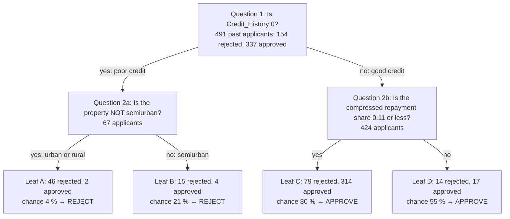

# 05 · Algorithms

> **In short.** An **algorithm** is a precise, step-by-step calculation method. The project tries three well-known methods for turning an applicant's 18 numbers ([04-data-preparation-and-features.md](04-data-preparation-and-features.md)) into a chance of approval between 0 % and 100 %. **Logistic regression** multiplies each number by a learned weight, adds the results into one score, and converts the score into a percentage with a fixed formula. A **decision tree** asks a short series of yes/no questions about the numbers, and each final answer carries a percentage taken from past applicants. A **random forest** builds 300 slightly different decision trees and averages their percentages. If the chance is 50 % or more, the answer is "approved". Logistic regression scored best in the project's self-checks and is the model the app uses. Its biggest weight, by far, is on credit history: having a good credit record multiplies the odds of approval by about 27. This chapter explains each method with real numbers from this project, including a full hand calculation for one real applicant that matches the computer's answer exactly.

Source: [`src/loanwise/ml/pipelines.py`](../src/loanwise/ml/pipelines.py). Numbers come from the saved model `artifacts/models/loan_model.pkl`, which learned from all 614 rows, unless a section says otherwise.

---

## 1. What every method has to do

Each method receives the 18 numbers for one applicant. It must return one number: the **estimated chance (probability) that the applicant is approved**. A probability is written either as a decimal from 0 to 1 or as a percentage: 0.729 and 72.9 % are the same thing.

The app then applies one fixed rule:

```
if the chance is 0.5 (50 %) or more → "approved"
otherwise                           → "rejected"
```

The value 0.5 is called the **threshold**.

Each method has some adjustable numbers inside it. **Training** (also called **learning** or **fitting**) means choosing those internal numbers automatically, so that the method's answers on past applicants match the real answers as closely as possible. Because the method learns from examples whose answers are known, this is called **supervised learning**. Because there are exactly two possible answers, it is called **binary classification**.

Some other settings are *not* learned. A person chooses them before learning starts, for example "how many questions may the tree ask". These are called **hyperparameters**. [06-training-and-evaluation.md](06-training-and-evaluation.md) §4 shows how the project tries several values and keeps the best.

---

## 2. Logistic regression (the method the app uses)

### 2.1 How it calculates a chance

Logistic regression works in two stages.

**Stage 1: a score.** Each of the 18 inputs has a learned **weight** (also called a **coefficient**). The method multiplies each input by its weight, adds the 18 results, and then adds one more learned number called the **intercept** (a starting value). The total is a single score.

- A positive weight means "more of this input raises the score".
- A negative weight means "more of this input lowers the score".
- The bigger the weight, positive or negative, the more that input matters.

**Stage 2: turn the score into a chance.** The score can be any number, from very negative to very positive. A fixed formula, called the **sigmoid** (or **logistic**) function, turns it into a chance between 0 and 1:

```
chance = 1 ÷ (1 + e^(−score))
```

Here `e` is a fixed mathematical constant, about 2.718, and `e^(−score)` means "e raised to the power of minus the score". You never need to work it out by hand. The table shows what the formula gives:

| Score | −4 | −2 | −1 | 0 | +1 | +2 | +4 |
|---|---|---|---|---|---|---|---|
| Chance | 0.018 (1.8 %) | 0.119 | 0.269 | **0.500** | 0.731 | 0.881 | 0.982 (98.2 %) |

So a score of 0 means 50/50, a positive score means more likely approved than not, and a negative score means more likely rejected. Plotted on a graph, the formula makes an S-shaped curve that never quite reaches 0 or 1.

### 2.2 Worked example: applicant LP001002, by hand

This applicant is a man, not married, with 0 dependents, a graduate, salaried, earning ₹5,849 a month. His loan amount was blank and filled in as ₹1,28,000. He chose 360 months, has good credit, and the property is urban. [04-data-preparation-and-features.md](04-data-preparation-and-features.md) §9 turned these answers into 18 numbers. Here they are, with the weights the model learned:

| Input | Applicant's number | × weight | = contribution |
|---|---|---|---|
| Credit_History (rescaled) | +0.4117 | × +1.1570 | **+0.4764** |
| Loan_Amount_Term (rescaled) | +0.2732 | × −0.1933 | −0.0528 |
| Log_EMI_Income_Ratio (rescaled) | −0.2470 | × −0.2184 | +0.0539 |
| Gender_Male | 1 | × −0.0278 | −0.0278 |
| Married_No | 1 | × −0.2009 | −0.2009 |
| Dependents_0 | 1 | × +0.0376 | +0.0376 |
| Education_Graduate | 1 | × +0.1231 | +0.1231 |
| Self_Employed_No | 1 | × +0.0227 | +0.0227 |
| Property_Area_Urban | 1 | × −0.1159 | −0.1159 |
| The other 9 one-hot columns | 0 | × (anything) | 0 |
| **Sum of contributions** | | | **+0.3163** |
| **+ intercept** | | | **+0.6716** |
| **Score** | | | **+0.9879** |

Now turn the score into a chance:

```
e^(−0.9879) = 0.3723
chance = 1 ÷ (1 + 0.3723) = 1 ÷ 1.3723 = 0.7287
```

**The estimated chance of approval is 72.9 %.** That is above 50 %, so the answer is "approved", which matches the real outcome. Asking the saved model the same question in code (`predict_proba`) returns 0.728675, exactly the hand result.

How to read the contributions:

- Good credit (+0.48) and the small repayment share (+0.05) pushed the score **up**.
- Being unmarried (−0.20) and the urban property (−0.12) pushed it **down**.
- Gender (−0.03) and self-employment (+0.02) hardly mattered.

### 2.3 "What if?": same applicant, one answer changed

Every row was computed with the saved model.

| Change (everything else the same) | Chance of approval |
|---|---|
| none | 72.9 % |
| credit history → does not meet the rules | **9.1 %** |
| married → yes | 80.0 % |
| property area → semiurban | 81.7 % |
| property area → rural | 69.6 % |
| gender → female | 74.0 % |
| loan → ₹3,00,000 | 66.7 % |
| loan → ₹10,00,000 | 42.3 % |
| loan → ₹50,00,000 | 2.7 % |

Credit history outweighs every other answer. Note also that marital status alone moves the chance by 7 points. That is a fairness problem ([03-dataset.md](03-dataset.md) §8).

### 2.4 All the learned weights, explained

**Odds** are another way of stating a chance: the chance of "yes" divided by the chance of "no". A chance of 75 % gives odds of 75 ÷ 25 = 3, often said "3 to 1". The score from §2.1 has an exact meaning in terms of odds: **adding 1 to the score multiplies the odds by e ≈ 2.718**. So each weight can be turned into an **odds multiplier** = e^(weight). A multiplier above 1 means this input raises the odds, and below 1 means it lowers them.

The three number inputs were rescaled ([04-data-preparation-and-features.md](04-data-preparation-and-features.md) §7.2), so their weights apply per "one typical spread".

| Input | Weight | Odds multiplier | Meaning |
|---|---|---|---|
| Credit_History | **+1.1570** | 3.18 per spread | The strongest factor. Going from "does not meet" (0) to "meets" (1) is 2.84 spreads, adding 3.29 to the score and **multiplying the odds by about 26.8**. Check with §2.3: odds of 9.1 % are 0.100, odds of 72.9 % are 2.686, and 2.686 ÷ 0.100 ≈ 26.7. |
| Log_EMI_Income_Ratio | −0.2184 | 0.80 | A bigger repayment share lowers the chance. The weight is negative, as the design requires ([04-data-preparation-and-features.md](04-data-preparation-and-features.md) §5). It looks small, but huge loans push this input many spreads above average, which is why the ₹50 lakh request above falls to 2.7 %. |
| Loan_Amount_Term | −0.1933 | 0.82 | Longer terms are slightly penalised directly. The 15 people on 40-year terms were approved only 40 % of the time. |
| Property_Area_Semiurban | +0.3924 | 1.48 | The most favourable area. |
| Property_Area_Rural | −0.2768 | 0.76 | The least favourable area. Semiurban instead of rural multiplies the odds by about 1.95. |
| Property_Area_Urban | −0.1159 | 0.89 | In between. |
| Married_Yes | +0.2007 | 1.22 | Married instead of unmarried multiplies the odds by about 1.49. **A legal and fairness concern.** |
| Married_No | −0.2009 | 0.82 | The mirror image of the row above. |
| Dependents_2 | +0.1912 | 1.21 | Copies the data (75.2 % approval for this group). Probably chance. |
| Dependents_1 | −0.2111 | 0.81 | Copies the data (64.7 %). |
| Dependents_0 | +0.0376 | 1.04 | Close to no effect. |
| Dependents_3+ | −0.0179 | 0.98 | Close to no effect. |
| Education_Graduate | +0.1231 | 1.13 | Graduate instead of not multiplies the odds by about 1.28. |
| Education_Not Graduate | −0.1234 | 0.88 | |
| Gender_Female | +0.0276 | 1.03 | Very small. With every other answer fixed, the model very slightly *favours* women, even though women's raw approval rate is lower. The raw gap is explained by other answers, such as marital status. |
| Gender_Male | −0.0278 | 0.97 | |
| Self_Employed_No | +0.0227 | 1.02 | Almost no effect, matching the data (68.6 % vs 68.3 %). |
| Self_Employed_Yes | −0.0229 | 0.98 | |
| *(intercept)* | +0.6716 | | The starting score before any input is added. |

### 2.5 How the weights are learned

Learning means finding the 19 numbers (18 weights + 1 intercept) that make the model's chances agree best with what really happened to the 614 past applicants.

"Agree best" needs a measure. For each past applicant, the method computes a **penalty**, called the **log-loss**:

- If the person was really **approved**, the penalty is `−ln(chance given to approval)`.
- If the person was really **rejected**, the penalty is `−ln(chance given to rejection)`.

(`ln` is the natural logarithm.) Worked numbers for an approved person:

| Chance the model gave to "approved" | Penalty |
|---|---|
| 0.9 (confident and right) | 0.105 |
| 0.5 (unsure) | 0.693 |
| 0.1 (confident and wrong) | 2.303 |

Being confidently wrong is punished heavily. The method adds up the penalties of all the applicants and adjusts the weights, step by step, until that total cannot be made any smaller. For logistic regression there is only one best set of weights, so the method always finds the same answer.

**Holding the weights back ("regularisation").** With only 614 rows, the method could give large weights to patterns that happen by chance, as in [04-data-preparation-and-features.md](04-data-preparation-and-features.md) §6. To discourage this, an extra penalty is added that grows with the size of the weights (specifically, the sum of the squared weights). A large weight must now "earn its place" by reducing the log-loss by more than it adds to this extra penalty. This is called **regularisation**. This particular kind, based on squared weights, is called **L2 regularisation**.

**The setting `C`.** How strongly the weights are held back is set by a hyperparameter called `C`. **A smaller C holds them back more.** The project tried four values:

| C | Score in self-checks (share of correct answers) |
|---|---|
| 0.01 | 0.7962 |
| **0.1** | **0.7983** |
| 1.0 | 0.7983 |
| 10.0 | 0.7983 |

Three values tie. On this data the yes/no answers barely change with C: every C reproduces "approve unless credit history is 0" on all 123 test rows, and on 489 to 491 of the 491 learning rows. C mainly changes how confident the chances are. On the test rows the chances range from 31 % to 78 % at C = 0.01, from 6 % to 89 % at C = 0.1, and from 2 % to 94 % at C = 10. When values tie, the search keeps the first in its list, so **C = 0.1**, the most cautious of the tied values, was kept.

### For the technically curious

- `LogisticRegression(max_iter=2000)`, solver `lbfgs` (a quasi-Newton optimiser), `C` searched over `[0.01, 0.1, 1.0, 10.0]`.
- Model: `p = σ(z)`, `z = b + w·x`, `σ(z) = 1/(1 + e^(−z))`. Equivalently `ln(p/(1−p)) = z`, so `z` is the **log-odds** or **logit**.
- Objective: `C · Σ_i [−y_i ln p_i − (1−y_i) ln(1−p_i)] + ½‖w‖²`. The intercept is not penalised. It is convex, so there is a unique minimum. Minimising log-loss is maximum-likelihood estimation.
- In scikit-learn 1.9.1 the penalty type is set by `l1_ratio` (default `0.0` = pure L2). The `penalty` parameter shows as `"deprecated"` in the saved model's parameters.
- With every one-hot column kept, L2 picks the minimum-norm solution, which splits each group's effect symmetrically (Married_Yes +0.2007, Married_No −0.2009).
- Inputs are standardised because the L2 penalty treats all coefficients alike.

### 2.6 How "importance" is reported for this model, and its catch

The app's "How it works" page and [docs/MODEL_CARD.md](../docs/MODEL_CARD.md) show a ranking of the most important factors. For logistic regression it is computed like this ([`feature_importance`](../src/loanwise/ml/evaluation.py)):

1. Take the size of each weight, ignoring its sign.
2. Add the sizes together for the columns that came from the same original question. For example, Property Area = 0.277 + 0.392 + 0.116 = 0.785.
3. Keep the top 8, and divide by their total so they add up to 1.

| Factor | Sum of weight sizes | Reported share |
|---|---|---|
| Credit History | 1.157 | 0.329 |
| Property Area | 0.785 | 0.223 |
| Number of Dependents | 0.458 | 0.130 |
| Marital Status | 0.402 | 0.114 |
| Education | 0.247 | 0.070 |
| EMI-to-Income Ratio | 0.218 | 0.062 |
| Loan Term | 0.193 | 0.055 |
| Gender | 0.055 | 0.016 |

**The catch.** Questions with several answers get several columns, and all of their weights are added up. Even a yes/no question counts twice, because its two mirror-image weights are both added. Number inputs count once. So this method inflates word questions. "Property area is the second most important factor" is partly an artefact of the bookkeeping. Self-employment (0.046) falls just outside the top 8.

For the technically curious: permutation importance, or the spread of per-applicant log-odds contributions, would be a fairer measure.

### 2.7 Strengths and weaknesses

| Strengths | Weaknesses |
|---|---|
| Every answer can be checked by hand, as in §2.2 | Each input adds its effect separately. It cannot learn rules like "a long term only hurts when income is low" unless such a combination is built as an extra input. |
| Learning always gives the same answer, quickly | Easily misled when inputs rise and fall together ([04-data-preparation-and-features.md](04-data-preparation-and-features.md) §6) |
| The direction of each input's effect is visible in the sign of its weight | Copies every pattern in the data, including the marital-status gap |
| Its chances are often reasonably realistic (not checked in this project) | Extreme inputs give extreme chances |

---

## 3. Decision tree

### 3.1 How it calculates a chance

A decision tree is a fixed list of yes/no questions arranged so that each answer leads either to another question or to a final box. Each question compares one input with a cut-off value. Each final box, called a **leaf**, holds the approval rate of the past applicants who ended up in it. That rate is the chance given to a new applicant who lands there.

This is the actual tree the project learned (from the 491 learning rows, with the best settings found):



(A compressed share of 0.11 is a repayment of about 11.6 % of income, using the interest-free repayment from [04-data-preparation-and-features.md](04-data-preparation-and-features.md) §5.)

**Worked example: applicant LP001002 through the tree.**

1. Question 1: is credit history 0? No, it is 1. Go right.
2. Question 2b: is the compressed share 0.11 or less? His is 0.059. Yes.
3. He lands in **Leaf C**: 314 of the 393 past applicants there were approved. 314 ÷ 393 = **0.799**, an 80 % chance. Answer: approved.

**What the tree reveals.** Both good-credit leaves say "approve" and both poor-credit leaves say "reject". The second-level questions only change the percentage, never the decision. In practice, **this tree's decisions come down to credit history alone**.

A tree can only give as many different chances as it has leaves: 4 here. Its chances are therefore coarse.

### 3.2 How the tree chooses its questions

The tree is built from the top down, one question at a time:

1. Start with all 491 learning applicants in one group.
2. Try every input and every possible cut-off. For each, split the group in two.
3. Measure how **mixed** each half is (how much approved and rejected people are mixed together). Keep the question that leaves the two halves least mixed.
4. Repeat inside each half, until a stopping rule is reached (§3.3).

**How "mixed" is measured: the Gini impurity.** For a group,

```
Gini = 1 − (share approved)² − (share rejected)²
```

A group of all-approved people has Gini 1 − 1² − 0² = **0** (not mixed at all). A 50/50 group has Gini 1 − 0.25 − 0.25 = **0.5** (as mixed as possible).

**Worked numbers for Question 1:**

```
Before the question: 154 rejected, 337 approved (491 people)
  Gini = 1 − (154/491)² − (337/491)²  = 0.4305

"Credit history is 0":  61 rejected,   6 approved (67 people)
  Gini = 1 − (61/67)² − (6/67)²       = 0.1631

"Credit history is 1":  93 rejected, 331 approved (424 people)
  Gini = 1 − (93/424)² − (331/424)²   = 0.3425

Average after the question, weighted by group size:
  (67 × 0.1631 + 424 × 0.3425) ÷ 491  = 0.3180

Reduction in mixing: 0.4305 − 0.3180   = 0.1126
```

No other input and cut-off reduced the mixing by more, so this question comes first.

### 3.3 Why the tree is kept small

If the tree were allowed to keep asking questions, it would eventually put every past applicant in a leaf of their own and get every past answer right. It would then be memorising chance details of these 491 people, and would do *worse* on new people. Fitting the past examples so closely that the method does worse on new ones is called **overfitting**.

Two hyperparameters prevent it:

- **Maximum depth:** the most questions allowed on any path from top to leaf.
- **Minimum leaf size:** every leaf must contain at least this many past applicants, so no rule is based on just one or two people.

The project tried depths 2, 3, 4 and 6, and minimum leaf sizes 5, 10 and 20 (12 combinations). The deepest trees did worst in self-checks: depth 6 with leaf size 5 scored 0.7738. Five combinations tied for best at 0.7840. The first of them, **depth 2, minimum leaf size 10**, was kept. That is the small tree shown above.

### 3.4 Forcing the right direction ("monotonic constraints")

A tree has no weights, so nothing guarantees by itself that, for example, a bigger repayment share is never treated as better. So the project gives the tree two rules while it is being built:

- **Credit history: chances may only go up (or stay level) as it goes from 0 to 1.**
- **Repayment share: chances may only go down (or stay level) as it rises.**
- All other inputs: no rule.

Any candidate question that would break these rules is simply not allowed. The cost is that the tree may miss a slightly better question. The benefit is that the sensible direction is guaranteed.

### For the technically curious

- `DecisionTreeClassifier(random_state=42, monotonic_cst=constraints)`, CART with `criterion="gini"`. Grid: `max_depth ∈ {2, 3, 4, 6}`, `min_samples_leaf ∈ {5, 10, 20}`. `GridSearchCV` keeps the first-ranked combination.
- `monotonic_cst` (scikit-learn ≥ 1.4) is one integer per input column, matched by position: `[+1, 0, −1, 0 × 15]` for `[Credit_History, Loan_Amount_Term, Log_EMI_Income_Ratio, one-hot…]`, built by [`monotonic_constraints`](../src/loanwise/ml/pipelines.py). Splits that violate a constraint are rejected, and value bounds propagate to descendants.
- Impurity-based importances of this tree: Credit_History 0.926, Log_EMI_Income_Ratio 0.060, Property_Area_Semiurban 0.013, everything else 0.
- `predict_proba` = class fractions in the leaf. No scaling is used (`passthrough`), so cut-offs stay in real units.

### 3.5 Strengths and weaknesses

| Strengths | Weaknesses |
|---|---|
| Readable as plain rules | A few changed rows can change the whole tree |
| Can learn combinations and cut-offs directly | Coarse chances: only one value per leaf |
| No rescaling needed | Overfits unless kept small |
| Direction rules can be enforced | A single small tree is usually less accurate than many trees combined |

---

## 4. Random forest

### 4.1 How it calculates a chance

A random forest builds **300 decision trees** and averages their answers. To make the trees differ from each other, two kinds of randomness are used while building them:

1. **Each tree learns from a different random sample of the 491 applicants.** The sample is drawn **with replacement**: 491 draws, where each draw can pick any applicant, including one already picked. So some applicants appear twice or more and others not at all. On average, each tree sees about 63 % of the different applicants. This kind of sample is called a **bootstrap sample**.
2. **At every question, a tree may consider only a random 4 of the 18 inputs.** So not every tree can start with credit history, and other inputs get a chance to be used.

To score an applicant, each of the 300 trees gives its own leaf chance, and the forest returns **the average of the 300 chances**.

**Worked example: applicant LP001002.** These are the real chances from the first six trees of the forest learned on the 491 learning rows:

```
Tree 1: 0.777   Tree 2: 0.742   Tree 3: 0.806   Tree 4: 0.634   Tree 5: 0.716   Tree 6: 0.714   …
```

Across all 300 trees, the lowest is 0.323 and the highest 0.888. Their average is **0.701**, a 70.1 % chance, which is what the forest reports. Answer: approved.

Individual trees disagree a lot, from 32 % to 89 %. Each one depends on its own random sample. Averaging cancels much of that variation, which is why a forest is usually more reliable than any single tree.

### 4.2 Settings used

- **300 trees.**
- Each tree uses the same two **direction rules** as the single tree (§3.4). The average of trees that all respect a direction also respects it.
- The project tried maximum depths 4, 6 and 8 with minimum leaf sizes 3, 5 and 10 (9 combinations). Three tied at 0.7962. The first, **depth 4, minimum leaf size 5**, was kept. The learned trees have 4 levels and about 11 leaves each, on average.
- The random choices are fixed by a **seed** (`random_state=42`): a starting number for the computer's random-number generator. With the same seed the same "random" choices happen every time, so results can be repeated exactly.

How much the forest relies on each input, averaged over its trees: credit history 0.519, repayment share 0.108, semiurban 0.064, term 0.046, rural 0.041, and 0.03 or less for each other column. Because each question may only look at 4 random inputs, the forest spreads its attention more widely than the single tree, which relied on credit history for 0.926.

### For the technically curious

`RandomForestClassifier(n_estimators=300, random_state=42, monotonic_cst=constraints, n_jobs=-1)`. Defaults: `bootstrap=True`, `max_features="sqrt"` (√18 → 4), `criterion="gini"`. Grid: `max_depth ∈ {4, 6, 8}`, `min_samples_leaf ∈ {3, 5, 10}`. `predict_proba` averages per-tree class probabilities (soft voting), not hard votes. Bagging reduces variance. Feature subsampling decorrelates the trees, which makes the averaging more effective. Impurity-based importances are biased towards features with many possible split points.

### 4.3 Strengths and weaknesses

| Strengths | Weaknesses |
|---|---|
| Usually the most accurate of the three on tables like this | 300 trees cannot be read as one set of rules |
| Much more stable than one tree | Bigger file, slower (still a few milliseconds here) |
| Smoother chances than one tree | Little to gain when one input dominates, as here |

---

## 5. The three methods side by side

| | Logistic regression | Decision tree | Random forest |
|---|---|---|---|
| How a chance is made | Weighted sum → sigmoid formula | Leaf approval rate after yes/no questions | Average of 300 trees' leaf rates |
| How it learns | Adjusts weights to minimise total log-loss plus a size penalty | Picks the question that reduces mixing most, then repeats | Same as the tree, on 300 random samples with random input choices |
| Chance for LP001002 (learned on the 491 learning rows) | 0.715 | 0.799 | 0.701 |
| Settings tried | C = 0.01, 0.1, 1, 10 | depth 2, 3, 4, 6 × leaf size 5, 10, 20 | depth 4, 6, 8 × leaf size 3, 5, 10 |
| Best setting | C = 0.1 | depth 2, leaf size 10 | depth 4, leaf size 5 |
| Self-check score (average ± spread across checks) | **0.7983 ± 0.0457** | 0.7840 ± 0.0461 | 0.7962 ± 0.0436 |
| Direction guaranteed by | The sign of the learned weight (then checked) | Built-in direction rules | Built-in direction rules on every tree |
| Used by the app? | **Yes** (relearned on all 614 rows, giving 0.729 for LP001002) | No | No |

How the self-check works, and why logistic regression was chosen, is explained in [06-training-and-evaluation.md](06-training-and-evaluation.md).

---

**Next →** [06 · Training and Evaluation](06-training-and-evaluation.md)

[← Back to index](README.md)
