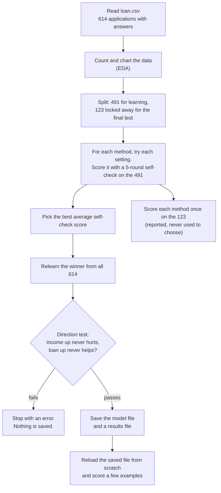

# 06 · Training and Evaluation

> **In short.** **Training** means letting each method ([05-algorithms.md](05-algorithms.md)) learn its internal numbers from past applications. **Evaluation** means measuring how often it is right on applications it has *not* learned from. The project does both in one fixed procedure, started with `python3 scripts/train_model.py`. First, it sets aside 123 of the 614 applications as a final test and does not touch them. With the other 491, it tries several settings for each of the three methods. It scores every attempt with a five-round self-check, in which each round holds back a different fifth of the 491. It picks the method and setting with the best average self-check score (logistic regression, 79.8 % correct), then measures it once on the 123 untouched rows: 85.4 % correct, against 69.1 % for simply approving everybody. It then relearns the winner from all 614 rows, tests that more income never lowers the chance and a bigger loan never raises it (and refuses to save the model if either fails), saves it, and reloads it as a final check. All three methods give exactly the same 123 answers: approve if, and only if, credit history is not "does not meet the rules". This tells us credit history decides almost everything in this data.

Source: [`src/loanwise/ml/train.py`](../src/loanwise/ml/train.py), [`src/loanwise/ml/evaluation.py`](../src/loanwise/ml/evaluation.py), [`src/loanwise/ml/sanity.py`](../src/loanwise/ml/sanity.py).

---

## 1. The whole procedure



| Step | In the code | What happens |
|---|---|---|
| 1 | `load_training_data` | Reads the 614 rows. The 11 answers become the inputs. `Loan_Status` becomes the target: 1 for `Y` (approved), 0 for `N`. |
| 2 | `_run_eda` | Prints counts and approval rates and saves 4 charts ([03-dataset.md](03-dataset.md)). |
| 3 | `evaluate_models` | Splits the data, tries settings with the self-check, scores the 123 test rows, and computes the do-nothing baseline. |
| 4 | `choose_model` | Applies the choosing rule (§5). |
| 5 | `final_pipe.fit(data.X, data.y)` | Relearns the winner from all 614 rows. |
| 6 | `_verify_monotonicity` | Runs the direction test (§8). On failure, the program stops. |
| 7 | `_save_model`, `_save_model_info` | Writes `loan_model.pkl` and `model_info.json` (§9). |
| 8 | `_sanity_check` | Loads the saved file in a fresh copy of Python and scores examples. |

---

## 2. Step 1: lock away a test set

**The idea.** A method that has seen an applicant's answer during learning can "remember" it. Scoring the method on applicants it learned from therefore makes it look better than it really is. The only honest measure is to score it on applicants it has never seen.

So, before anything is learned, the project takes **20 % of the rows (123) and locks them away**. These are called the **test set** (or **hold-out set**). The remaining **491 rows** are the **training set**: the only rows used for learning and for choosing settings.

The first five test rows, for example, are `LP001528`, `LP002804`, `LP002945`, `LP001784` and `LP001514`. No method sees their answers until the very end.

**Keeping the mix the same ("stratified").** The split is arranged so that both parts keep the same share of approvals as the whole dataset:

| Part | Rows | Approved | Rejected | Share approved |
|---|---|---|---|---|
| All | 614 | 422 | 192 | 68.7 % |
| Training | 491 | 337 | 154 | 68.6 % |
| Test | 123 | 85 | 38 | 69.1 % |

Without this, chance alone could put, say, 50 rejections in the test set instead of 38, and every score would shift for reasons that have nothing to do with the method.

**Repeatable.** The rows are shuffled randomly before splitting. The shuffle is controlled by a fixed **seed** (`random_state=42`), a starting number for the random-number generator. With the same seed the same shuffle happens every time, so anyone re-running the program gets exactly the same split and the same results. The number 42 is a programmers' convention. It has no special meaning.

### For the technically curious

`train_test_split(X, y, test_size=0.2, stratify=y, random_state=42)`. The same `RANDOM_STATE = 42` also seeds the cross-validation shuffle, the Decision Tree and the Random Forest ([`pipelines.py`](../src/loanwise/ml/pipelines.py)).

---

## 3. Step 2: the five-round self-check ("5-fold cross-validation")

**The problem.** To choose between settings, for example a tree with 2 questions versus 6, each setting needs a score. The test set must not be used for this (§5 explains why). Holding back a single small slice of the 491 would give a noisy score, depending on which rows happened to land in it.

**The method.** The 491 training rows are shuffled and dealt into **5 groups of about 98 rows**, called **folds**. Each fold keeps the ~69 % approval mix. Then there are 5 rounds:

- in each round, one fold is held back for checking, and the method learns from the other four;
- the method answers for the held-back fold, and the share it gets right is recorded;
- the next round holds back the next fold.

After 5 rounds, every one of the 491 rows has been checked exactly once, each time by a version of the method that never saw it. The **average of the 5 scores** is the self-check score. This procedure is called **cross-validation**, and with 5 folds, **5-fold cross-validation**.

**Which rows are used when.** Here are four real applicants from each fold:

| Fold | Example applicants in this fold | Rows in fold | Approved in fold |
|---|---|---|---|
| 1 | LP001535, LP002443, LP001894, LP001245, … | 99 | 68 |
| 2 | LP002928, LP002301, LP001552, LP001882, … | 98 | 68 |
| 3 | LP001792, LP002517, LP001643, LP001256, … | 98 | 67 |
| 4 | LP001350, LP001273, LP001488, LP001421, … | 98 | 67 |
| 5 | LP001884, LP001114, LP001608, LP002050, … | 98 | 67 |

| Round | Learns from | Checked on | Learning rows | Checking rows |
|---|---|---|---|---|
| 1 | folds 2, 3, 4, 5 | fold 1 | 392 | 99 |
| 2 | folds 1, 3, 4, 5 | fold 2 | 393 | 98 |
| 3 | folds 1, 2, 4, 5 | fold 3 | 393 | 98 |
| 4 | folds 1, 2, 3, 5 | fold 4 | 393 | 98 |
| 5 | folds 1, 2, 3, 4 | fold 5 | 393 | 98 |

So `LP001535` is checked in round 1 and helps the method learn in rounds 2 to 5.

**Everything is relearned in every round.** That includes the blank-filling values and the rescaling averages ([04-data-preparation-and-features.md](04-data-preparation-and-features.md) §8). In round 1, for example, the median income used to fill blanks comes only from folds 2 to 5. The checked rows never influence their own scores.

**Real round scores for the chosen method** (logistic regression, C = 0.1), as the share of correct answers:

| Round 1 | Round 2 | Round 3 | Round 4 | Round 5 | **Average** |
|---|---|---|---|---|---|
| 0.8485 | 0.7959 | 0.8265 | 0.7143 | 0.8061 | **0.7983** |

The rounds range from 71.4 % to 84.9 %. That 13-point range comes purely from *which* ~98 applicants land in a fold. The usual measure of this spread, the **standard deviation**, is **0.0457**: scores typically sit about 4.6 points from their average. Keep this in mind whenever two methods differ by a fraction of a point.

### For the technically curious

`StratifiedKFold(n_splits=5, shuffle=True, random_state=42)`. The whole `Pipeline` is cloned and refit per fold, so the imputers and the scaler are fit on the training folds only, with no leakage.

---

## 4. Step 3: trying the settings ("grid search")

Each method has hyperparameters: settings chosen before learning ([05-algorithms.md](05-algorithms.md) §1). The project lists a few values for each and tries **every combination**. Each combination gets the 5-round self-check. A full list of combinations tried this way is called a **grid**, and the process is called **grid search**.

| Method | Values tried | Combinations | Total learning runs (× 5 rounds) | Best setting | Best average self-check |
|---|---|---|---|---|---|
| Logistic regression | C: 0.01, 0.1, 1, 10 | 4 | 20 | C = 0.1 | 0.7983 |
| Decision tree | max depth: 2, 3, 4, 6 × min leaf size: 5, 10, 20 | 12 | 60 | depth 2, leaf 10 | 0.7840 |
| Random forest | max depth: 4, 6, 8 × min leaf size: 3, 5, 10 | 9 | 45 (each 300 trees) | depth 4, leaf 5 | 0.7962 |

When several settings tie, the first one in the list is kept. That happened for all three methods ([05-algorithms.md](05-algorithms.md)). The best setting of each method is then relearned on all 491 training rows.

The values tried are deliberately cautious: few questions, large leaves, strong holding-back of weights. With only 491 rows, a big search would mostly find settings that happen to suit the particular folds.

### For the technically curious

`GridSearchCV(pipeline, param_grid, cv=cv, scoring="accuracy", n_jobs=-1)`. Afterwards, `cross_val_score(best, …)` re-runs the same folds to record the per-fold scores stored as `cv_accuracy_mean` and `cv_accuracy_std`.

---

## 5. Step 4: choosing the winner, without peeking at the test set

**The rule, word for word from the code:**

> Highest mean 5-fold CV accuracy on the training split (hold-out test set is used only for reporting); ties within 0.001 go to the lower CV std.

In plain words: pick the method with the best average self-check score. If two are within 0.1 percentage points of each other, pick the one whose 5 round scores were more consistent.

**Why the test set is never used to choose.** Choosing is itself a form of learning. Suppose we picked whichever method scored best on the 123 test rows. With only 123 rows, one applicant is worth 0.8 points, so the "winner" could simply be whichever method got lucky on those rows. Its test score would then overstate how it does on new people, because the test set would have been used to pick it. Letting the test set influence any choice is called **test-set leakage**. Because it is kept out of every decision, the test score remains an honest preview.

**What happened:**

| Method | Average self-check | Gap to best |
|---|---|---|
| **Logistic regression** | **0.7983** | — |
| Random forest | 0.7962 | 0.0021 |
| Decision tree | 0.7840 | 0.0143 |

The random forest is 0.0021 behind, more than the 0.001 tie margin, so **logistic regression wins outright**.

**An honest note.** A 0.2-point lead is tiny next to the 4.6-point spread between rounds. Logistic regression and the random forest are, in truth, equally good on this data. In that situation, preferring the simplest, most explainable method is sensible, and that is the outcome here.

### For the technically curious

```python
best_cv    = max(m["cv_accuracy_mean"] for m in metrics)
contenders = [m for m in metrics if best_cv - m["cv_accuracy_mean"] <= 0.001]
chosen     = min(contenders, key=lambda m: m["cv_accuracy_std"])["name"]
```

The tie rule is unit-tested in `tests/unit/test_features.py` (`test_selection_rule_prefers_lower_std_on_ties`).

---

## 6. Measuring the results on the test set

### 6.1 The four possible outcomes ("confusion matrix")

Every one of the 123 test applicants lands in one of four boxes, comparing the method's answer with what really happened. Here "positive" means *approved*. A table of these four counts is called a **confusion matrix**.

|  | Method said **reject** | Method said **approve** |
|---|---|---|
| **Really rejected (38 people)** | **21**: correctly rejected ("true negative") | **17**: approved, but really rejected ("false positive") |
| **Really approved (85 people)** | **1**: rejected, but really approved ("false negative") | **84**: correctly approved ("true positive") |

These are the real counts for logistic regression, learned from the 491 training rows and scored on the 123 test rows. The other two methods produce exactly the same table (§7).

### 6.2 Four scores, all calculated from that table

**Accuracy: what share of all answers were right?**

```
(84 + 21) ÷ 123 = 105 ÷ 123 = 0.8537   → 85.4 % correct
```

**Precision: when the method says "approve", how often is that right?**

```
84 ÷ (84 + 17) = 84 ÷ 101 = 0.8317   → 83.2 % of its approvals were real approvals
```

**Recall: of the people who really were approved, how many did the method approve?**

```
84 ÷ (84 + 1) = 84 ÷ 85 = 0.9882   → it found 98.8 % of them
```

**F1 score: one number that combines precision and recall.** It is high only when both are high:

```
2 × precision × recall ÷ (precision + recall)
= 2 × 0.8317 × 0.9882 ÷ (0.8317 + 0.9882) = 0.9032
```

**One more useful number** (not stored in the results file): of the people who really were rejected, how many did the method reject? 21 ÷ 38 = **0.553**. This is called **specificity**.

**What the four scores say together.** The method almost never wrongly rejects: only 1 person out of 85. But it approves **17 of the 38 people who were really rejected**. It is lenient. Those 17 all had good credit and were rejected for reasons the dataset does not record.

### 6.3 The do-nothing comparison ("baseline")

Suppose you approved all 123 test applicants without looking at anything:

```
accuracy = 85 ÷ 123 = 0.6911   precision = 0.6911   recall = 1.0   F1 = 0.817
```

This is the **baseline**: the score of not using a model at all. A model must beat it to be worth anything. Logistic regression's accuracy of 0.854 is **16.3 points above the baseline**. All of that gain comes from correctly rejecting 21 people with poor credit. Training prints this baseline next to the results for exactly this reason. "85 % correct" means much less once you know that 69 % comes for free.

### 6.4 The results table

These numbers are stored in `artifacts/models/model_info.json`:

| Method | Average self-check (± spread), 491 rows | Test accuracy | Precision | Recall | F1 |
|---|---|---|---|---|---|
| **Logistic regression (chosen)** | **0.7983 ± 0.0457** | 0.8537 | 0.8317 | 0.9882 | 0.9032 |
| Random forest | 0.7962 ± 0.0436 | 0.8537 | 0.8317 | 0.9882 | 0.9032 |
| Decision tree | 0.7840 ± 0.0461 | 0.8537 | 0.8317 | 0.9882 | 0.9032 |
| Baseline (approve everyone) | — | 0.6911 | 0.6911 | 1.0000 | 0.817 |

The file also records: 614 rows, 422 approved, 192 rejected.

**Why is the test score (85.4 %) higher than the self-check (79.8 %)?** Mostly luck. The 123 test rows happen to contain relatively few "good credit but rejected" people: 17 of the 94 with good credit. Remember that individual self-check rounds ranged from 71.4 % to 84.9 %. **About 80 % is the realistic expectation.** The 85.4 % is one favourable draw.

**Which model do these numbers belong to?** The test scores belong to the versions that learned from the 491 training rows. The model the app actually uses was then **relearned from all 614 rows**, test rows included, so there is no untouched test score for it. This is normal practice: use the split to choose and to estimate, then use every row for the final model. But it should be said clearly. For reference, the final model is right on 80.9 % of its own 614 learning rows. That is an optimistic figure, since it has seen those answers. It rejects all 89 poor-credit applicants, and only 2 of the 525 with good or blank credit. Both of those two chose very short terms (36 and 12 months), which makes their monthly repayment share large.

---

## 7. Why all three methods gave identical answers

The three methods do not just have the same scores. They give **the same answer for every one of the 123 test applicants**. Grouping the test applicants by credit history shows why:

| Test applicants with Credit_History… | People | Method said approve | Method said reject | Really approved |
|---|---|---|---|---|
| 1 (meets the rules) | 94 | 94 | 0 | 77 |
| 0 (does not) | 22 | 0 | 22 | 1 |
| blank (filled in as 1) | 7 | 7 | 0 | 7 |

Every method has, in effect, learned one rule: **approve if, and only if, credit history is not 0**.

- The decision tree asks about credit history first, and its later questions never change the decision ([05-algorithms.md](05-algorithms.md) §3.1).
- In logistic regression, credit history moves the score by about 3.3. All the other inputs together rarely move it by more than about 1, so they almost never flip the answer.
- The random forest's 300 trees average out to the same thing.

**What this means:**

1. **Credit history decides almost everything in this dataset.** The other ten answers mostly change the *percentage* (which the app shows as confidence and uses for explanations), not the yes/no decision.
2. **The choice of method hardly matters here.** The ranking between them comes down to self-check noise. More data or more informative inputs, not a cleverer method, would be needed to tell them apart.
3. **The 17 wrongly approved people cannot be fixed by tuning.** The data contains nothing that explains why they were rejected.
4. **A one-line rule would be just as accurate.** Say so openly. What the model adds is a graded percentage that responds sensibly to affordability, and explanations. Combined with the app's fixed safety rules ([07-validation-and-guardrails.md](07-validation-and-guardrails.md)), that percentage stops absurd requests being approved just because credit is good.

---

## 8. The direction test ("monotonicity check")

### 8.1 What it tests

Three made-up applicants are used as starting points:

| Starting applicant | Description |
|---|---|
| 1 | Man, married, 0 dependents, graduate, salaried, ₹5,000 + ₹1,500 a month, loan ₹1,30,000 over 360 months, good credit, semiurban |
| 2 | Woman, unmarried, 2 dependents, not graduate, self-employed, ₹2,500 + ₹0, loan ₹2,00,000 over 180 months, **poor credit**, rural |
| 3 | Man, unmarried, 3+ dependents, graduate, salaried, ₹12,000 + ₹4,000, loan ₹60,000 over 84 months, good credit, urban |

For each one, the test changes a single thing in 60 steps across a huge range and records the chance at each step:

| Change | Range (60 steps, each a fixed multiple of the last) | Rule |
|---|---|---|
| Applicant income up | ₹1,000 → ₹1,00,00,000 (₹1 crore) a month | the chance must never fall |
| Second earner's income up | same | the chance must never fall |
| Both incomes up together | same | the chance must never fall |
| Loan amount up | ₹10,000 → ₹1 crore | the chance must never rise |

That is 3 applicants × 4 changes = **12 tests**. Between any two neighbouring steps, the chance may move only in the allowed direction. (A difference smaller than 0.000000001 is ignored, because computers round very slightly.)

### 8.2 Results for the saved model: all 12 pass

| Starting applicant | Change | Chance at first step → last step |
|---|---|---|
| 1 | applicant income up | 83.2 % → 89.4 % |
| 1 | second income up | 87.0 % → 89.4 % |
| 1 | both incomes up | 81.4 % → 89.4 % |
| 1 | loan up | 89.2 % → 1.2 % |
| 2 | applicant income up | 0.9 % → 14.6 % |
| 2 | second income up | 5.4 % → 14.6 % |
| 2 | both incomes up | 2.9 % → 14.6 % |
| 2 | loan up | 13.5 % → 0.001 % |
| 3 | applicant income up | 81.3 % → 88.0 % |
| 3 | second income up | 85.6 % → 88.0 % |
| 3 | both incomes up | 68.8 % → 88.0 % |
| 3 | loan up | 87.7 % → 0.2 % |

Two things are worth noticing. With poor credit (applicant 2), even ₹1 crore a month lifts the chance only to about 15 %. And income stops helping beyond a point, because the repayment share approaches zero and cannot fall further. The other two methods, in their 491-row versions, also pass all 12 tests.

### 8.3 Why it exists, and why it stops the program

The accuracy scores **cannot** catch the "more income means less chance" fault ([04-data-preparation-and-features.md](04-data-preparation-and-features.md) §6). A model with that fault can still be about 80 % correct, because very few applicants earn enough to trigger it. So the project tests the *behaviour* directly, over a range far wider than the data, because a user or a regulator would find any wrong-way movement indefensible.

If any test fails, the program stops with an error (`MonotonicityError`) that lists every failure. This happens **before** saving, so **no model file and no results file are written**, and the previous, good model stays in place. A faulty model cannot be released by accident. The same test runs in the project's automatic test suite against the saved model (`tests/unit/test_features.py`, `test_saved_model_is_monotonic`).

What it does **not** test: the term in months, the word answers, and several changes at once. None of those have direction rules.

---

## 9. What training writes to disk

| File | Contents | Used by |
|---|---|---|
| `artifacts/models/loan_model.pkl` | The complete saved pipeline: tidy → fill blanks → new facts → numbers → model. (".pkl" is Python's format for saving an object to a file.) | The app's server, which reloads it automatically whenever the file changes ([08-backend.md](08-backend.md)) |
| `artifacts/models/model_info.json` | The chosen method, the choosing rule, every method's scores, the top-8 factor ranking and how it was computed, the row counts, and the training date and time (UTC). (".json" is a plain-text format for structured data.) | The app's `/api/model-info` address and its "How it works" page ([09-frontend.md](09-frontend.md)) |
| `artifacts/reports/eda/*.png` | The four charts | These docs and the model card |

The saved model file refers to code in `loanwise.ml.features` by name. Moving or renaming that code, or changing the version of the scikit-learn library (pinned at 1.9.1), means you must retrain.

**The final reload check.** After saving, a brand-new copy of Python loads the saved file, exactly as the app does, and scores four made-up applicants and the first five rows of `test.csv`. Current results: good profile 88.1 %, same with poor credit 21.7 %, every field blank 86.5 %, income ₹90 lakh a month 89.4 %. This proves the file works on its own. It runs *after* saving, so if it fails, the new file is already on disk and must be investigated before the app serves it.

### For the technically curious

The model is written with `joblib.dump`. The sanity check is `subprocess.run([sys.executable, "-m", "loanwise.ml.sanity", model, sample], check=True)`, with `PYTHONPATH` set to the package's parent directory.

---

## 10. How to retrain, and what to check afterwards

Run one of these from the project folder:

```bash
python3 scripts/train_model.py     # or: make train      or: loanwise-train (after pip install -e .)
./run.sh --retrain                 # retrain, then start the app (on Windows: run.bat --retrain)
```

`./run.sh` also trains automatically if no saved model exists yet. Training takes about a minute, mostly for the random forest. File locations can be changed with settings such as `LOANWISE_TRAIN_DATA_PATH` and `LOANWISE_MODEL_PATH` ([`src/loanwise/config.py`](../src/loanwise/config.py)).

**Checklist after retraining:**

1. The output ends with the **SANITY CHECK** section, and shows `Monotonicity check PASSED` for every method.
2. In the comparison table, self-check averages are around 0.78 to 0.80, and every method is above the printed baseline (about 0.69). With the same data and seed, the numbers must match §6.4 exactly. If they don't, something changed: the data, a library version, or the code.
3. `model_info.json` shows the expected chosen method, training time and row counts.
4. The reload check looks sensible: the good profile scores high and the poor-credit profile clearly lower.
5. The automatic tests pass: `python3 -m unittest discover -s tests -t .`
6. [docs/MODEL_CARD.md](../docs/MODEL_CARD.md) is updated if any number changed. It is written by hand.
7. A running app picks up the new model without a restart.

---

## 11. Honest limitations, and what a professional team would do next

| Limitation | Why it matters | What a production team would do |
|---|---|---|
| **614 rows from one old public source** | Scores swing by about ±4.6 points; extremes are barely covered; the population is unknown | Learn from the lender's own recent applications, ideally recording whether loans were *repaid*, not just approved |
| **Gender and marital status are inputs**; dependents and area may act as stand-ins | Legal and fairness risk ([03-dataset.md](03-dataset.md) §8) | Remove them and retrain; run a **fairness audit**, i.e. compare approval rates and error rates across groups; get legal review |
| **One input decides almost everything** | Poor at telling good-credit applicants apart (specificity 0.55) | Add informative inputs: credit score, existing debts, years employed, property value, interest rate |
| **The percentages have not been checked for realism** | The app shows "confidence" without having checked that, say, 70 % predictions come true about 70 % of the time. That check is called **calibration**. | Compare predicted and actual approval rates on held-back data; adjust the percentages if needed |
| **Fixed 50 % cut-off; accuracy is the only choosing score** | A wrong approval and a wrong rejection rarely cost a lender the same | Set the cut-off from the real costs, or from a target precision or recall; compare methods on several scores |
| **Only 123 test rows** | The test score is noisy (85.4 % vs 79.8 % in self-checks) | Repeat the self-check many times with different shuffles; report ranges, not single numbers |
| **Blanks are filled with favourable values** | Every-field-blank scores 86.5 % | Add "was blank" inputs, or refuse incomplete applications (the app's form already requires every field) |
| **Interest-free repayment used as an input** | Understates the real monthly burden | Use a realistic repayment with interest (the safety rules already do: [07-validation-and-guardrails.md](07-validation-and-guardrails.md)) |
| **Importance ranking favours word questions** ([05-algorithms.md](05-algorithms.md) §2.6) | Can mislead people about what drives decisions | Measure how much accuracy drops when each input is scrambled ("permutation importance"), or explain each prediction individually |
| **No monitoring after release** | Applicants and lending rules change over time, called **drift** | Record inputs and outputs; watch for changes in input patterns and approval rates; retrain on a schedule, with the direction test and a fairness test run automatically |
| **Fragile direction-rule list** | The tree rules are matched to columns by position, and the number of 0/1 columns is counted from the full data. If an answer were missing from a self-check round's learning rows, the counts would not match and learning would fail. | Match rules to columns by name, or fix the list of possible answers explicitly |

None of these is hidden. The app presents its answer as an **educational estimate, not a lending decision**, which is the only use the current data supports.

---

**Next →** [07 · Validation and Guardrails](07-validation-and-guardrails.md)

[← Back to index](README.md)
