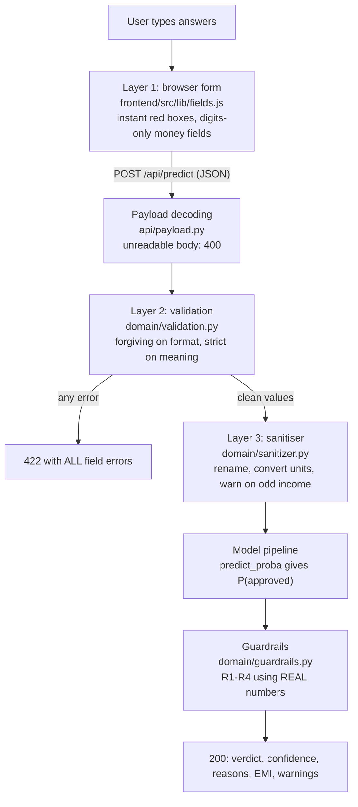
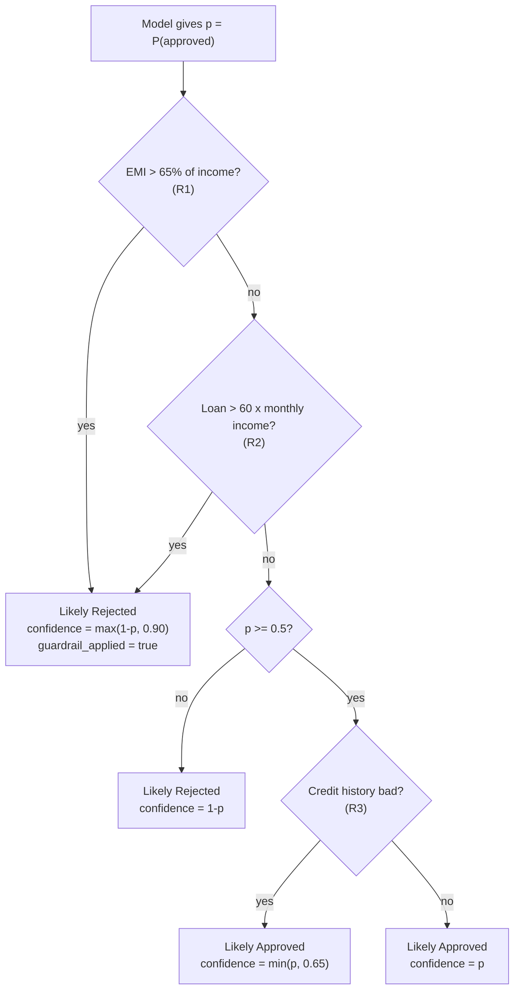

# 07 · Validation and Guardrails

> **In short.** The prediction program (the "model") always gives an answer, even when it is given nonsense. So LoanWise AI never passes your answers straight to it. Your answers are checked three times. First, the website checks them on your phone as you type. Second, the server checks them again, accepts harmless differences in how you wrote something (like "25 lakh" or "₹ 48,000"), and refuses anything that changes the meaning (like a negative income). Third, the server converts the checked answers into the exact format the model was taught with. After the model answers, fixed money rules called **guardrails** look at your real numbers and can change an "approved" into "rejected" when the monthly payment is clearly unaffordable. Part A explains all of this in plain words with real examples. Part B, for the technically curious, lists every rule with the exact numbers from the code, every message, the payment formula, and 36 bad inputs that were actually sent to the running server with what came back.

---

## Contents

**Part A: the plain story**

- [A1. The words you need](#a1-the-words-you-need)
- [A2. Why the answers must be checked](#a2-why-the-answers-must-be-checked)
- [A3. The three checks, shown with real examples](#a3-the-three-checks-shown-with-real-examples)
- [A4. The money rules (guardrails), shown with real examples](#a4-the-money-rules-guardrails-shown-with-real-examples)
- [A5. How sure is the answer?](#a5-how-sure-is-the-answer)

**Part B: for the technically curious**

- [B1. Layer 1: the browser form](#b1-layer-1-the-browser-form)
- [B2. Layer 2: server-side validation](#b2-layer-2-server-side-validation)
- [B3. Layer 3: the sanitiser](#b3-layer-3-the-sanitiser)
- [B4. Guardrails: every rule and constant](#b4-guardrails-every-rule-and-constant)
- [B5. The EMI formula, with a worked example](#b5-the-emi-formula-with-a-worked-example)
- [B6. Confidence and confidence labels](#b6-confidence-and-confidence-labels)
- [B7. How the "reasons" list is built](#b7-how-the-reasons-list-is-built)
- [B8. Message catalogue](#b8-message-catalogue)
- [B9. Garbage in, what comes out: captured from the real API](#b9-garbage-in-what-comes-out-captured-from-the-real-api)
- [B10. Limitations and honest caveats](#b10-limitations-and-honest-caveats)

---

# Part A: the plain story

## A1. The words you need

| Word | Meaning in this chapter |
|---|---|
| **Website** | The pages you see and tap on your phone or computer. |
| **Server** | The program on the LoanWise computer that receives your answers and works out the result. |
| **Model** | The prediction program made by learning from 614 past loan applications. Given one application, it returns a chance of approval between 0 and 1. See [00](00-ai-from-zero.md). |
| **Validation** | Checking that an answer is present and makes sense before using it. |
| **Normalising** | Rewriting an answer into one standard form without changing what it means. For example `" FEMALE "`, `"female"` and `"f"` are all rewritten as `Female`. |
| **Guardrail** | A fixed rule, written by a person, that is applied after the model and can override it. |
| **EMI** | Equated Monthly Instalment: the fixed amount paid every month until a loan and its interest are fully repaid. |
| **Interest** | The extra money charged by the lender for lending. LoanWise assumes 9% of the amount still owed, per year. |
| **Status code** | A number on every server reply. 200 means "here is your result". 422 means "some answers need fixing". 400 means "the message could not be read". |

## A2. Why the answers must be checked

A model is a calculation. It turns numbers into a number. It has no way to know whether the numbers it was given are sensible.

For example, if the model received an income of minus ₹5,000, it would still calculate a chance of approval. That chance would mean nothing, but it would look exactly as trustworthy as a real one. A person might then act on it.

There are three kinds of problem:

1. **Different ways of writing the same thing.** A person might write `25 lakh`, `25,00,000`, `2500000` or `₹ 25,00,000`. They all mean the same amount. A computer reading `25 lakh` as a number would simply fail, because "lakh" is not a digit.
2. **Answers that do not make sense.** An income of minus ₹5,000. A loan length of 100 months, when the model only ever saw ten specific lengths. "robot" as a gender. Both incomes zero.
3. **Answers that are each sensible but impossible together.** An income of ₹5,000 a month is possible. A loan of ₹1 crore is possible. A ₹1 crore loan on a ₹5,000 income is not something any lender would give. Each answer passes a check on its own, so checking answers one by one cannot catch this.

Problems 1 and 2 are handled by **validation**. Problem 3 is handled by **guardrails**.

The rule LoanWise follows is: **be forgiving about how something is written, and strict about what it means.** If the meaning is clear, accept it and say how it was read. If the meaning is unclear or impossible, ask the person to fix it, in plain words, next to the exact question.

## A3. The three checks, shown with real examples

All examples below were sent to the running LoanWise server while writing this document. The replies are copied exactly.

### Check 1: on the website, while you type

This check runs on your own phone or computer, before anything is sent.

* The 8 multiple-choice questions are big buttons. There is nothing to type, so you cannot type something wrong. The only possible mistake is skipping a question.
* The 3 money boxes only accept digits. Pressing a letter key does nothing. They add commas automatically: typing `2500000` shows `25,00,000`, with "That's ₹25 lakh." underneath.
* If you press "Next" with a question unanswered, a red message appears under it. For example: "Please tap 'Yes' or 'No'." A box above the button counts the problems: "4 answers need fixing. Look for the red boxes."
* If you type a monthly income above ₹1 crore, the message asks: "That is more than ₹1 crore a month. Please check the number. Did you type the yearly amount?"
* The "See my result" button stays switched off until every answer is valid.

This check is fast and friendly. But it cannot be relied on alone. The server can receive answers from other programs that never use the website. So the server checks everything again.

### Check 2: on the server, every answer again

The server reads each answer and first tries to understand it.

**Example: messy but clear answers are accepted.** This was sent:

```json
{"gender": " FEMALE ", "married": "y", "dependents": "four", "education": "grad",
 "self_employed": "salaried", "applicant_income": "₹ 48,000", "coapplicant_income": "22k",
 "loan_amount": "25 lakh", "loan_term": "20 years", "credit_history": "Yes",
 "property_area": "semi-urban"}
```

The server understood every answer. `" FEMALE "` became `Female`. `"y"` became `Yes`. `"four"` dependents became `3+` (the dataset groups 3 or more together). `"₹ 48,000"` became 48000. `"22k"` became 22000. `"25 lakh"` became 2500000. `"20 years"` became 240 months. The result was "Likely Approved", and the reply listed what it had reinterpreted, so the person can confirm it was read correctly:

```
We read your co-applicant's monthly income "22k" as ₹22,000.
We read your loan amount "25 lakh" as ₹25,00,000.
We read your loan length "20 years" as 240 months.
```

**Example: an answer that does not make sense is refused.** This was sent with an income of `-5000`. The reply (status 422):

```json
{"ok": false,
 "errors": {"applicant_income": "This can't be a negative number. Please type your monthly income using numbers only, like 25000."},
 "message": "Some answers need fixing. Look for the red boxes."}
```

**Example: every problem is reported at once.** An empty form `{}` was sent. The reply listed ten problems in one go, one per missing question, each starting "This answer is missing." and then saying what to do. (The eleventh question, the co-applicant's income, is allowed to be empty: it then counts as zero, because most people apply alone.)

**Example: words instead of digits.** `"fifty thousand"` is refused with "Please type your monthly income using numbers only, like 25000." Writing numbers as words has too many variations to read safely.

### Check 3: converting to the model's format

The model was taught with a table of past applications that uses its own names and units. The server rewrites the checked answers into exactly that form:

* `loan_amount` 2500000 becomes `LoanAmount` **2500.0**, because the past data records loans in thousands of rupees.
* `credit_history` "good" becomes `Credit_History` **1.0**; "bad" becomes 0.0.
* The other answers only change name, for example `applicant_income` becomes `ApplicantIncome`.

This step also looks for a common mistake: typing yearly income where monthly was asked. If the total monthly income is above ₹5,00,000, it does not refuse, but adds a note. A real example with an income of ₹9,00,000 a month got "Likely Approved" plus:

```
Your total monthly income (₹9,22,000) is very high. Please double-check you typed MONTHLY income, not yearly.
```

## A4. The money rules (guardrails), shown with real examples

The model learned from 614 past applications. Very few of them involved huge loans or tiny incomes. For cases unlike anything it has seen, its answer can be wrong. Repayment record is by far its strongest factor, so a person with a good record can be "approved" for a loan they could never repay.

So after the model answers, the server calculates the real monthly payment (EMI) at 9% yearly interest and applies four rules:

| Rule | In plain words | What it does |
|---|---|---|
| **R1** | The monthly payment would be more than 65% of the household's monthly income | Changes the answer to "Likely Rejected" |
| **R2** | The loan is more than 5 years (60 months) of the household's total income | Changes the answer to "Likely Rejected" |
| **R3** | The repayment record is bad | Always listed as a reason. If the model still says "approved", the "how sure" figure is limited to 65% |
| **R4** | The monthly payment is between 45% and 65% of income | Adds the reason "that is a big stretch". Does not change the answer |

The rules can only make the answer more cautious. They never turn a "rejected" into an "approved".

**Real example, R1 and R2 both apply.** Income ₹5,000 a month. Loan ₹1,00,00,000 over 30 years. Good repayment record.

* Monthly payment at 9%: ₹80,462. That is more than the whole income, so R1 applies.
* ₹1,00,00,000 is 2,000 months of a ₹5,000 income, far more than 60, so R2 applies.

Reply: "Likely Rejected", "Sorry — this loan looks too big for your income right now.", with these reasons first:

```
The monthly payment would be about ₹80,462, which is more than your whole monthly income.
Banks don't allow payments above about 65% of income. Try a smaller loan or a longer repayment time.

The loan (₹1,00,00,000) is more than 5 years of your total income (₹5,000 a month).
Try asking for a smaller amount.
```

**Real example, only R1 applies.** Income ₹20,000. Loan ₹5,00,000 over just 1 year (12 months). The loan is only about 2 years of income, so R2 does not apply. But repaying it in 12 months means ₹43,726 a month, more than the income. R1 applies: "Likely Rejected".

**Real example, R4 only.** Income ₹48,000, no co-applicant, loan ₹25,00,000 over 20 years. Monthly payment ₹22,493, which is 47% of income. That is between 45% and 65%, so the answer is not changed (it stayed "Likely Approved") but this reason is added: "The monthly payment (about ₹22,493) is 47% of your income — that is a big stretch."

The arithmetic of the payment formula, step by step, is in [section B5](#b5-the-emi-formula-with-a-worked-example).

## A5. How sure is the answer?

The model returns a chance of approval, for example 0.8521, which is 85.21%.

* If the chance is 50% or more, the answer is "Likely Approved" and "how sure" is that chance (85%).
* If it is below 50%, the answer is "Likely Rejected" and "how sure" is the chance of rejection. For example a 18% chance of approval means 82% sure of rejection.
* When R1 or R2 changes the answer, "how sure" is set to at least 90%, because the rule is arithmetic, not a guess.

The percentage is then given a word:

| How sure | Word | Sentence shown |
|---|---|---|
| 75% or more | High | We are quite sure about this answer. |
| 60% to under 75% | Medium | We are fairly sure, but it could go either way. |
| under 60% | Low | This one is close. Small changes could flip the answer. |

This figure is the model's own estimate. It is not a promise about what a bank would do.

---

# Part B: for the technically curious

Everything below gives the exact code-level detail behind Part A. A non-technical reader can skip to [section B9](#b9-garbage-in-what-comes-out-captured-from-the-real-api) for the table of tested inputs, or stop here.



| Layer | Where | Can it be trusted? | Its job |
|---|---|---|---|
| 1 | Browser | **No.** Any HTTP client (for example `curl`) can bypass it | Fast, friendly feedback before a network round-trip |
| 2 | Server | **Yes.** This is the real gate | Parse every way a human might write a value; reject anything ambiguous; report *all* problems at once |
| 3 | Server | Yes | Guarantee the model gets exactly the 11 columns, names, data types and units it was trained on |
| Guardrails | Server, after the model | Yes | Override the model when the answer contradicts basic affordability arithmetic |

## B1. Layer 1: the browser form

Source: [../frontend/src/lib/fields.js](../frontend/src/lib/fields.js), [../frontend/src/components/inputs.jsx](../frontend/src/components/inputs.jsx), [../frontend/src/pages/Check.jsx](../frontend/src/pages/Check.jsx).

### B1.1 Input design prevents most errors

The cheapest error to handle is the one that cannot be made:

* **Choices are big tappable cards** (native radio buttons underneath). The user cannot type "robot" for gender because there is nothing to type. The only possible error is "not answered".
* **Loan length is a choice of 10 cards** (1, 3, 5, 7, 10, 15, 20, 25, 30, 40 years). Each card stores the value in months (`y * 12`), so an unsupported term like 100 months cannot be submitted from the UI.
* **Money fields accept digits only.** `MoneyInput` blocks any non-digit key press, strips non-digits from pasted text, removes leading zeros and caps the field at 9 digits. The display is re-formatted live with Indian grouping (`25,00,000`) and a words line underneath ("That's ₹25 lakh."), while the caret stays in the right place.
* **"No one" quick chip** for the co-applicant income fills `0` with one tap.

### B1.2 Layer-1 rules, exactly as coded

`validateField(name, answers)` in `fields.js` returns a message or an empty string. Constants: `MAX_MONEY = 10_000_000` (₹1 crore), `MIN_LOAN = 1_000`.

| Field | Rule | Message shown |
|---|---|---|
| gender | must be chosen | Please tap "Man" or "Woman". |
| married | must be chosen | Please tap "Yes" or "No". |
| dependents | must be chosen | Please tap how many people depend on you. Tap "None" if nobody does. |
| education | must be chosen | Please tap whether you finished college. |
| self_employed | must be chosen | Please tap how you earn your money. |
| credit_choice | must be chosen | Please tap one answer about past loans. |
| loan_term | must be chosen | Please tap how many years you want to pay the loan back over. |
| property_area | must be chosen | Please tap where the house is. |
| applicant_income | not empty | Please type how much you earn each month. Type 0 if you earn nothing. |
| applicant_income | ≤ ₹1,00,00,000 | That is more than ₹1 crore a month. Please check the number. Did you type the yearly amount? |
| applicant_income | not both incomes 0 (only checked once the co-applicant field has a value) | Someone has to earn money for a loan. Type your income here, or the other person's income below. |
| coapplicant_income | not empty | Please type the other person's monthly income. Type 0 if no one else is helping. |
| coapplicant_income | ≤ ₹1,00,00,000 | That is more than ₹1 crore a month. Please check the number. |
| loan_amount | not empty | Please type how much money you want to borrow. |
| loan_amount | ≥ ₹1,000 | The smallest loan we can check is ₹1,000. |
| loan_amount | ≤ ₹1,00,00,000 | The biggest loan we can check is ₹1,00,00,000 (1 crore). |

Note that layer 1 is *stricter about blanks* than layer 2: the UI requires the co-applicant field to be filled (even with 0), while the API treats a blank co-applicant income as 0.

### B1.3 When layer 1 runs

* **Choice taps** validate immediately (so a red box disappears the moment you tap an answer).
* **Typed numbers** are validated on blur (leaving the field), and live after that once the field has been touched or flagged. This avoids shouting "too small" at someone who has only typed the first digit.
* The two incomes are cross-checked: changing either re-validates `applicant_income`.
* **Next** validates the whole step. If anything is wrong it shows a banner ("4 answers need fixing. Look for the red boxes."), marks the fields and scrolls/focuses the first bad one.
* On the last step, **See my result** is disabled until every answer in all three steps is valid, and a line under it says how many are left ("Answer all 3 remaining questions to see your result.").

### B1.4 The credit-history mapping

The UI asks "Have you paid back past loans or credit cards on time?" with three answers. The API only knows `good` and `bad`, so `creditToApi()` maps:

| UI answer | Sent to API |
|---|---|
| Yes, always on time | `good` |
| No, I was late or missed some | `bad` |
| I never had a loan or card | `good` (the UI explains: "You haven't missed any payments, so we count this as a clean record.") |

This mirrors the dataset convention, where `Credit_History = 1` means "meets guidelines", which includes having no negative record.

### B1.5 Server errors are mapped back to the form

If the server returns 422 despite layer 1 (possible if someone edits the page, or if the rules ever diverge), [../frontend/src/pages/Check.jsx](../frontend/src/pages/Check.jsx) renames `credit_history` to `credit_choice`, jumps to the earliest step that has an error, shows each server message under the right field, and shows the server's banner message. See screenshot [../docs/screenshots/server-422-desktop.png](../docs/screenshots/server-422-desktop.png).

---

## B2. Layer 2: server-side validation

Source: [../src/loanwise/domain/validation.py](../src/loanwise/domain/validation.py), limits in [../src/loanwise/domain/schemas.py](../src/loanwise/domain/schemas.py), wording in [../src/loanwise/domain/messages.py](../src/loanwise/domain/messages.py).

Public entry point: `validate_application(payload) -> ValidationResult`. It **never raises**. It returns:

* `cleaned`: canonical values for every field that parsed;
* `errors`: `{field: message}` for every field that did not;
* `warnings`: notes such as `We read your loan amount "25 lakh" as ₹25,00,000.` These are **cleared whenever there are errors**, because they only matter once the form is accepted.

Unknown extra fields are silently ignored. A payload that is not a JSON object yields the single error key `_form`, but in practice the HTTP layer already rejects non-objects with a 400 before validation runs.

### B2.1 Limits (from `schemas.py`)

| Constant | Value | Meaning |
|---|---|---|
| `INCOME_MAX` | 10,000,000 | Max monthly income per person, ₹1,00,00,000 |
| `LOAN_MIN` | 1,000 | Smallest loan, ₹1,000 |
| `LOAN_MAX` | 10,000,000 | Largest loan, ₹1,00,00,000 (1 crore) |
| `ALLOWED_LOAN_TERMS` | 12, 36, 60, 84, 120, 180, 240, 300, 360, 480 | Months; the terms present in the training data |
| `MAX_TEXT_LEN` | 60 | Longest accepted text for one answer, after trimming |
| `MAX_DEPENDENTS` | 30 | Above this, "That is a lot of dependents" |
| `DEPENDENTS_CAP` | 3 | 3 or more collapses into `"3+"` |

### B2.2 Choice fields: case, spaces and synonyms

For gender, married, education, self_employed, credit_history and property_area the value is normalised (trimmed, lower-cased, inner whitespace collapsed to one space) and looked up in `CHOICE_SYNONYMS`:

| Field | Accepted (after lower-casing) | Canonical value |
|---|---|---|
| gender | male, m, man | `Male` |
| gender | female, f, woman | `Female` |
| married | yes, y, true, t, 1, yeah, yep, ok, married | `Yes` |
| married | no, n, false, f, 0, nope, nah, single, unmarried, not married | `No` |
| self_employed | the yes-words above, self employed, self-employed | `Yes` |
| self_employed | the no-words above, salaried, employed, not self employed | `No` |
| education | graduate, grad, graduated, yes | `Graduate` |
| education | not graduate, not_graduate, notgraduate, not-graduate, non graduate, non-graduate, nongraduate, undergraduate, no | `Not Graduate` |
| credit_history | the yes-words above, good, g, clean, 1.0, ok, fine | `good` |
| credit_history | the no-words above, bad, b, poor, 0.0 | `bad` |
| property_area | urban, city | `Urban` |
| property_area | semiurban, semi urban, semi-urban, semi_urban, suburban | `Semiurban` |
| property_area | rural, village | `Rural` |

Type handling in `_normalise_text`:

* `null` / missing → "This answer is missing. " + the field's help text.
* JSON `true`/`false` → treated as `"yes"`/`"no"` (meaningful for yes/no questions; for gender it simply fails the lookup).
* Numbers → `1` becomes `"1"`, `1.0` becomes `"1"`; `NaN`/`Infinity` are rejected.
* Lists, objects → rejected with the field's help text.
* Empty or whitespace-only string → missing.
* Longer than 60 characters → rejected (stops someone pasting an essay or a script).

### B2.3 Dependents

| Input | Result |
|---|---|
| `none`, `zero`, `no` | `"0"` |
| `3+`, `3 +`, `3 or more`, `more than 3`, `3plus`, `3 plus`, `three+` | `"3+"` |
| `one` … `five` | 1 … 5 (then 3 and above become `"3+"`) |
| a whole number such as `"2"`, `4`, `"4.0"` | that count; 3 or more becomes `"3+"` |
| `2.5`, `-1` | "Please choose a whole number of dependents: 0, 1, 2 or 3+." |
| more than 30 | "That is a lot of dependents. Please check the number and choose 0, 1, 2 or 3+." |
| `true`/`false` | rejected (a boolean is not a count) |
| other words | "Please choose how many people depend on you: 0, 1, 2 or 3+." |

### B2.4 Money amounts: the forgiving parser

`parse_number()` and `_parse_amount_text()` turn what a person types into a float. Steps for a string, in order:

1. Trim and lower-case. Empty → missing. Longer than 60 characters → help message.
2. If it **starts with** `-` or `−` (Unicode minus) → "This can't be a negative number. " + help.
3. Remove "noise" words/symbols (order matters): `₹`, `inr`, `rs.`, `rs`, `rupees`, `rupee`, `/-`, `per month`, `/month`, `a month`, `monthly`, `month`, `pm`.
4. Remove `,` `_` and `'` (so `2,50,000`, `250_000` and `2'50'000` all work).
5. Join digits separated by a single space: `25 000` → `25000`.
6. `nan`, `inf`, `infinity`, `+inf` → help message.
7. Match `number` + optional word suffix. The suffix must be one of:

| Suffix | Multiplier |
|---|---|
| `k`, `thousand` | 1,000 |
| `l`, `lakh`, `lakhs`, `lac`, `lacs`, `lk` | 1,00,000 |
| `m`, `million`, `mn` | 10,00,000 |
| `cr`, `crore`, `crores` | 1,00,00,000 |

8. If a suffix was used, append a note: `We read your <label> "<what you typed>" as ₹<amount>.`

Non-string values: JSON numbers are used directly; `true`/`false`, lists and objects are rejected; `NaN` and infinities are rejected; negatives get the "negative" prefix.

Then per-field range checks:

| Field | Check | Message |
|---|---|---|
| applicant_income, coapplicant_income | ≤ ₹1,00,00,000 | That monthly income looks too big (more than ₹1,00,00,000). Please check you typed your MONTHLY income, not yearly, like 25000. |
| coapplicant_income | blank or missing → 0 | (no message; "no co-applicant" is the common case) |
| both incomes | sum must be > 0 (error placed on applicant_income) | At least one person must have some income. Please type your monthly income (or your co-applicant's), like 25000. |
| loan_amount | ≥ ₹1,000 | The smallest loan we can check is ₹1,000. Please type the full amount in rupees, like 500000. |
| loan_amount | ≤ ₹1,00,00,000 | The biggest loan we can check is ₹1,00,00,000 (1 crore). Please type a smaller amount, like 500000. |

Amounts are rounded to 2 decimal places.

### B2.5 Loan term

* Numbers are taken as months.
* Strings may be `360`, `360 months`, `360 mo`, `30 years`, `30 yrs`, `30 y` (regex `^number (months?|mos?|m|years?|yrs?|y)?$`). Year units are multiplied by 12 and a note is added: `We read your loan length "20 years" as 240 months.`
* The result must be a positive whole number that is in `ALLOWED_LOAN_TERMS`. Anything else (100, `7.5 years` = 90) gets: "Please choose how long you want to repay the loan: 12, 36, 60, 84, 120, 180, 240, 300, 360 or 480 months."

Why only those ten terms? They are the terms that appear in the training data. A model has no basis for judging a 100-month loan, so the system asks rather than guessing.

### B2.6 All errors at once

Each field is parsed independently by `_record()`, which catches `FieldError` and stores its message. The user therefore gets every problem in one response, not one per attempt. An empty payload `{}` produces ten errors (all fields except co-applicant income, which defaults to 0), captured in section B9.

---

## B3. Layer 3: the sanitiser

Source: [../src/loanwise/domain/sanitizer.py](../src/loanwise/domain/sanitizer.py).

`to_model_frame(cleaned)` builds a one-row pandas DataFrame with exactly the 11 columns in `MODEL_COLUMNS` order, and does three things:

1. **Renames** API fields to dataset columns (`applicant_income` → `ApplicantIncome`, etc.).
2. **Converts units** to match the training data:
   * `loan_amount` in full rupees → `LoanAmount` in **thousands** of rupees (÷ 1000), because that is how the original dataset stores it. ₹25,00,000 becomes `2500.0`.
   * `credit_history` `"good"`/`"bad"` → `1.0`/`0.0`.
   * `loan_term` → float.
3. **Warns about suspicious income.** If the total monthly income (applicant + co-applicant) is more than ₹5,00,000 (`SUSPICIOUS_MONTHLY_INCOME = 500_000.0`) it adds: `Your total monthly income (₹9,22,000) is very high. Please double-check you typed MONTHLY income, not yearly.` The request still succeeds. This catches people who typed their yearly salary.

It deliberately **does not clamp** large values. The model only sees income and loan size through a capped log EMI-to-income ratio (see [04 · Data Preparation and Features](04-data-preparation-and-features.md) and [../src/loanwise/ml/features.py](../src/loanwise/ml/features.py)), and training verifies the model is monotonic in that ratio. Clamping here would distort the ratio.

---

## B4. Guardrails: every rule and constant

Source: [../src/loanwise/domain/guardrails.py](../src/loanwise/domain/guardrails.py).

### B4.1 The idea

The model was trained on 614 historical rows, mostly modest incomes and loans. Given a ₹1 crore loan on a ₹5,000 salary, it is in territory it has never seen, and the most important feature (credit history) can still push it to "approved". Real lenders apply simple affordability rules before anything else. The guardrails apply those rules **using the applicant's real numbers** (not the model's transformed features), after the model has spoken.

Two safety properties are built in:

* **Guardrails can only make the answer more conservative.** They can turn an approval into a rejection, never the other way round.
* **They are explainable.** Each override adds a reason that states the actual number ("about ₹80,462, which is more than your whole monthly income").

### B4.2 Constants

| Constant | Value | Used for |
|---|---|---|
| `INTEREST_RATE_ANNUAL` | 0.09 (9% a year) | EMI estimate |
| `EMI_HARD_LIMIT` | 0.65 | R1 |
| `EMI_STRETCH_LIMIT` | 0.45 | R4 |
| `EMI_COMFORT_LIMIT` | 0.30 | "easy to afford" wording |
| `LOAN_TO_INCOME_HARD` | 60.0 (months of total income, i.e. 5 years) | R2 |
| `SENSIBLE_LOAN_YEARS` | 3.0 | "sensible size" wording |
| `OVERRIDE_CONFIDENCE` | 0.90 | Minimum confidence when R1/R2 fire |
| `BAD_CREDIT_CONF_CAP` | 0.65 | R3 |
| `APPROVAL_THRESHOLD` | 0.5 | Model probability needed for "approved" |
| `HIGH_CONFIDENCE` / `MEDIUM_CONFIDENCE` | 0.75 / 0.60 | Confidence labels |
| `MIN_REASONS` / `MAX_REASONS` | 3 / 5 | Length of the reasons list |

"Total income" everywhere means applicant + co-applicant monthly income.

### B4.3 The rules, in order

| Rule | Condition | Effect |
|---|---|---|
| **R1** Unaffordable EMI | EMI > 65% of total monthly income | Force **Likely Rejected**, headline "Sorry — this loan looks too big for your income right now.", `guardrail_applied = true` |
| **R2** Loan far too large | Loan > 60 × total monthly income (more than 5 years of all income) | Same as R1 |
| **R3** Bad credit | `credit_history == "bad"` | Always listed as a negative reason. If the model *still* approves (and R1/R2 did not fire), confidence is capped at 0.65, so the label can be at most "Medium" |
| **R4** Stretch | 45% < EMI/income ≤ 65% | Negative reason "that is a big stretch". No override |

When R1 or R2 fires, confidence = `max(1 − p_approve, 0.90)`. In words: the rejection is a hard arithmetic fact, so the system is at least 90% sure, or more if the model itself was even more sure of a rejection.

The decision logic, as pseudo-code (mirrors `apply_guardrails`):

```
p = clip(model_probability, 0, 1)
approved   = p >= 0.5
confidence = p if approved else 1 - p

if R1 or R2:
    approved   = False
    confidence = max(1 - p, 0.90)
elif approved and credit is bad:          # R3
    confidence = min(confidence, 0.65)

confidence = round(confidence, 4)
label      = High if confidence >= 0.75 else Medium if confidence >= 0.60 else Low
```



### B4.4 R3 in practice

With the model currently shipped (Logistic Regression), bad credit never produces an approval: an exhaustive search over every categorical combination at a comfortable income (₹70,000 total, ₹5,00,000 loan over 30 years) found a highest approval probability of **0.264**. So in today's build, the R3 cap is a safety net that never actually triggers; the visible part of R3 is the negative reason. It exists so that a future retrained model (say, a Random Forest that overfits some rare bad-credit approvals) cannot show "High confidence" for an applicant lenders would almost never approve. It is covered by unit tests with a fake model in [../tests/unit/test_guardrails.py](../tests/unit/test_guardrails.py).

### B4.5 Why these particular numbers?

* **65% EMI-to-income.** Indian lenders typically cap the "FOIR" (fixed obligations to income ratio) somewhere around 40-60% depending on income band. 65% is deliberately above that range, so the rule only fires when a loan is clearly unaffordable, not borderline. Borderline (45-65%) gets a warning-style reason instead (R4).
* **60 months of income (5 years).** Home-loan eligibility is commonly quoted at roughly 5-6 times *annual* income; 5 years of income is in that range and is easy to explain to a user.
* **9% interest.** A round figure close to typical Indian home-loan rates at the time of writing. Real rates vary; the result page says "This is a rough guess. The bank's real interest rate will change it."

These are policy choices, not learned values. They are named constants in one file so a reviewer can change them in one place, and the tests assert their behaviour.

---

## B5. The EMI formula, with a worked example

**EMI** (Equated Monthly Instalment) is the fixed amount you pay every month so that, after the last payment, the loan and all its interest are paid off. Each payment is partly interest (large at the start) and partly principal (large at the end). This is called *amortisation*.

```
EMI = P · r · (1 + r)^n / ((1 + r)^n − 1)

P = principal (loan amount in ₹)
r = monthly interest rate = annual rate / 12 = 0.09 / 12 = 0.0075
n = number of monthly payments (loan term in months)
```

The code (`estimate_emi`) also handles two edge cases: `months <= 0` returns the principal, and a 0% rate returns `P / n`. Neither can happen through the API because validation only allows the ten listed terms.

### Worked example (the request followed in [02-how-it-works-end-to-end.md](02-how-it-works-end-to-end.md))

Loan ₹25,00,000 over 20 years (240 months); applicant earns ₹48,000 and co-applicant ₹22,000 a month.

```
r          = 0.09 / 12               = 0.0075
(1 + r)^n  = 1.0075^240              = 6.009152
numerator  = 25,00,000 × 0.0075 × 6.009152 = 1,12,671.59
denominator= 6.009152 − 1            = 5.009152
EMI        = 1,12,671.59 / 5.009152  = ₹22,493.15

total income      = 48,000 + 22,000  = ₹70,000
EMI / income      = 22,493.15 / 70,000 = 0.3213  (32%)
loan / income     = 25,00,000 / 70,000 = 35.7 months = 2.98 years
```

Rule check:

| Rule | Test | Result |
|---|---|---|
| R1 | 32% > 65%? | No |
| R2 | 35.7 > 60 months? | No |
| R3 | credit bad? | No (good) |
| R4 | 45% < 32% ≤ 65%? | No. 32% is between 30% and 45%, so the reason is neutral: "manageable, but not small" |
| Loan size | 2.98 ≤ 3 years | "The loan is about 3.0 years of your income — a sensible size." (positive) |

The API returned exactly `"emi_estimate": 22493.15` and the reason "The monthly payment (about ₹22,493) is 32% of your income — manageable, but not small."

### A second example: R1 firing on its own

₹5,00,000 over 12 months on ₹20,000 income: `1.0075^12 = 1.093807`, EMI = ₹43,725.74. That is more than the whole income, so R1 fires. The loan is only 25 months of income (2.1 years), so R2 does not. Captured response: verdict "Likely Rejected", `guardrail_applied: true`, `confidence: 0.9`, and the first reason "The monthly payment would be about ₹43,726, which is more than your whole monthly income. Banks don't allow payments above about 65% of income. Try a smaller loan or a longer repayment time."

### Important distinction: two different EMIs

There are **two** EMI calculations in the project and they serve different purposes:

| Where | Formula | Purpose |
|---|---|---|
| Guardrails ([guardrails.py](../src/loanwise/domain/guardrails.py)) | Amortised at 9% | A realistic rupee figure shown to the user, and used for the affordability rules |
| Model feature ([ml/features.py](../src/loanwise/ml/features.py)) | Interest-free `loan / term` | Only needs to *increase with loan size and decrease with income* (monotonic); the model learns the scale itself |

For the worked example the model's internal EMI is ₹10,416.67 (25,00,000 / 240), ratio 0.1488. The user never sees this number.

---

## B6. Confidence and confidence labels

"Confidence" is the probability of the **winning** side, not the probability of approval:

* Approved with `p = 0.85` → confidence 0.85.
* Rejected with `p = 0.18` → confidence 0.82 (82% sure it is a rejection).

Labels (`confidence_label()`):

| Confidence | Label | What the result page says |
|---|---|---|
| ≥ 0.75 | High | We are quite sure about this answer. |
| ≥ 0.60 and < 0.75 | Medium | We are fairly sure, but it could go either way. |
| < 0.60 | Low | This one is close. Small changes could flip the answer. |

Because the threshold is 0.5, confidence is always at least 0.5 (except after a guardrail override, where it is at least 0.9). A captured "Low" example: a single, rural, non-graduate applicant on ₹25,000 asking for ₹8,00,000 over 30 years got `approved: true, confidence: 0.5706, confidence_label: "Low"`.

Caveat for the viva: these are the model's probabilities, not calibrated real-world odds. A "High" label means the model is far from its decision boundary, not that a bank will agree 85% of the time.

---

## B7. How the "reasons" list is built

`_explain()` builds 3 to 5 reasons, most important first:

1. Override reasons from R1 and/or R2 (negative), if any.
2. Credit history: positive "Your credit history is good — this helps a lot." or negative "Your credit history is bad (past loans or cards not paid on time). This is the biggest reason loans get rejected."
3. EMI reason, **unless R1 already explained the EMI**: ≤ 30% → positive "easy to afford"; ≤ 45% → neutral "manageable, but not small"; otherwise (R4) negative "that is a big stretch".
4. Loan-size reason, **unless R2 already explained it**: ≤ 3 years of income → positive "a sensible size"; otherwise neutral "on the large side".
5. Co-applicant income > 0 → positive "Having a co-applicant with income makes the loan safer for the bank."
6. If fewer than 5 so far and the applicant is a graduate → neutral "Being a graduate helps a little."
7. If still fewer than 3 → neutral "This is an estimate from past loan data, not a bank's final decision."

The list is then cut to 5. Each reason has `type` `positive`, `negative` or `neutral`; the UI turns these into thumbs-up, thumbs-down and info icons with screen-reader prefixes ("Helps you:", "Hurts your chances:", "Good to know:").

Honest note: the reasons are **rule-based explanations of the applicant's situation**, not a mathematical decomposition of the model's output (they are not SHAP values). They describe the factors that drive lending decisions and that the model is known to weigh (credit history is its top feature), but they are generated by the guardrails module, not extracted from the model.

---

## B8. Message catalogue

All user-facing strings live in two files and are asserted by tests, so wording changes are deliberate.

### B8.1 Field-level (layer 2), from [../src/loanwise/domain/messages.py](../src/loanwise/domain/messages.py)

| Key | Text |
|---|---|
| `CHOICE_HELP[gender]` | Please choose Male or Female. |
| `CHOICE_HELP[married]` | Please choose Yes or No for 'Are you married?'. |
| `CHOICE_HELP[dependents]` | Please choose how many people depend on you: 0, 1, 2 or 3+. |
| `CHOICE_HELP[education]` | Please choose Graduate or Not Graduate. |
| `CHOICE_HELP[self_employed]` | Please choose Yes or No for 'Do you work for yourself?'. |
| `CHOICE_HELP[credit_history]` | Please choose Good (you paid past loans and cards on time) or Bad. |
| `CHOICE_HELP[property_area]` | Please choose where the property is: Urban, Semiurban or Rural. |
| `NUMBER_HELP[applicant_income]` | Please type your monthly income using numbers only, like 25000. |
| `NUMBER_HELP[coapplicant_income]` | Please type your co-applicant's monthly income using numbers only, like 15000. Type 0 if there is no co-applicant. |
| `NUMBER_HELP[loan_amount]` | Please type the loan amount you want in rupees using numbers only, like 500000. |
| `NUMBER_HELP[loan_term]` | Please choose how long you want to repay the loan: 12, 36, 60, 84, 120, 180, 240, 300, 360 or 480 months. |
| `MISSING_PREFIX` | "This answer is missing. " + the field's help |
| `NEGATIVE_PREFIX` | "This can't be a negative number. " + the field's help |
| `DEPENDENTS_NOT_WHOLE` | Please choose a whole number of dependents: 0, 1, 2 or 3+. |
| `DEPENDENTS_TOO_MANY` | That is a lot of dependents. Please check the number and choose 0, 1, 2 or 3+. |
| `INCOME_TOO_BIG` | That monthly income looks too big (more than ₹1,00,00,000). Please check you typed your MONTHLY income, not yearly, like 25000. |
| `NO_INCOME` | At least one person must have some income. Please type your monthly income (or your co-applicant's), like 25000. |
| `LOAN_TOO_SMALL` | The smallest loan we can check is ₹1,000. Please type the full amount in rupees, like 500000. |
| `LOAN_TOO_BIG` | The biggest loan we can check is ₹1,00,00,000 (1 crore). Please type a smaller amount, like 500000. |
| `FORM_UNREADABLE` | We couldn't read your answers. Please fill in the form and press the button again. |

### B8.2 Warnings (request still succeeds)

| Key | Text |
|---|---|
| `NOTE_AMOUNT_READ_AS` | We read your {label} "{raw}" as {amount}. |
| `NOTE_TERM_READ_AS` | We read your loan length "{raw}" as {months} months. |
| `WARN_VERY_HIGH_INCOME` | Your total monthly income ({amount}) is very high. Please double-check you typed MONTHLY income, not yearly. |

The UI shows these under "Things we fixed for you".

### B8.3 Request-level, from [../src/loanwise/api/messages.py](../src/loanwise/api/messages.py)

| Status | Text |
|---|---|
| 422 banner | Some answers need fixing. Look for the red boxes. |
| 400 | We couldn't read your answers. Please fill in the form again and press the button. If it keeps happening, refresh the page. |
| 404 | We couldn't find that. Please check the address. |
| 405 | That action isn't allowed here. Please use the form on the website. |
| 413 | That was too much information to send at once. Please only fill in the loan form. |
| 503 (no model) | Our loan checker isn't ready yet. Please try again in a few minutes. (The person running this site needs to train the model first.) |
| 500 | Something went wrong on our side. Please try again in a minute. |

### B8.4 Verdicts and headlines

| Situation | `verdict` | `headline` |
|---|---|---|
| Model approves, no override | Likely Approved | Great news! Your loan is likely to be approved. |
| Model rejects, no override | Likely Rejected | Sorry — your loan is likely to be rejected right now. |
| R1 or R2 fired | Likely Rejected | Sorry — this loan looks too big for your income right now. |

---

## B9. Garbage in, what comes out: captured from the real API

Every row below was sent with `POST /api/predict` to the running server (`LOANWISE_PORT=5099 python3 scripts/run_server.py`) on 21 Oct 2026 with the shipped model. Unless stated, the other fields were the valid base application: Female, married, 1 dependent, Graduate, salaried, ₹48,000 + ₹22,000 income, ₹25,00,000 loan, 240 months, good credit, Semiurban.

### B9.1 Accepted after normalisation

| # | What was sent | Status | What happened |
|---|---|---|---|
| 1 | `gender " FEMALE "`, `married "y"`, `dependents "four"`, `education "grad"`, `self_employed "salaried"`, `applicant_income "₹ 48,000"`, `coapplicant_income "22k"`, `loan_amount "25 lakh"`, `loan_term "20 years"`, `credit_history "Yes"`, `property_area "semi-urban"` | 200 | Approved, High, `emi_estimate 22493.15`. Warnings: `We read your co-applicant's monthly income "22k" as ₹22,000.`, `We read your loan amount "25 lakh" as ₹25,00,000.`, `We read your loan length "20 years" as 240 months.` (Dependents "four" became "3+", so the probability differs slightly from the base case: 0.8748 vs 0.8521.) |
| 2 | `applicant_income "Rs. 48000 per month"`, `loan_amount "2.5 lakhs"` | 200 | Approved. Warning: `We read your loan amount "2.5 lakhs" as ₹2,50,000.` EMI ₹2,249.31, "only 3% of your income — easy to afford" |
| 3 | `applicant_income "48 000"` (space inside the number) | 200 | Read as 48000; identical result to the base case |
| 4 | `coapplicant_income ""` | 200 | Treated as 0. EMI is now 47% of ₹48,000, so R4 adds the negative reason "that is a big stretch"; still approved (0.8211) |
| 5 | Extra fields `"hack": "<script>"`, `"__proto__": "x"` | 200 | Ignored; same result as the base case |
| 6 | Valid JSON sent as `Content-Type: text/plain` | 200 | Accepted (`read_payload` decodes JSON regardless of content type) |
| 7 | Classic form post `application/x-www-form-urlencoded` | 200 | Accepted; all values arrive as strings and are parsed by layer 2 |
| 8 | `applicant_income 900000` (₹9 lakh a month) | 200 | Approved, with warning `Your total monthly income (₹9,22,000) is very high. Please double-check you typed MONTHLY income, not yearly.` |

### B9.2 Rejected by validation (422, all errors at once)

| # | What was sent | `errors` returned |
|---|---|---|
| 9 | `applicant_income "fifty thousand"` | applicant_income: Please type your monthly income using numbers only, like 25000. |
| 10 | `applicant_income -5000` | applicant_income: This can't be a negative number. Please type your monthly income using numbers only, like 25000. |
| 11 | `loan_amount "-500000"` | loan_amount: This can't be a negative number. Please type the loan amount you want in rupees using numbers only, like 500000. |
| 12 | `applicant_income true` | applicant_income: Please type your monthly income using numbers only, like 25000. |
| 13 | `applicant_income [48000]` | same as 12 |
| 14 | `applicant_income "48000 dollars"` | same as 12 (unknown suffix) |
| 15 | both incomes `0` | applicant_income: At least one person must have some income. Please type your monthly income (or your co-applicant's), like 25000. |
| 16 | `applicant_income 12000000` (yearly typed as monthly) | applicant_income: That monthly income looks too big (more than ₹1,00,00,000). Please check you typed your MONTHLY income, not yearly, like 25000. |
| 17 | `loan_amount 500` | loan_amount: The smallest loan we can check is ₹1,000. Please type the full amount in rupees, like 500000. |
| 18 | `loan_amount "2 crore"` | loan_amount: The biggest loan we can check is ₹1,00,00,000 (1 crore). Please type a smaller amount, like 500000. |
| 19 | `loan_term 100` | loan_term: Please choose how long you want to repay the loan: 12, 36, 60, 84, 120, 180, 240, 300, 360 or 480 months. |
| 20 | `loan_term "7.5 years"` (= 90 months) | same as 19 |
| 21 | `dependents "2.5"` | dependents: Please choose a whole number of dependents: 0, 1, 2 or 3+. |
| 22 | `dependents 45` | dependents: That is a lot of dependents. Please check the number and choose 0, 1, 2 or 3+. |
| 23 | `gender "robot"` | gender: Please choose Male or Female. |
| 24 | `property_area` = 200 × "x" | property_area: Please choose where the property is: Urban, Semiurban or Rural. |
| 25 | `{}` (empty object) | 10 errors, every field except coapplicant_income, each "This answer is missing. …" |
| 26 | Raw body `{"gender":"Male","applicant_income":NaN}` | 9 errors: applicant_income "Please type your monthly income using numbers only, like 25000." plus "missing" for the 8 other absent fields (gender was fine) |

Every 422 body also has `"message": "Some answers need fixing. Look for the red boxes."`

### B9.3 Rejected before validation

| # | What was sent | Status | Body `message` |
|---|---|---|---|
| 27 | Malformed JSON `{"gender": "Male",` | 400 | We couldn't read your answers. Please fill in the form again and press the button. If it keeps happening, refresh the page. |
| 28 | A JSON array `[1,2,3]` | 400 | same |
| 29 | Empty body | 400 | same |
| 30 | A 40 KB body (limit 32,768 bytes) | 413 | That was too much information to send at once. Please only fill in the loan form. |
| 31 | `PUT /api/predict` or `GET /api/predict` | 405 | That action isn't allowed here. Please use the form on the website. |
| 32 | Valid request while no model file exists (server started with `LOANWISE_MODEL_PATH` pointing nowhere) | 503 | Our loan checker isn't ready yet. Please try again in a few minutes. (The person running this site needs to train the model first.) |

### B9.4 Valid but absurd: caught by guardrails

| # | What was sent | Result |
|---|---|---|
| 33 | ₹5,000 income, ₹1,00,00,000 loan, 360 months | **R1 + R2**. Likely Rejected, `guardrail_applied: true`, confidence 0.9958. Reasons: "The monthly payment would be about ₹80,462, which is more than your whole monthly income. …" and "The loan (₹1,00,00,000) is more than 5 years of your total income (₹5,000 a month). Try asking for a smaller amount." |
| 34 | ₹30,000 income, ₹20,00,000 loan, 240 months | **R2 only** (loan = 66.7 months of income; EMI ₹17,995 = 60%, below R1). Likely Rejected, confidence exactly 0.9 (`OVERRIDE_CONFIDENCE`), plus R4's "60% of your income — that is a big stretch." |
| 35 | ₹20,000 income, ₹5,00,000 loan, 12 months | **R1 only** (EMI ₹43,726). Likely Rejected, confidence 0.9 |
| 36 | Base case with `credit_history "bad"` | Not a guardrail override: the model itself rejects (confidence 0.8228, headline "Sorry — your loan is likely to be rejected right now."), and R3 puts the credit reason first |

No input in this list produced a stack trace, an HTML error page, or a 500.

---

## B10. Limitations and honest caveats

* **The UI cannot send the forgiving formats.** Money fields are digits-only, so `"25 lakh"` typed in the browser becomes `25`, which then fails "smallest loan is ₹1,000". The words parser serves API clients, form posts and future front-ends (for example a chatbot or WhatsApp form). This is a deliberate split: the UI prevents ambiguity; the API tolerates it.
* **Guardrail thresholds are policy, not learned.** 65%, 60 months and 9% are reasonable round numbers, not taken from any specific bank. They should be reviewed by a domain expert before real use.
* **R3's confidence cap is currently unreachable** with the shipped model (see B4.4).
* **"Confidence" is not calibrated.** It is the model's probability, adjusted by rules.
* **Reasons are rule-based**, not model attributions (see section B7).
* **Gender and marital status are validated and used** because the original specification required them. See [01-what-and-why.md](01-what-and-why.md#7-disclaimer-and-ethics) for why that would not be acceptable in a real lending product.
* **Layer 1 and layer 2 are separate code in two languages.** They agree on limits today (₹1,000 to ₹1 crore, income ≤ ₹1 crore), but nothing enforces that automatically; a change to [schemas.py](../src/loanwise/domain/schemas.py) must be mirrored in [fields.js](../frontend/src/lib/fields.js). The 422 mapping in section B1.5 is the safety net.

---

[Next → 08 · Backend](08-backend.md)  
[← Back to index](README.md)
