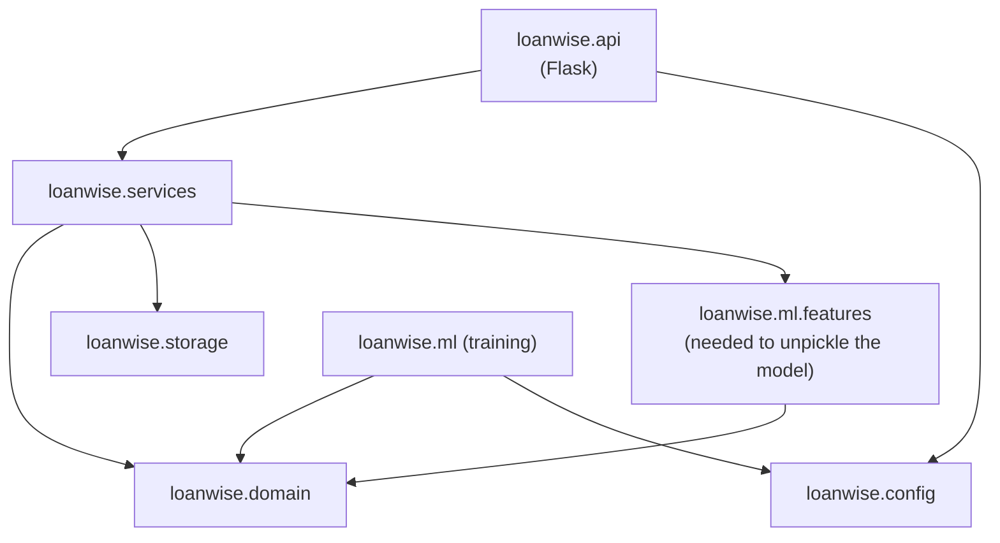

# 08 · Backend

> **In short.** The **backend** (also called the **server**) is the part of LoanWise AI that runs on the LoanWise computer, not on your phone. It is a program written in the Python programming language. It waits for messages from the website, checks the answers, asks the prediction program (the "model") for a chance of approval, applies the money rules, keeps a list of past checks, and replies. It never shows technical errors to users; every problem becomes one plain sentence. Part A explains what the server does, in plain words, using real messages captured from it. Part B, for the technically curious, gives the engineering detail: how the code is organised, every address it answers, settings, security, logging, the 90 automatic tests, and how it is started in production.

---

## Contents

**Part A: the plain story**

- [A1. What the server is and what it does](#a1-what-the-server-is-and-what-it-does)
- [A2. The six things you can ask the server](#a2-the-six-things-you-can-ask-the-server)
- [A3. What the server remembers](#a3-what-the-server-remembers)
- [A4. What happens when something goes wrong](#a4-what-happens-when-something-goes-wrong)
- [A5. How the server is kept safe](#a5-how-the-server-is-kept-safe)
- [A6. How we know it works: automatic tests](#a6-how-we-know-it-works-automatic-tests)

**Part B: for the technically curious**

- [B1. Concepts in plain English](#b1-concepts-in-plain-english)
- [B2. Package layout](#b2-package-layout)
- [B3. Dependency direction and why it matters](#b3-dependency-direction-and-why-it-matters)
- [B4. The application factory](#b4-the-application-factory)
- [B5. Blueprints and routes](#b5-blueprints-and-routes)
- [B6. Endpoints with real examples](#b6-endpoints-with-real-examples)
- [B7. Services](#b7-services)
- [B8. Storage: the SQLite history](#b8-storage-the-sqlite-history)
- [B9. Configuration](#b9-configuration)
- [B10. Error handling](#b10-error-handling)
- [B11. Security measures](#b11-security-measures)
- [B12. Logging](#b12-logging)
- [B13. Testing strategy](#b13-testing-strategy)
- [B14. Tooling, running and deployment](#b14-tooling-running-and-deployment)
- [B15. Limitations and what to change for real production](#b15-limitations-and-what-to-change-for-real-production)

---

# Part A: the plain story

## A1. What the server is and what it does

A **program** is a list of instructions a computer follows. A **server** is a program that keeps running and waits for messages from other programs, then answers each one.

The LoanWise server is written in **Python**, a programming language widely used for data and machine learning. It uses a Python tool called **Flask** that handles the work of receiving messages over the internet and sending replies.

The website on your phone and the server talk only by sending short pieces of text. A message to the server is a **request**. The reply is a **response**. The text is in a format called **JSON**: named values inside curly brackets, such as `{"ok": true, "model_loaded": true}`.

Each request goes to an **address** that says what is wanted. All LoanWise addresses for data start with `/api/`. ("API" means the agreed list of addresses and message formats that one program offers to others.)

When the server receives your 11 answers at `/api/predict`, it does these things, in this order:

1. Reads the message. If it cannot be read, it replies "We couldn't read your answers."
2. Checks every answer. If any are wrong, it replies with all the problems at once.
3. Makes sure the model is available. If not, it replies "Our loan checker isn't ready yet."
4. Converts the answers into the model's format.
5. Asks the model for a chance of approval.
6. Applies the money rules (guardrails).
7. Saves the check in its list of past checks.
8. Replies with the verdict, confidence, reasons and monthly payment.

[02](02-how-it-works-end-to-end.md) follows a real request through these steps with every message shown.

The same server also sends the website itself: when a browser opens the LoanWise address, the server sends the page files first. Then the page sends requests to `/api/...` addresses as you use it.

## A2. The six things you can ask the server

Each row below is a real request and the start of the real reply, captured from the running server.

| What you ask | Address | Real reply (shortened) |
|---|---|---|
| "Is the server working, and is the model loaded?" | `GET /api/health` | `{"ok": true, "model_loaded": true}` |
| "Here are my 11 answers. What is the result?" | `POST /api/predict` | `{"ok": true, "approved": true, "verdict": "Likely Approved", "confidence": 0.8521, ...}` |
| "Show me past checks." | `GET /api/history` | `{"ok": true, "items": [{"id": 15, "verdict": "Likely Approved", "confidence": 0.5706, ...}]}` |
| "Delete all past checks." | `DELETE /api/history` | `{"ok": true}` |
| "Give me an example application." | `GET /api/sample` | `{"ok": true, "gender": "Male", "applicant_income": 2783, "loan_amount": 158000, ..., "loan_id": "LP001187"}` |
| "How was the model made and how good is it?" | `GET /api/model-info` | `{"chosen_model": "Logistic Regression", "dataset": {"rows": 614, "approved": 422, "rejected": 192}, ...}` |

`GET` means "give me something". `POST` means "here is some data, do something with it". `DELETE` means "remove something".

Every reply contains `"ok": true` when it worked or `"ok": false` with a `"message"` sentence when it did not.

## A3. What the server remembers

The server keeps a list of past checks in a **database**: a file that stores information in rows and columns so it can be searched and read back. LoanWise uses **SQLite**, a database that is a single file (`instance/loanwise.db`) and needs no separate software.

Each check becomes one row with: a number, the date and time, the checked answers, approved or not, the verdict, the confidence, and the full result. A real stored row:

```
id 1 | 2026-10-21T10:27:52+00:00 | {"gender": "Female", ..., "loan_amount": 2500000.0, "loan_term": 240}
     | approved 1 | Likely Approved | 0.8521 | {...full result..., "model_probability": 0.8521}
```

No name, phone number or address is ever asked for or stored.

The server also reads, but never changes, the model file (`artifacts/models/loan_model.pkl`) and its report (`model_info.json`). If someone re-trains the model and the file changes, the server notices and starts using the new one without being restarted.

## A4. What happens when something goes wrong

Every reply carries a **status code**, a number that says how it went. The website uses it to decide what to show. These were all captured from the running server:

| Code | Meaning | Example cause | Message in the reply |
|---|---|---|---|
| 200 | Done | A valid check | (the result) |
| 400 | The message could not be read | Text cut off half-way | We couldn't read your answers. Please fill in the form again and press the button. If it keeps happening, refresh the page. |
| 404 | No such address | `/api/nope` | We couldn't find that. Please check the address. |
| 405 | Wrong kind of request for this address | `GET /api/predict` | That action isn't allowed here. Please use the form on the website. |
| 413 | Message far too large | A 40 KB message | That was too much information to send at once. Please only fill in the loan form. |
| 422 | Some answers need fixing | Income of -5000 | Some answers need fixing. Look for the red boxes. (plus one message per wrong answer) |
| 503 | The model is not available | No model file | Our loan checker isn't ready yet. Please try again in a few minutes. (The person running this site needs to train the model first.) |
| 500 | An unexpected problem inside the server | A bug | Something went wrong on our side. Please try again in a minute. |

The technical details of a failure are written to the server's own log (a running record of events, readable only by whoever runs the server). They are never sent to the user.

## A5. How the server is kept safe

* **Size limit.** Messages larger than 32,768 bytes are refused. A real form is a few hundred bytes.
* **Every answer is checked** before use; see [07](07-validation-and-guardrails.md).
* **Only trusted websites may call it from a browser.** A browser will only let a web page read the server's replies if the server says that page's address is allowed. LoanWise allows only `localhost` and `127.0.0.1` (the computer itself) by default. A page at `http://localhost.evil.com` gets no permission.
* **It cannot be shown inside another website's frame**, which prevents tricking users into clicking hidden buttons.
* **No technical details leak** in replies.
* **In production it runs as a restricted user** that can only write to one folder.

## A6. How we know it works: automatic tests

A **test** is a small program that runs a piece of the real code with known input and checks the output is exactly what it should be. LoanWise has **90** of them. All 90 pass:

```
Ran 90 tests in 2.161s
OK
```

Examples of what they check: that "5 lakh" is read as ₹5,00,000 (with a note saying so); that a ₹1 crore loan on a ₹2,000 income is rejected; that a broken model gives the friendly 500 message and no technical text; that a missing model gives 503 but wrong answers still get their 422 messages; that a look-alike website address is refused.

---

# Part B: for the technically curious

Everything below is engineering detail. A non-technical reader can stop here without losing the story.

## B1. Concepts in plain English

| Term | Plain meaning in this project |
|---|---|
| **Backend / server** | The program that runs on a computer you control, receives the form answers from the browser, runs the model and sends back the verdict |
| **API** | The list of addresses (`/api/predict`, `/api/history`, …) the browser can call, and the exact shape of what goes in and comes out |
| **JSON** | The text format used for those messages, e.g. `{"loan_term": 240}` |
| **HTTP status code** | A number on every response: 200 = OK, 4xx = the request was wrong, 5xx = the server had a problem |
| **Flask** | A small Python library for writing web servers. You write a function and tell Flask which URL calls it |
| **Blueprint** | A Flask way of grouping related routes (e.g. everything about history) into one file |
| **App factory** | A function (`create_app`) that builds a fresh, fully configured app. Tests call it with different settings; production calls it once |
| **Dependency injection** | Passing the things a component needs (the model, the database) into it, instead of it creating them itself. This is what makes testing with a fake model easy |
| **WSGI / gunicorn** | WSGI is the standard interface between Python web apps and web servers. gunicorn is a production-grade server that runs several copies (workers) of the app |
| **SQLite** | A database that is just one file on disk; no separate database server needed |

---

## B2. Package layout

```
src/loanwise/
├── __init__.py            version "1.0.0"; deliberately imports nothing heavy
├── config.py              Settings dataclass, read from LOANWISE_* env vars
├── logging_config.py      text or JSON-lines logging, configured once by entry points
├── api/                   HTTP layer (the only package that imports Flask)
│   ├── __init__.py        create_app(), CORS check, security headers
│   ├── context.py         AppServices bundle stored on app.extensions
│   ├── payload.py         read_payload(): body decoding that never raises
│   ├── responses.py       ok() / fail() JSON envelopes, is_api_path()
│   ├── errors.py          exception -> status code + friendly message
│   ├── messages.py        every HTTP-level user message
│   ├── spa.py             serves frontend/dist with SPA fallback
│   ├── dev_server.py      `loanwise-serve` entry point (Flask dev server)
│   └── routes/
│       ├── predict.py     POST /api/predict
│       ├── history.py     GET, DELETE /api/history
│       └── meta.py        GET /api/health, /api/model-info, /api/sample
├── services/              use cases; no Flask
│   ├── prediction_service.py   validate -> sanitise -> predict -> guardrails -> persist
│   ├── model_registry.py       lazy, thread-safe, hot-reloading model loader
│   ├── sample_service.py       random demo row for "Fill an example"
│   └── model_info.py           reads model_info.json
├── domain/                pure logic; no Flask, no I/O
│   ├── schemas.py         field names, allowed values, limits, model columns
│   ├── validation.py      layer 2
│   ├── sanitizer.py       layer 3 (the only domain module using pandas)
│   ├── guardrails.py      lending rules, EMI, confidence, reasons
│   ├── messages.py        all user-facing wording for the domain
│   └── formatting.py      format_inr(): ₹12,34,567
├── storage/
│   └── history_repository.py   SQLite prediction log
└── ml/                    offline training (see 04-06); features.py is also needed at serve time
```

Entry points outside the package: [../wsgi.py](../wsgi.py) (production), [../scripts/run_server.py](../scripts/run_server.py) and [../scripts/train_model.py](../scripts/train_model.py) (which add `src/` to `sys.path` via [../scripts/_bootstrap.py](../scripts/_bootstrap.py), so they work without `pip install`). `pyproject.toml` also declares console scripts `loanwise-serve` and `loanwise-train`.

---

## B3. Dependency direction and why it matters



Rules:

* Arrows only point downwards. `domain` imports nothing from the project except its own modules; it has no Flask, no file or network I/O and does not load the model.
* Only `api` imports Flask. The prediction use case could be reused from a CLI, a batch job or a different web framework unchanged.
* `services` raise plain Python exceptions (`InvalidApplicationError`, `ModelUnavailableError`, `ModelPredictionError`); `api/errors.py` decides which HTTP status each becomes.

Why it matters to a reviewer: the most important logic (validation and guardrails) can be unit-tested with plain dictionaries in milliseconds, and an engineer can change the web layer without risk of changing a business rule.

One subtle coupling is documented in [../src/loanwise/ml/features.py](../src/loanwise/ml/features.py): the pickled model stores references to `loanwise.ml.features.coerce_raw_input` and `add_engineered_features` by import path. That module must stay importable under that exact name, which is why `model_registry.py` imports it explicitly. Renaming it requires retraining.

---

## B4. The application factory

[../src/loanwise/api/__init__.py](../src/loanwise/api/__init__.py):

```python
def create_app(settings=None, *, model=None) -> Flask:
    settings = settings or Settings.from_env()
    app = Flask(__name__, static_folder=None)
    app.config.update(MAX_CONTENT_LENGTH=settings.max_request_bytes)
    app.json.ensure_ascii = False      # "₹" stays "₹", not "₹"
    app.json.sort_keys = False         # keep the documented field order
    attach_services(app, _build_services(settings, model))
    for blueprint in API_BLUEPRINTS:   # predict, history, meta
        app.register_blueprint(blueprint)
    app.register_blueprint(spa_blueprint)   # last: its catch-all must not shadow /api
    register_error_handlers(app)
    _register_response_headers(app, settings.cors_origins)
    return app
```

`_build_services()` creates the object graph once per app:

| Object | Built from |
|---|---|
| model provider | `StaticModelProvider(model)` if a model was passed (tests), else `ModelRegistry(settings.model_path)` |
| `HistoryRepository` | `settings.database_path` (creates the file and table if missing) |
| `PredictionService` | model provider + history repository |
| `SampleService` | `settings.sample_data_path` |

They are bundled in a frozen `AppServices` dataclass and stored in `app.extensions["loanwise"]`. Route handlers fetch them with `services()` from [../src/loanwise/api/context.py](../src/loanwise/api/context.py). There are no module-level globals, so two apps with different settings can live in one test process.

---

## B5. Blueprints and routes

| Blueprint | File | Routes |
|---|---|---|
| `predict` | [routes/predict.py](../src/loanwise/api/routes/predict.py) | `POST /api/predict` |
| `history` | [routes/history.py](../src/loanwise/api/routes/history.py) | `GET /api/history`, `DELETE /api/history` |
| `meta` | [routes/meta.py](../src/loanwise/api/routes/meta.py) | `GET /api/health`, `GET /api/model-info`, `GET /api/sample` |
| `spa` | [spa.py](../src/loanwise/api/spa.py) | `/` and `/<path:path>` (everything else) |

The SPA blueprint handles three cases:

1. Path is `api` or starts with `api/` but matched no API route → JSON **404**, or **405** if that path exists for a different method (it probes GET, POST and DELETE against the URL map). This is why `GET /api/predict` gives a JSON 405 rather than the React page.
2. `frontend/dist/index.html` does not exist → a short HTML page "LoanWise AI is almost ready" explaining how to build the frontend, with a link to `/api/health`.
3. Otherwise, a real file inside `frontend/dist` is served; any other path returns `index.html` so that client-side routes like `/result` survive a page refresh. `_is_file_inside()` resolves the path and refuses anything that escapes the `dist` folder (path traversal such as `/../../etc/passwd`).

---

## B6. Endpoints with real examples

The binding contract is [../docs/API.md](../docs/API.md). Below is a summary plus responses captured from the running server. The full walk-through of one prediction is in [02-how-it-works-end-to-end.md](02-how-it-works-end-to-end.md), and every validation case is in [07-validation-and-guardrails.md](07-validation-and-guardrails.md#b9-garbage-in-what-comes-out-captured-from-the-real-api).

Every response has `"ok": true` or `"ok": false`. Errors always carry a `message`.

### `POST /api/predict`

Request (JSON; form-encoded and `text/plain` JSON are also accepted; max 32,768 bytes):

```json
{"gender":"Female","married":"Yes","dependents":"1","education":"Graduate","self_employed":"No",
 "applicant_income":48000,"coapplicant_income":22000,"loan_amount":2500000,"loan_term":240,
 "credit_history":"good","property_area":"Semiurban"}
```

200 response (captured):

```json
{
  "ok": true,
  "approved": true,
  "verdict": "Likely Approved",
  "headline": "Great news! Your loan is likely to be approved.",
  "confidence": 0.8521,
  "confidence_label": "High",
  "reasons": [
    {"type": "positive", "text": "Your credit history is good — this helps a lot."},
    {"type": "neutral", "text": "The monthly payment (about ₹22,493) is 32% of your income — manageable, but not small."},
    {"type": "positive", "text": "The loan is about 3.0 years of your income — a sensible size."},
    {"type": "positive", "text": "Having a co-applicant with income makes the loan safer for the bank."},
    {"type": "neutral", "text": "Being a graduate helps a little."}
  ],
  "warnings": [],
  "guardrail_applied": false,
  "emi_estimate": 22493.15,
  "id": 1
}
```

`id` is the history row id, or `null` if saving history failed (the prediction still succeeds).

Other statuses: **400** unreadable body or not a JSON object; **413** body too large; **422** `{"ok": false, "errors": {field: message}, "message": "Some answers need fixing. Look for the red boxes."}`; **503** no model; **500** model crashed or returned NaN/infinity.

Order of checks inside the service matters: validation runs **before** the model is fetched, so an applicant gets field errors even while no model is available (asserted by `test_validation_still_runs_without_model`).

### `GET /api/history?limit=N`

Newest first. `limit` defaults to 50, is clamped to 1..500, and falls back to 50 if it is not an integer (`?limit=abc` is treated as 50, not an error).

```json
{"ok": true, "items": [
  {"id": 15, "created_at": "2026-10-21T10:28:44+00:00",
   "inputs": {"gender": "Female", "married": "No", "education": "Not Graduate", "self_employed": "No",
              "credit_history": "good", "property_area": "Rural", "dependents": "1",
              "applicant_income": 25000.0, "coapplicant_income": 0.0, "loan_amount": 800000.0, "loan_term": 360},
   "approved": true, "verdict": "Likely Approved", "confidence": 0.5706}
]}
```

`inputs` are the **cleaned** values (after layer 2), not what the user typed.

### `DELETE /api/history`

Deletes every row. Response: `{"ok": true}`. There is no authentication (see section B15).

### `GET /api/health`

`{"ok": true, "model_loaded": true}`. With no model file: `{"ok": true, "model_loaded": false}`. Status is 200 either way: the process is alive. The Docker `HEALTHCHECK` calls this.

### `GET /api/model-info`

The contents of `artifacts/models/model_info.json` with `"ok": true` appended at the end: `chosen_model` ("Logistic Regression"), `selection_metric`, `models` (accuracy, precision, recall, f1, cv_accuracy_mean, cv_accuracy_std for each of the three), `feature_importance`, `importance_method`, `dataset` (`rows: 614, approved: 422, rejected: 192`) and `trained_at`. 503 with "Model details aren't available yet. …" if the file is missing or not valid JSON. Used by the "How it works" page.

### `GET /api/sample`

A random row from the **unlabelled** `data/raw/test.csv`, converted to request fields. Returned both at top level and under `sample`, plus the source `loan_id`:

```json
{"ok": true, "gender": "Male", "married": "Yes", "dependents": "0", "education": "Graduate",
 "self_employed": "No", "applicant_income": 2783, "coapplicant_income": 2708, "loan_amount": 158000,
 "loan_term": 360, "credit_history": "good", "property_area": "Urban",
 "sample": { "...same 11 fields..." }, "loan_id": "LP001187"}
```

`row_to_application()` fills blank cells with typical values (`Male`, `Yes`, `0`, `Graduate`, `No`, income 3800, co-applicant 0, LoanAmount 128 thousand, term 360, credit 1.0, `Urban`), snaps the term to the nearest allowed term, multiplies the loan by 1000, and guarantees that at least one income is positive, so every sample passes validation (asserted by `test_sample_is_valid_request` and `test_many_samples_predict`). The CSV is re-read on every call, so edits are picked up without a restart.

Note: the dataset's incomes are small (₹2,783 a month), because the public dataset's units are unclear. Samples are for demonstration, not realism. See [03-dataset.md](03-dataset.md).

---

## B7. Services

### B7.1 `PredictionService.predict(payload)`

[../src/loanwise/services/prediction_service.py](../src/loanwise/services/prediction_service.py):

```
checked = validate_application(payload)          # layer 2
if errors: raise InvalidApplicationError(errors) # -> 422
model = models.get()
if model is None: raise ModelUnavailableError    # -> 503
sanitized = to_model_frame(checked.cleaned)      # layer 3
p = model.predict_proba(frame)[0][1]             # any exception or NaN -> ModelPredictionError -> 500
decision = apply_guardrails(checked.cleaned, p)  # rules use REAL values, not the frame
warnings = checked.warnings + sanitized.warnings
id = history.add(...)                            # failure is logged, id = None
```

`PredictionResult.to_response()` emits the documented field order. `to_record()` (stored in history) additionally includes `model_probability`, the raw model output before guardrails, which is useful for auditing overrides later.

### B7.2 `ModelRegistry`

[../src/loanwise/services/model_registry.py](../src/loanwise/services/model_registry.py). Loads the joblib pickle **lazily** (on the first request, not at import) and **reloads it when the file's modification time changes**:

1. `stat()` the file. If it is gone, keep serving whatever is loaded (possibly `None`).
2. If a model is loaded and the mtime is unchanged, return it (no lock: fast path).
3. Otherwise take a lock, re-check (another thread may have loaded it), then `joblib.load`.
4. If loading fails, or the object has no `predict_proba`, log the exception and **keep the previous model**.

Verified while writing this document: after `touch artifacts/models/loan_model.pkl`, the next request logged a second "Model loaded from …" line with no restart. With gunicorn, each worker process has its own registry and reloads independently.

`ProbabilisticClassifier` is a `typing.Protocol` with one method, `predict_proba`. Tests pass any object with that method (a `FakeModel`, a `BrokenModel` that raises, a `NanModel`) through `create_app(settings, model=...)`.

### B7.3 `SampleService` and `load_model_info`

Covered in section B6. Both convert every failure into a single exception or `None`, which the routes map to a friendly 503.

---

## B8. Storage: the SQLite history

[../src/loanwise/storage/history_repository.py](../src/loanwise/storage/history_repository.py). Default file: `instance/loanwise.db` (created on first start; the folder is git-ignored).

```sql
CREATE TABLE IF NOT EXISTS predictions (
    id          INTEGER PRIMARY KEY AUTOINCREMENT,
    created_at  TEXT    NOT NULL,   -- UTC ISO-8601, seconds precision
    inputs      TEXT    NOT NULL,   -- JSON of the cleaned request fields
    approved    INTEGER NOT NULL,   -- 0 / 1
    verdict     TEXT    NOT NULL,
    confidence  REAL    NOT NULL,
    result      TEXT                -- JSON of the full response + model_probability
)
```

A real stored row (`result` shortened):

```
(1, '2026-10-21T10:27:52+00:00',
 '{"gender": "Female", "married": "Yes", ..., "loan_amount": 2500000.0, "loan_term": 240}',
 1, 'Likely Approved', 0.8521,
 '{"ok": true, "approved": true, ..., "emi_estimate": 22493.15, "model_probability": 0.8521}')
```

Design choices:

* **One short-lived connection per call** (`sqlite3.connect(..., timeout=10)`), so one repository object is safe to share across request threads.
* **Writes are serialised with a `threading.Lock`** to avoid "database is locked" under the threaded dev server.
* Connections commit on success, roll back on exception and always close (context manager).
* All SQL is parameterised (`?` placeholders); no string formatting of user data into SQL.
* Only the six summary columns are read back by `list_recent`; `result` is stored for audit but not exposed by the API.

---

## B9. Configuration

All settings come from environment variables, read once into an immutable `Settings` dataclass by `Settings.from_env()` ([../src/loanwise/config.py](../src/loanwise/config.py)). Relative paths resolve against `LOANWISE_ROOT` (default: the repository root, detected from the file's location). Nothing reads `.env` automatically; [../.env.example](../.env.example) documents the variables.

| Variable | Default | Notes |
|---|---|---|
| `LOANWISE_ROOT` | repository root | Set in Docker to `/app` |
| `LOANWISE_MODEL_PATH` | `artifacts/models/loan_model.pkl` | |
| `LOANWISE_MODEL_INFO_PATH` | `artifacts/models/model_info.json` | |
| `LOANWISE_DATABASE_PATH` | `instance/loanwise.db` | |
| `LOANWISE_TRAIN_DATA_PATH` | `data/raw/loan.csv` | Training only |
| `LOANWISE_SAMPLE_DATA_PATH` | `data/raw/test.csv` | `/api/sample` |
| `LOANWISE_EDA_DIR` | `artifacts/reports/eda` | Training only |
| `LOANWISE_FRONTEND_DIST` | `frontend/dist` | |
| `LOANWISE_HOST` | `0.0.0.0` | Dev server only. `run.sh` exports `127.0.0.1` |
| `LOANWISE_PORT` | `5000` (falls back to `PORT`) | Dev server; also used by the Docker `CMD` |
| `LOANWISE_DEBUG` | `false` | Accepts 1/0, true/false, yes/no, on/off |
| `LOANWISE_MAX_REQUEST_BYTES` | `32768` | Becomes Flask's `MAX_CONTENT_LENGTH` |
| `LOANWISE_CORS_ORIGINS` | `http://localhost, http://127.0.0.1, https://localhost, https://127.0.0.1` | Comma-separated `scheme://host` |
| `LOANWISE_LOG_LEVEL` | `INFO` | |
| `LOANWISE_LOG_FORMAT` | `text` | `text` or `json` |

Invalid values fail fast at start-up with `ConfigError` (for example `LOANWISE_PORT=abc` → "LOANWISE_PORT must be an integer, got 'abc'"; a zero or negative integer is also rejected), rather than surfacing as odd behaviour later.

---

## B10. Error handling

[../src/loanwise/api/errors.py](../src/loanwise/api/errors.py) registers handlers on the app:

| Raised | Status | Body |
|---|---|---|
| `InvalidApplicationError` | 422 | `{"ok": false, "errors": {...}, "message": FIX_FORM}` |
| `ModelUnavailableError` | 503 | `NO_MODEL` |
| `ModelPredictionError` | 500 | `GENERIC_ERROR` (the service already logged the traceback) |
| Any Werkzeug `HTTPException` on `/api/*` (400, 404, 405, 413, …) | same code | Message from `HTTP_ERRORS`, else `GENERIC_ERROR` |
| Same, on a non-API path | same code | Werkzeug's default page |
| Any other `Exception` | 500 | Logged with `log.exception`; JSON `GENERIC_ERROR` on `/api/*`, a two-line HTML apology elsewhere |

Bad request bodies never reach the exception path: `read_payload()` ([../src/loanwise/api/payload.py](../src/loanwise/api/payload.py)) catches `UnicodeDecodeError`, `ValueError` and `RecursionError` (deeply nested JSON) and returns `(None, False)`, which the route turns into a 400.

The integration tests assert that no error body contains any of `Traceback`, `Error:`, `Exception` or a planted string `secret internal` (`LEAK_MARKERS` in [../tests/helpers.py](../tests/helpers.py)), including when a fake model raises `RuntimeError("secret internal traceback text")`.

---

## B11. Security measures

The app has no login and holds no real personal data, so the threat model is modest: a public demo that must not crash, leak internals, or be abused from another website.

| Measure | Where | Detail |
|---|---|---|
| **Request size limit** | `MAX_CONTENT_LENGTH` | 32,768 bytes; a loan form is a few hundred bytes. Larger → 413 before the body is parsed |
| **CORS exact-origin allow-list** | `is_allowed_origin()` in [api/__init__.py](../src/loanwise/api/__init__.py) | `Access-Control-Allow-*` headers are added only on `/api/*` and only if the `Origin`'s scheme and hostname exactly match an allowed entry. Any port is accepted (dev servers move around). Look-alikes such as `http://localhost.evil.com`, malformed ports, or origins with a path are rejected. `Vary: Origin` is set so caches do not mix responses |
| **Security headers** | every response | `X-Content-Type-Options: nosniff`, `X-Frame-Options: DENY` (no clickjacking via iframes), `Referrer-Policy: same-origin` |
| **No stack traces** | error handlers | See section B10 |
| **Strict input validation** | domain layer | Type checks, 60-character text cap, finite-number checks; see [07](07-validation-and-guardrails.md) |
| **Path-traversal guard** | `spa._is_file_inside()` | Static files must resolve inside `frontend/dist` |
| **Parameterised SQL** | history repository | No SQL injection surface |
| **Non-root container** | Dockerfile | Runs as system user `loanwise` (uid 10001); only `/app/instance` is writable |
| **Pinned ML library** | requirements | `scikit-learn==1.9.1` exactly, because the pickle is tied to that version |
| **Static analysis** | ruff `S` rules (bandit) | Security lint runs with every `make lint` |

Captured headers for a request with `Origin: http://localhost:5173`:

```
HTTP/1.1 200 OK
Access-Control-Allow-Origin: http://localhost:5173
Vary: Origin
Access-Control-Allow-Methods: GET, POST, DELETE, OPTIONS
Access-Control-Allow-Headers: Content-Type
X-Content-Type-Options: nosniff
X-Frame-Options: DENY
Referrer-Policy: same-origin
```

With `Origin: http://localhost.evil.com` the response is still 200 (CORS is enforced by the browser), but carries no `Access-Control-Allow-Origin`, so the browser blocks the calling page from reading it.

Important: **pickles execute code when loaded.** Only load `loan_model.pkl` files you produced yourself. The model path is configuration, not user input.

---

## B12. Logging

[../src/loanwise/logging_config.py](../src/loanwise/logging_config.py). Library modules only call `logging.getLogger(__name__)`. Entry points (`wsgi.py`, the dev server, the training CLI) call `configure_logging(level, fmt)` exactly once, installing a single stderr handler.

* `text` (default): `2026-10-21 10:27:44,270 INFO     loanwise.services.model_registry: Model loaded from /home/claude/LoanWiseAI/artifacts/models/loan_model.pkl`
* `json` (default in Docker): one object per line with `time` (UTC, milliseconds), `level`, `logger`, `message`, and `exception` when there is a traceback. Suitable for log shippers (CloudWatch, Stackdriver, ELK).

What is logged: model loads and load failures, model prediction failures, history save failures, sample/model-info read failures, and every unhandled exception with its traceback. Applicant answers are **not** logged.

---

## B13. Testing strategy

Run: `python3 -m unittest discover -s tests -t .` (or `make test`, `./run.sh --test`, or `pytest`). Result when this document was written:

```
Ran 90 tests in 2.161s
OK
```

| File | Tests | Kind | Covers |
|---|---|---|---|
| [unit/test_validation.py](../tests/unit/test_validation.py) | 22 | unit | Every forgiving format and every rejection; messages |
| [unit/test_services.py](../tests/unit/test_services.py) | 11 | unit | Prediction orchestration, registry reload/failure, samples, model info |
| [unit/test_features.py](../tests/unit/test_features.py) | 8 | unit | Pipeline transforms, schema consistency, selection rule, monotonicity of the saved model |
| [unit/test_guardrails.py](../tests/unit/test_guardrails.py) | 8 | unit | EMI maths, R1-R4, confidence caps and labels, reasons |
| [unit/test_config.py](../tests/unit/test_config.py) | 6 | unit | Env parsing, defaults, invalid values |
| [unit/test_sanitizer.py](../tests/unit/test_sanitizer.py) | 4 | unit | Frame shape, columns, units, high-income warning |
| [unit/test_cors.py](../tests/unit/test_cors.py) | 3 | unit | Allowed, look-alike and malformed origins |
| [integration/test_api.py](../tests/integration/test_api.py) | 26 | integration | Full HTTP behaviour through Flask's test client with fake, broken, missing and the real model; 400/404/405/413/422/500/503; CORS; SPA serving |
| [integration/test_history.py](../tests/integration/test_history.py) | 2 | integration | History round-trip and clearing |
| **Total** | **90** | 62 unit + 28 integration | |

Approach:

* **Unit tests** call domain and service functions directly with dictionaries; no HTTP, no disk (except temporary folders).
* **Integration tests** build a real app with `create_app(make_settings(tmp), model=FakeModel())`: an isolated temporary database and no frontend build. `FakeModel` approves exactly when `Credit_History == 1`, so tests are deterministic and do not depend on training.
* **Real-model tests** (`test_strong_applicant_approved`, `test_bad_credit_rejected`, `test_absurd_loan_rejected_by_guardrail`, `test_extreme_income_still_sensible`, `test_many_samples_predict`, …) load the shipped pickle and are skipped with a clear reason if it has not been trained yet.
* **Wording is tested.** Because the product promise is plain English, tests assert on message text, so changing a message is a deliberate act.
* Tests use only the standard library `unittest` (no pytest-only fixtures), so `run.sh --test` works with nothing but the runtime dependencies.

---

## B14. Tooling, running and deployment

| Tool | Config | Status at time of writing |
|---|---|---|
| **ruff** (lint + format) | `[tool.ruff]` in [../pyproject.toml](../pyproject.toml): line length 100; rule sets E, W, F, I, B, UP, SIM, C4, RUF, S (security), T20 (no `print` in library code), D (Google docstrings), ANN (type annotations), PTH, N | `All checks passed!` |
| **mypy --strict** | `[tool.mypy]`: `strict = true`, `warn_unreachable = true`; sklearn/joblib/pandas/matplotlib stubs ignored | `Success: no issues found in 37 source files` |
| **Makefile** | [../Makefile](../Makefile) | `make help` lists: install, install-dev, train, test, lint, typecheck, format, run, serve, build-frontend, docker-build, clean |
| **run.sh / run.bat** | [../run.sh](../run.sh) | One-command setup: venv, deps (re-installed only when `requirements.txt`/`pyproject.toml` change, via a SHA stamp), train if no model, build frontend if no `dist`, pick port 5000 or fall back to 8000 (macOS AirPlay), open browser. Flags `--retrain`, `--test` |

Running:

| Mode | Command | Server |
|---|---|---|
| Development | `make run` or `python3 scripts/run_server.py` | Flask's built-in threaded server; honours `LOANWISE_HOST/PORT/DEBUG` |
| Production (local) | `make serve` → `gunicorn --bind 0.0.0.0:${LOANWISE_PORT:-5000} --workers 2 wsgi:app` | gunicorn, 2 worker processes |
| Docker | `docker build -t loanwise-ai . && docker run -p 5000:5000 loanwise-ai` | gunicorn inside `python:3.12-slim` |

[../wsgi.py](../wsgi.py) adds `src/` to the path if needed, reads `Settings.from_env()`, configures logging and exposes `app`.

The [../Dockerfile](../Dockerfile) is a **multi-stage build**:

1. `node:20-slim` stage: `npm install` and `npm run build` the frontend.
2. `python:3.12-slim` stage: install `requirements.txt` (cached layer), install the package, copy `wsgi.py`, `artifacts/models/`, `data/raw/test.csv` (for samples only; the training CSV is not shipped) and the built `dist`. Env defaults `LOANWISE_ROOT=/app`, `LOANWISE_LOG_FORMAT=json`, `LOANWISE_PORT=5000`.
3. Create non-root user `loanwise`, make only `/app/instance` writable, `EXPOSE 5000`, `HEALTHCHECK` every 30 s against `/api/health`, and `CMD` gunicorn with `GUNICORN_WORKERS` (default 2) and access logs to stdout.

The model is trained **before** the image is built and copied in; the container never trains.

---

## B15. Limitations and what to change for real production

| Limitation | Why it is acceptable here | What to change |
|---|---|---|
| SQLite history, one file | Single-instance demo | Use Postgres/MySQL behind the same `HistoryRepository` interface; multiple replicas would each have their own SQLite file |
| History is global and unauthenticated; `DELETE /api/history` clears everyone's | Single-user academic demo | Add user identity or per-session scoping, auth on DELETE, and retention limits |
| No rate limiting | Demo traffic | Add a reverse-proxy or Flask-Limiter rate limit |
| No HTTPS termination or CSP header | Normally done at the load balancer | Terminate TLS at the proxy; add `Content-Security-Policy` and `Strict-Transport-Security` |
| Pickle model format | Standard for scikit-learn | Keep pickles in trusted storage; consider skops or ONNX for untrusted distribution |
| Model hot-reload per worker | Convenient for development | In production prefer immutable deploys (new image per model) |
| `test.csv` incomes look very small | Inherited from the public dataset | Use realistic demo rows if this is shown to real users |

---

[Next → 09 · Frontend](09-frontend.md)  
[← Back to index](README.md)
