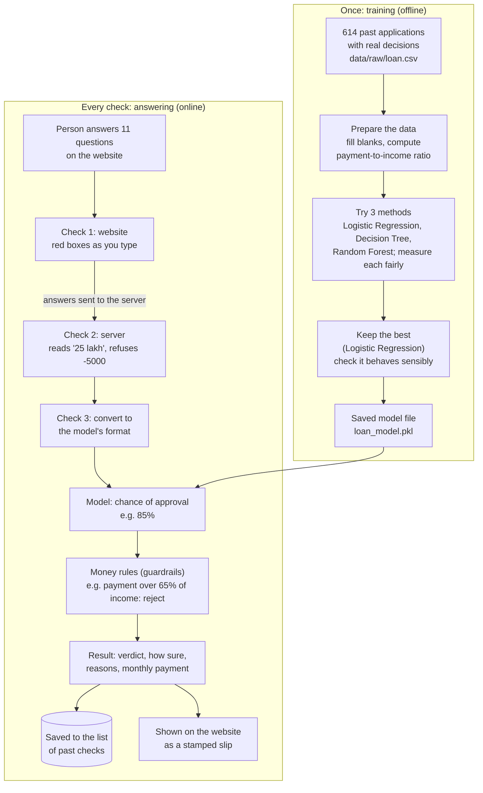

# About LoanWise AI

> **In short.** LoanWise AI is a website that tells a person whether their home-loan application is likely to be approved by a bank, how sure it is, why, and roughly what the monthly payment would be. The answer comes from a computer program that learned patterns from 614 real past loan applications and their outcomes, with fixed common-sense money rules on top that stop it from giving absurd answers. This folder explains the whole project from the very beginning, in plain words first and with full technical detail after, for anyone from a person who has never heard of AI to an engineer who will maintain the code.

---

## What LoanWise AI is, in three sentences

1. You answer 11 simple questions on a website (mostly by tapping), such as your monthly income, how much you want to borrow, and whether you paid past loans on time.
2. A program on the LoanWise server checks your answers, gives them to a **model** (a calculation learned from 614 past applications), and then applies money rules such as "the monthly payment must not exceed 65% of income".
3. You see "Likely Approved" or "Likely Rejected", how sure it is (for example "85%, High"), the reasons in plain English, and the estimated monthly payment, all within about a second.

---

## The whole project in 5 minutes

The project has two separate parts that happen at different times.

**Part 1 happens once, before anyone uses the website: training.** A person runs a training command. It reads a table of 614 past home-loan applications, each with the bank's real decision. It tidies the table, tries three different learning methods, measures each one fairly, keeps the best one (Logistic Regression), and saves it to a file. This saved file is the **model**.

**Part 2 happens every time someone uses the website: answering.** The website sends the person's answers to the server. The server checks them, gives them to the saved model, applies the money rules, and sends the result back.



A walk through the picture with one real person (all numbers are real, captured from the running project):

1. **The data.** The training table has 614 rows. 422 were approved and 192 rejected. The strongest single fact is the repayment record: 79.6% of people with a good record were approved, against 7.9% of those without one. ([03](03-dataset.md))
2. **Preparing it.** The computer can only learn from numbers. Blank cells are filled; words like "Urban" become columns of 0s and 1s; and income and loan size are combined into one figure, "what share of income would the monthly payment take", so that more income can never lower the chance and a bigger loan can never raise it. ([04](04-data-preparation-and-features.md))
3. **Learning and choosing.** Three methods were taught and each was tested five times on parts of the data it had not seen. Logistic Regression scored best on average (79.8% correct) and was kept. On a final held-back set of 123 applications it was 85.4% correct. A program that always said "approved" would be 69% correct, so the model is useful but not magic. ([05](05-algorithms.md), [06](06-training-and-evaluation.md))
4. **A real check.** A woman earning ₹48,000 a month, with a husband earning ₹22,000, a good repayment record and one child, asks for ₹25,00,000 over 20 years. The website sends her 11 answers. The server checks them, converts ₹25,00,000 into the model's unit (2500 thousands), and the model returns an 85.21% chance of approval. ([02](02-how-it-works-end-to-end.md))
5. **The money rules.** The monthly payment at 9% interest is ₹22,493, which is 32% of the household income of ₹70,000. That is below the 65% limit, and the loan is about 3 years of income, below the 5-year limit. No rule overrides the model. Had she earned ₹5,000 and asked for ₹1 crore, the rules would have rejected it whatever the model said. ([07](07-validation-and-guardrails.md))
6. **The result.** Her screen shows a green "LIKELY APPROVED" stamp, "85%, High confidence", five plain-English reasons and "about ₹22,493 a month". The check is saved in the history list. ([09](09-frontend.md))

The whole system is one Python server (built with Flask) that both serves the website and answers its requests, a React website, a SQLite file for history, and 90 automatic tests. ([08](08-backend.md))

---

## Reading order

| # | File | What it explains |
|---|---|---|
| 00 | [AI from zero](00-ai-from-zero.md) | What AI, machine learning, data, a model, training and prediction actually are, from nothing, using this project as the example |
| 01 | [What and why](01-what-and-why.md) | The problem, why it matters, goals, users, the "built for the dumbest person alive" principle, ethics and limits, and the technology chosen |
| 02 | [How it works end to end](02-how-it-works-end-to-end.md) | One real check followed from button press to result, with every message shown; training vs answering; where files live |
| 03 | [The dataset](03-dataset.md) | The 614 past applications: every column, blanks, who got approved, what the data can and cannot tell us |
| 04 | [Data preparation and features](04-data-preparation-and-features.md) | The four steps that turn raw answers into the 18 numbers the model uses, and why income enters only as a payment-to-income ratio |
| 05 | [Algorithms](05-algorithms.md) | How Logistic Regression, Decision Tree and Random Forest each turn numbers into a chance of approval |
| 06 | [Training and evaluation](06-training-and-evaluation.md) | How the three were trained, compared fairly and checked; every score; why Logistic Regression won |
| 07 | [Validation and guardrails](07-validation-and-guardrails.md) | The three checks on answers, the money rules, the monthly-payment formula, and 36 bad inputs tested against the real server |
| 08 | [Backend](08-backend.md) | The server: what it does, its addresses, storage, errors, security, tests, settings, deployment |
| 09 | [Frontend](09-frontend.md) | The website: design, every screen with screenshots, accessibility, and how it is built |
| 10 | [Glossary](10-glossary.md) | Every term used anywhere in the project, A to Z, in plain words |
| 11 | [FAQ and viva prep](11-faq-and-viva-prep.md) | 65 likely questions with model answers, an elevator pitch and a presentation outline |

Most chapters have two parts: a plain story first, then sections marked **for the technically curious**, which a non-technical reader can skip without losing the thread.

---

## How to run it

Full instructions are in the main [../README.md](../README.md). In short, from the project folder:

```bash
./run.sh          # macOS / Linux: set up on first run, then start; opens the browser
run.bat           # Windows
./run.sh --test   # run the 90 automatic tests
./run.sh --retrain  # train the model again, then start
```

It needs Python 3.10 or newer. Node.js is only needed to change the website, because a ready-built copy is included. The app opens at `http://127.0.0.1:5000` (or port 8000 on a Mac, where port 5000 is usually taken).

---

## Suggested reading paths

### I know nothing about technology: start here

Read everything in order, plain parts only. Skip any section marked "for the technically curious". Keep the [glossary](10-glossary.md) open for any word you do not know.

[00](00-ai-from-zero.md) → [01](01-what-and-why.md) → [02](02-how-it-works-end-to-end.md) → [03](03-dataset.md) → [04](04-data-preparation-and-features.md) → [05](05-algorithms.md) → [06](06-training-and-evaluation.md) → [07](07-validation-and-guardrails.md) → [08](08-backend.md) → [09](09-frontend.md) → [10](10-glossary.md) → [11](11-faq-and-viva-prep.md)

### Presenting the project in a viva

Goal: explain and defend every decision.

1. [00](00-ai-from-zero.md), so you can explain the basic ideas from scratch if asked.
2. [01](01-what-and-why.md): problem, goals, ethics. Know the disclaimer and the gender/marital-status issue.
3. [02](02-how-it-works-end-to-end.md): be able to narrate the real example from button press to result.
4. [03](03-dataset.md), [04](04-data-preparation-and-features.md), [05](05-algorithms.md), [06](06-training-and-evaluation.md): the ML core. Know the scores, the 69% "always approve" baseline, and why selection uses cross-validation, not the test set.
5. [07](07-validation-and-guardrails.md): the three checks and the money rules, with the ₹22,493 worked example.
6. [11](11-faq-and-viva-prep.md): rehearse the answers, the elevator pitch and the slide outline.
7. Demo tip: run `./run.sh`, use "Fill an example for me", then try an absurd loan (₹5,000 income, ₹1 crore loan) to show the guardrails.

### Engineer onboarding

Goal: run, change and deploy the code safely.

1. [02](02-how-it-works-end-to-end.md) for the request flow and the training/serving split.
2. [08](08-backend.md) Part B: package layout, dependency direction, endpoints, configuration, error handling, security, tests, Docker.
3. [09](09-frontend.md) Part B: component structure, API client, state, esbuild build and dev proxy.
4. [07](07-validation-and-guardrails.md) Part B: exact rules and constants, and where layer 1 and layer 2 must be kept in sync.
5. [04](04-data-preparation-and-features.md) and [06](06-training-and-evaluation.md) before retraining: the pickle depends on `loanwise.ml.features` and on scikit-learn 1.9.1 exactly.
6. Also read the existing [../docs/API.md](../docs/API.md) (binding contract), [../docs/ARCHITECTURE.md](../docs/ARCHITECTURE.md) and [../docs/MODEL_CARD.md](../docs/MODEL_CARD.md).

### Just want the ML

[00](00-ai-from-zero.md) (skim if you know ML) → [03](03-dataset.md) → [04](04-data-preparation-and-features.md) → [05](05-algorithms.md) → [06](06-training-and-evaluation.md) → [07, section B4](07-validation-and-guardrails.md#b4-guardrails-every-rule-and-constant) (how the rules sit on top of the model) → [../docs/MODEL_CARD.md](../docs/MODEL_CARD.md).

---

## Conventions used in these documents

* Money is written in rupees with Indian digit grouping: ₹5,00,000 is five lakh; ₹1,00,00,000 is one crore.
* Every number, message and threshold quoted was checked against the code or captured from the running project on 20-21 October 2026.
* Links to source code are relative, for example [../src/loanwise/domain/guardrails.py](../src/loanwise/domain/guardrails.py).
* Diagrams are written in Mermaid, which GitHub draws automatically.
